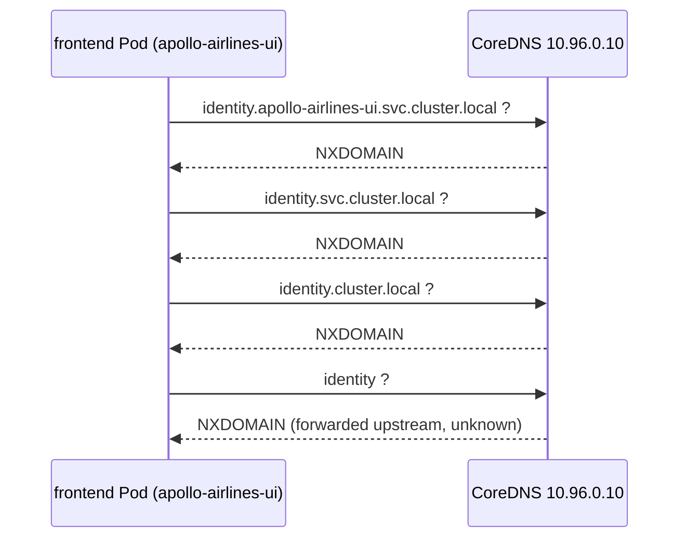

# DNS and namespaces

*Stage 2 · Guidance*

**You will be able to:** predict whether a name resolves from a given namespace, list the DNS records a Service and a Pod get, explain what `ndots:5` costs for external names, and work through a failing lookup from resolver file to CoreDNS.

In Stage 1 everything lived in one namespace, and `http://identity:8080` just worked. In Stage 2 the frontend moves to `apollo-airlines-ui`, and the same short name fails with `NXDOMAIN`. Nothing about identity changed. What changed is the caller's position, and Kubernetes DNS answers relative to the caller.

## Namespaces scope names

A **namespace** groups objects and scopes their names. Two namespaces can each hold a Service called `identity`; they are different objects.

A short name is like saying "call Sam from accounts" inside an office: it is understood relative to the building you stand in. From another building you must name the building too. Where the analogy breaks: the "building" is filled in by a plain text rule in each container's resolver file, not by any knowledge of who you meant.

## How cluster DNS is wired

| Piece | Where | Job |
|---|---|---|
| **CoreDNS** | Deployment in `kube-system` (two Pods) | The cluster's DNS server. Watches Services and EndpointSlices and answers from them |
| `kube-dns` Service | `kube-system`, ClusterIP `10.96.0.10` | The stable address of CoreDNS. The name is historical |
| `coredns` ConfigMap | `kube-system` | The **Corefile**: which zones CoreDNS serves and where everything else goes |
| kubelet | Every node | Writes `/etc/resolv.conf` into each container, pointing at `10.96.0.10` |

The relevant part of kind's default Corefile:

```text
.:53 {
    kubernetes cluster.local in-addr.arpa ip6.arpa {   # answer cluster names from the API
       pods insecure
       fallthrough in-addr.arpa ip6.arpa
    }
    forward . /etc/resolv.conf                          # everything else: ask the node's resolver
    cache 30                                            # cache answers for up to 30 s
}
```

So a lookup for `flight.apollo-airlines-apps.svc.cluster.local` is answered from the Kubernetes API, and a lookup for `api.github.com` is forwarded upstream.

## The records a cluster publishes

| Name | Record | Answer |
|---|---|---|
| `<svc>.<ns>.svc.cluster.local` | A / AAAA | The Service's ClusterIP |
| same, for a **headless** Service | A / AAAA | Every ready Pod IP ([Stage 3](../storage/statefulsets-and-headless-dns)) |
| `<pod-name>.<svc>.<ns>.svc.cluster.local` | A | One StatefulSet member's IP |
| same, for an **ExternalName** Service | CNAME | The external hostname |
| `_<port-name>._<proto>.<svc>.<ns>.svc.cluster.local` | SRV | Port number and target, for named ports |
| `<a-b-c-d>.<ns>.pod.cluster.local` | A | A Pod by IP with dashes. Rarely useful |

Every answer for a normal Service is the **ClusterIP**, which exists whether or not any Pod is ready. DNS cannot tell you whether a Service works; it only tells you the Service exists.

## How a short name is expanded

The kubelet writes this into every container in `apollo-airlines-apps`:

```text
search apollo-airlines-apps.svc.cluster.local svc.cluster.local cluster.local
nameserver 10.96.0.10
options ndots:5
```

- **`search`**: suffixes the resolver appends to a name, in order, until one returns an answer.
- **`ndots:5`**: if a name has **fewer than five dots**, try the search suffixes *first*, and the name as written last.

The resolver library inside the container (glibc, musl, Go's resolver) does this expansion. CoreDNS only ever sees full names.



The second suffix explains why `identity.apollo-airlines-apps` works from anywhere: appending `svc.cluster.local` completes it.

| Name written | Works from | Note |
|---|---|---|
| `identity` | Same namespace only | Fine for calls inside `apollo-airlines-apps` |
| `identity.apollo-airlines-apps` | Any namespace | The shortest portable form |
| `identity.apollo-airlines-apps.svc.cluster.local` | Any namespace | Still goes through the search list (4 dots < 5) |
| `identity.apollo-airlines-apps.svc.cluster.local.` | Any namespace | Trailing dot: absolute, no search list at all |

## The cost of `ndots:5`

`ndots:5` makes short Kubernetes names work, but every external name has fewer than five dots. A Pod calling `api.github.com` (2 dots) sends:

1. `api.github.com.apollo-airlines-apps.svc.cluster.local` → NXDOMAIN
2. `api.github.com.svc.cluster.local` → NXDOMAIN
3. `api.github.com.cluster.local` → NXDOMAIN
4. `api.github.com` → answer

Most resolvers ask for A and AAAA records separately, so that can be eight queries for one lookup. At low volume nobody notices. Under load it shows up as DNS latency and CoreDNS CPU. The fixes, in order of preference: use fully qualified names with a trailing dot for heavy external calls; lower `ndots` for a Pod with `dnsConfig`; or add a node-local DNS cache.

```yaml
spec:
  dnsConfig:
    options:
      - {name: ndots, value: "2"}   # only names with <2 dots use the search list first
```

## DNS policy per Pod

`spec.dnsPolicy` chooses which resolver file a Pod gets:

| Policy | Resolver | Use |
|---|---|---|
| `ClusterFirst` (the default) | CoreDNS, with search domains | Normal Pods |
| `Default` | The **node's** resolver; cluster names do not resolve | Rare. The name is misleading: it is not the default |
| `ClusterFirstWithHostNet` | CoreDNS, for a Pod with `hostNetwork: true` | Host-network agents that still need Service names |
| `None` | Only what `dnsConfig` lists | Full manual control |

## What else a namespace scopes

| Scope | Crosses namespaces? | Consequence for Apollo |
|---|---|---|
| Short DNS names | No | Cross-namespace callers use `<svc>.<ns>` |
| Service selectors | No | A Service only selects Pods in its own namespace |
| ConfigMaps and Secrets | No; a Pod reads only its own namespace's | Each namespace gets its own copy; the UI's Secret holds only `JWT_SECRET` |
| RBAC Roles | No | Permissions are granted per namespace |
| Gateway route attachment | Only with explicit permission | A `ReferenceGrant` ([Gateway API](./gateway-api)) |
| **Network traffic** | **Yes** | Namespaces are not a firewall. Any Pod can reach any Pod IP unless a NetworkPolicy is enforced |

The last row is the one people get wrong. Splitting the frontend into its own namespace changes names and permissions; it does not stop the frontend Pod from connecting to `booking-db` on 5432.

## Apollo example

From [`configmap.yaml`](https://github.com/darshan-raul/Apollo11/blob/f6211e679f8ed66a5a19033ac49a3bfc3a506eab/stages/stage2/k8s/config/configmap.yaml):

```yaml
# namespace: apollo-airlines-apps (callers and targets in the same namespace)
FLIGHT_SERVICE_URL: "http://flight:8081"
REDIS_URL: "redis://redis:6379"
---
# namespace: apollo-airlines-ui (targets in another namespace)
VITE_IDENTITY_URL: "http://identity.apollo-airlines-apps.svc.cluster.local:8080"
VITE_FLIGHT_URL:   "http://flight.apollo-airlines-apps.svc.cluster.local:8081"
```

The backend's short names work because booking, flight and redis share a namespace. The UI's copy uses full names because it sits across the boundary. If you ever move one backend to its own namespace, every short name that points at it breaks, with no error until the first request.

## Debugging a lookup

Work from the caller outwards:

| Step | Command | What a failure means |
|---|---|---|
| 1. What does the caller send? | `kubectl exec <pod> -- cat /etc/resolv.conf` | Wrong search list or nameserver: check `dnsPolicy` |
| 2. Does the full name resolve? | `nslookup <svc>.<ns>.svc.cluster.local` | No: the Service does not exist there, or CoreDNS is down |
| 3. Is CoreDNS up and reachable? | `kubectl get pods,endpointslices -n kube-system -l k8s-app=kube-dns` | No ready endpoints: every lookup in the cluster times out |
| 4. What did CoreDNS do? | `kubectl logs -n kube-system -l k8s-app=kube-dns` | Errors forwarding upstream, or config errors |
| 5. Name works, call fails? | `kubectl get endpointslice -l kubernetes.io/service-name=<svc> -n <ns>` | DNS is fine; the problem is [endpoints](./endpoints-and-endpointslices) |

Read the error carefully: **`NXDOMAIN`** means the server answered "no such name" (wrong name or namespace). A **timeout** or `SERVFAIL` means the DNS path itself is broken.

## Try it

:::caution[Unverified]
Not yet run on a live cluster for this documentation revision. Read-only, using Apollo's `curl-client` Pod.
:::

```bash
C="kubectl exec -n apollo-airlines-ui curl-client --"

# 1. The caller's resolver file
$C cat /etc/resolv.conf

# 2. Same name, different namespace, different result
$C nslookup identity                                  # NXDOMAIN
$C nslookup identity.apollo-airlines-apps             # the ClusterIP
kubectl get svc identity -n apollo-airlines-apps      # compare

# 3. SRV records exist for named ports (Traefik's Service names its ports)
$C nslookup -type=SRV _web._tcp.traefik.kube-system.svc.cluster.local

# 4. Where CoreDNS lives, and its configuration
kubectl get svc,endpointslices -n kube-system -l k8s-app=kube-dns
kubectl get configmap coredns -n kube-system -o jsonpath='{.data.Corefile}'
```

- Step 2 shows the namespace boundary: one form fails, the qualified form returns the same IP as `kubectl get svc`.
- Step 3 returns port `80` for the Traefik Service once Substage 3 is applied.
- Step 4 shows CoreDNS's two Pod IPs behind the `10.96.0.10` ClusterIP: DNS itself is reached through an ordinary Service.

## Common misconceptions

- **"A successful lookup means the service works."** It proves the Service object exists. Check its endpoints next.
- **"Namespaces isolate traffic."** They isolate names and permissions. Packets cross freely without an enforced NetworkPolicy.
- **"A full name like `x.ns.svc.cluster.local` skips the search list."** It has four dots, so with `ndots:5` it is still tried with suffixes first; it just matches on the last try. Only a trailing dot makes it absolute.
- **"`dnsPolicy: Default` is the default."** `ClusterFirst` is. `Default` means "use the node's resolver".
- **"`ndots:5` is a typo."** It is deliberate: it lets names like `flight.apollo-airlines-apps` find the search list.

## Check yourself

<details>
<summary>Why does <code>http://identity:8080</code> fail from the UI namespace?</summary>

The first search suffix is the caller's namespace, so it becomes <code>identity.apollo-airlines-ui.svc.cluster.local</code>, which does not exist. No other suffix completes it either.
</details>

<details>
<summary>Every DNS lookup in the cluster times out. What do you check first?</summary>

The <code>kube-dns</code> Service's endpoints in <code>kube-system</code>. If CoreDNS has no ready Pods, the Service has nothing to send to.
</details>

<details>
<summary>A Pod makes thousands of calls a second to <code>api.payments.example.com</code>. What does <code>ndots:5</code> cost, and how do you avoid it?</summary>

Up to three failed lookups (times A and AAAA) before every real one. Use the name with a trailing dot, or set a lower <code>ndots</code> for that Pod with <code>dnsConfig</code>.
</details>

## Where this leads

Names and ClusterIPs work only inside the cluster. Reaching Apollo from your laptop needs a way in: [NodePort and LoadBalancer](./nodeport-and-loadbalancer).

## References

- [DNS for Services and Pods](https://kubernetes.io/docs/concepts/services-networking/dns-pod-service/)
- [Debugging DNS resolution](https://kubernetes.io/docs/tasks/administer-cluster/dns-debugging-resolution/)
- [Customizing DNS service](https://kubernetes.io/docs/tasks/administer-cluster/dns-custom-nameservers/)
