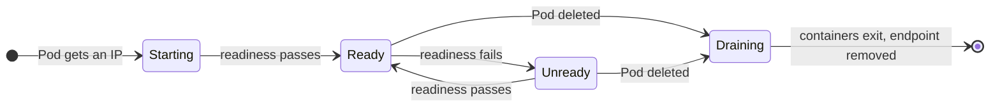

# Endpoints and EndpointSlices

*Stage 2 · Guidance*

**You will be able to:** read an EndpointSlice field by field, predict the `ready`, `serving` and `terminating` conditions of a Pod at each point in its life, explain why the older Endpoints object was replaced, and hand-write an EndpointSlice for a Service that has no selector.

The [previous chapter](./service-control-and-data-paths) showed kube-proxy turning a list of endpoints into kernel rules. That list is the hinge of the whole Service mechanism. A Service with a correct ClusterIP, correct DNS and healthy Pods still fails if the list is empty, stale, or lists the wrong port. When a Service misbehaves, the EndpointSlice is the first object to read, because it shows what the data path is actually being told.

## The idea

An **endpoint** is one network destination that can serve a Service: an IP address, a port, and some facts about it (is it ready, which node is it on, which Pod is it). An **EndpointSlice** is an API object that holds a batch of endpoints for one Service.

Think of it as a duty roster pinned up for the switchboard. The roster says who is on shift and who is about to leave. The switchboard operators (kube-proxy on every node) read it and route calls accordingly. The roster does not answer calls. Where the analogy breaks: there can be several roster pages per Service, and each is a separate object that changes on its own.

| Object | API | Status in Kubernetes v1.37 |
|---|---|---|
| `EndpointSlice` | `discovery.k8s.io/v1` | The source kube-proxy, DNS and gateways read |
| `Endpoints` | `v1` (core) | Still populated for compatibility; **deprecated since v1.33**. `kubectl get endpoints` prints a warning |

## Anatomy of an EndpointSlice

A slice for Apollo's `flight` Service with two Pods, one of them still starting:

```yaml
apiVersion: discovery.k8s.io/v1
kind: EndpointSlice
metadata:
  name: flight-x7k2p                                       # <service>-<random>
  namespace: apollo-airlines-apps
  labels:
    kubernetes.io/service-name: flight                     # which Service this belongs to
    endpointslice.kubernetes.io/managed-by: endpointslice-controller.k8s.io   # who may edit it
  ownerReferences:
    - {kind: Service, name: flight}                        # deleted with the Service
addressType: IPv4                                          # one family per slice
ports:
  - name: ""                                               # matches the Service port's name
    port: 8081                                             # the resolved targetPort, not the Service port
    protocol: TCP
endpoints:
  - addresses: ["10.244.1.6"]
    conditions: {ready: true, serving: true, terminating: false}
    nodeName: apollo11-worker
    targetRef: {kind: Pod, name: flight-6d8f9c-abcde}
  - addresses: ["10.244.2.9"]
    conditions: {ready: false, serving: false, terminating: false}   # readiness probe not passed yet
    nodeName: apollo11-worker2
    targetRef: {kind: Pod, name: flight-6d8f9c-fghij}
```

| Field | What it tells you | Debugging use |
|---|---|---|
| `kubernetes.io/service-name` label | The owning Service | The only way to find a Service's slices: `-l kubernetes.io/service-name=flight` |
| `managed-by` label | Which controller owns it | A slice you wrote by hand must use your own value, or the controller deletes it |
| `addressType` | `IPv4` or `IPv6` | A dual-stack Service gets one slice per family |
| `ports[].port` | The **container** port the rules DNAT to | A wrong number here means a wrong `targetPort` in the Service |
| `endpoints[].addresses` | The Pod IP | Compare with `kubectl get pods -o wide` |
| `endpoints[].conditions` | Whether the data path may use it | See the next section |
| `nodeName`, `zone` | Where it runs | Used by `Local` traffic policies and topology-aware routing |
| `targetRef` | The Pod behind the IP | Jump from an IP to a Pod name |

Note that **not-ready Pods are listed**, with `ready: false`. The older `kubectl get endpoints` view hides them in a separate `notReadyAddresses` list, which is easy to miss. Pods without an IP yet (still `Pending`) and Pods that have finished (`Succeeded` or `Failed`) are not listed at all.

## Conditions through a Pod's life

The three conditions are set by the EndpointSlice controller from the Pod's state:

- **`ready`**: the data path should send *new* connections here. True when the Pod's `Ready` condition is true and the Pod is not terminating.
- **`serving`**: the Pod's readiness probe is passing, regardless of termination. The same as `ready`, except it stays true while a Pod shuts down.
- **`terminating`**: the Pod has been asked to stop (it has a deletion timestamp).



| Moment | `ready` | `serving` | `terminating` | Gets new connections? |
|---|---|---|---|---|
| Container started, probe not yet passed | false | false | false | No |
| Readiness passing | **true** | true | false | **Yes** |
| Readiness failing (e.g. search's `/readyz` when flight is down) | false | false | false | No |
| Pod deleted, `preStop` running, probe still passing | false | **true** | **true** | Only as a fallback |
| Containers exited | removed | | | No |

kube-proxy uses `ready` endpoints. If a Service has **none**, it falls back to endpoints that are `serving` and `terminating`, so that replacing the last Pod does not refuse connections while the old one finishes. A Service with `publishNotReadyAddresses: true` (common for headless StatefulSet Services) reports every endpoint as `ready` regardless of probes.

The `terminating` stage is why [graceful termination](../reliability/termination-and-draining) works in two directions at once: the endpoint leaves new-connection rotation immediately, while the process keeps serving what it already has.

## Why slices replaced Endpoints

The original `Endpoints` object held **every** address of a Service in one object. Every node's kube-proxy watches it, so every change (one Pod becoming ready) re-sent the whole object to every node. For a Service with thousands of Pods in a cluster of thousands of nodes, one rolling update moved gigabytes through the API server. The object was also capped at 1,000 addresses; beyond that it is truncated and annotated `endpoints.kubernetes.io/over-capacity: truncated`.

EndpointSlices fix this by splitting:

| | Endpoints (legacy) | EndpointSlice |
|---|---|---|
| Objects per Service | One | Many; up to 100 endpoints each by default |
| One Pod changes | Whole list re-sent to every watcher | Only the affected slice |
| Address families | Mixed | One per slice |
| Per-endpoint data | IP, Pod, node | Adds `serving`, `terminating`, `zone`, topology hints |
| Size limit | 1,000 addresses, then truncated | None in practice |

The controller does not rebalance slices on every change, to avoid churn. A Service whose Pods were replaced many times can end up with several part-full slices. That is normal.

## Who writes slices

| Writer | When | `managed-by` value |
|---|---|---|
| EndpointSlice controller | Service **has** a selector | `endpointslice-controller.k8s.io` |
| EndpointSlice mirroring controller | Service has **no** selector and you wrote a legacy `Endpoints` object by hand | `endpointslicemirroring-controller.k8s.io` |
| You, or another controller | Service has **no** selector | Anything else, e.g. `staff` |

A Service **with** a selector belongs to the controller: hand edits to its slices are overwritten within seconds. A Service **without** a selector gets no slices at all until someone writes them. That is the supported way to give an in-cluster name to something that is not a Pod: a database on a VM, a service in another cluster, or a target you are migrating towards.

## Apollo example

Every Apollo Service in [`stages/stage2/k8s/apps/`](https://github.com/darshan-raul/Apollo11/tree/f6211e679f8ed66a5a19033ac49a3bfc3a506eab/stages/stage2/k8s/apps) has a selector, so the controller manages all their slices. Two Stage 2 behaviours are visible only in them:

- **Readiness chains.** search's readiness probe calls flight's `/readyz`. If flight has no ready Pods, search's Pods stay `Running` but flip to `ready: false` in search's slice. Nothing restarts; search simply stops receiving traffic.
- **The broken-selector drill** in [Substage 1](https://github.com/darshan-raul/Apollo11/blob/f6211e679f8ed66a5a19033ac49a3bfc3a506eab/stages/stage2/k8s/substages/01-internal-dns/README.md) patches identity's selector to `app: identity-broken`. The slice empties, kube-proxy installs a `REJECT` rule, and calls fail while the identity Pod is perfectly healthy. No event is emitted: an empty slice is a valid state.

## Try it

:::caution[Unverified]
Not yet run on a live cluster for this documentation revision. Uses throwaway objects in the `default` namespace.
:::

```bash
kubectl apply -f - <<'YAML'
apiVersion: apps/v1
kind: Deployment
metadata: {name: web}
spec:
  replicas: 2
  selector: {matchLabels: {app: web}}
  template:
    metadata: {labels: {app: web}}
    spec:
      terminationGracePeriodSeconds: 40
      containers:
        - name: web
          image: nginx:1.27-alpine
          readinessProbe:                    # ready only once /tmp/ready exists
            exec: {command: ["cat", "/tmp/ready"]}
            periodSeconds: 2
          lifecycle:
            preStop: {exec: {command: ["sleep", "30"]}}
---
apiVersion: v1
kind: Service
metadata: {name: web}
spec:
  selector: {app: web}
  ports: [{port: 80}]
YAML
kubectl rollout status deploy/web --timeout=10s   # times out: nobody is ready

# A helper that prints one line per endpoint
show() { kubectl get endpointslice -l kubernetes.io/service-name=$1 -o jsonpath='{range .items[*].endpoints[*]}{.targetRef.name}{"  ready="}{.conditions.ready}{" serving="}{.conditions.serving}{" terminating="}{.conditions.terminating}{"\n"}{end}'; }

# 1. Not-ready Pods are listed, with ready=false
show web

# 2. Make one Pod ready
P=$(kubectl get pod -l app=web -o jsonpath='{.items[0].metadata.name}')
kubectl exec $P -- touch /tmp/ready; sleep 4; show web

# 3. The legacy view hides the difference in a separate list
kubectl get endpoints web -o yaml | grep -A3 -E 'addresses|notReadyAddresses'

# 4. Delete the ready Pod: it drains as serving + terminating
kubectl delete pod $P --wait=false; sleep 2; show web

# 5. A selector-less Service with a hand-written slice
sleep 35                                   # let the deleted Pod finish draining
IP=$(kubectl get pod -l app=web -o jsonpath='{.items[0].status.podIP}')
kubectl apply -f - <<YAML
apiVersion: v1
kind: Service
metadata: {name: manual}
spec:
  ports: [{name: http, port: 80}]
---
apiVersion: discovery.k8s.io/v1
kind: EndpointSlice
metadata:
  name: manual-1
  labels:
    kubernetes.io/service-name: manual
    endpointslice.kubernetes.io/managed-by: staff
addressType: IPv4
ports: [{name: http, port: 80, protocol: TCP}]
endpoints:
  - addresses: ["$IP"]
YAML
kubectl run c --rm -it --restart=Never --image=curlimages/curl:8.5.0 -- curl -sI manual | head -1

kubectl delete svc web manual; kubectl delete endpointslice manual-1; kubectl delete deploy web
```

- Step 1 lists two endpoints with `ready=false serving=false`.
- Step 2 flips one to `ready=true serving=true`.
- Step 3 prints a deprecation warning, then shows the Pods split between `addresses` and `notReadyAddresses`.
- Step 4 shows the deleted Pod as `ready=false serving=true terminating=true` for about 30 seconds (its `preStop` sleep), then it disappears.
- Step 5 returns `HTTP/1.1 200 OK` even though the `manual` Service has no selector: kube-proxy does not care who wrote the slice. An unset `ready` condition counts as ready.

## Common misconceptions

- **"Endpoints and EndpointSlices are two copies I need to check."** Slices are what the data path reads. Endpoints exists for older tools and is deprecated.
- **"Only ready Pods appear in the slice."** Not-ready and terminating Pods appear too, with conditions saying so.
- **"I can fix a Service by editing its slice."** For a Service with a selector, the controller reverts your edit. Fix the selector, labels or readiness instead.
- **"Several slices for one small Service means something is wrong."** Slices are not rebalanced on every change; part-full slices are normal.
- **"`terminating` means the Pod gets no traffic."** It gets no *new* connections while other ready endpoints exist. Established connections continue.

## Check yourself

<details>
<summary>A Service's slice shows three endpoints, all <code>ready=false serving=false terminating=false</code>. What is wrong, and what do you look at next?</summary>

The selector matches, but none of the Pods passes its readiness probe. Look at the Pods' events and probe definition with <code>kubectl describe pod</code>, then at the dependency the probe checks.
</details>

<details>
<summary>Why does the controller not just keep one Endpoints object and send diffs?</summary>

Watch events carry whole objects. With one object, every change re-sends every address to every node. Splitting into slices makes the unit of change small.
</details>

<details>
<summary>You hand-edit an EndpointSlice of the <code>booking</code> Service to add an IP. What happens?</summary>

booking has a selector, so its slices are managed by the EndpointSlice controller, which rewrites them from the selector and removes your entry.
</details>

## Where this leads

Endpoints say *where* a Service's traffic may go. Callers still need to find the Service's address by name: [DNS and namespaces](./dns-and-namespaces).

## References

- [EndpointSlices](https://kubernetes.io/docs/concepts/services-networking/endpoint-slices/)
- [Services without selectors](https://kubernetes.io/docs/concepts/services-networking/service/#services-without-selectors)
- [EndpointSlice API reference](https://kubernetes.io/docs/reference/kubernetes-api/service-resources/endpoint-slice-v1/)
