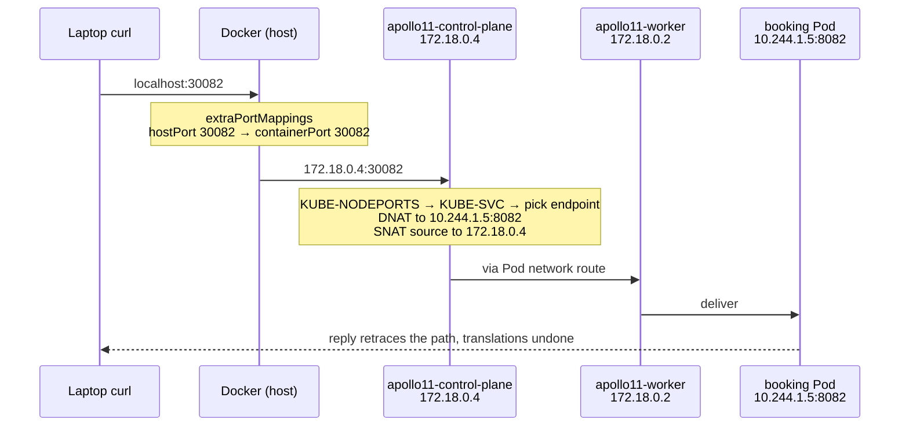
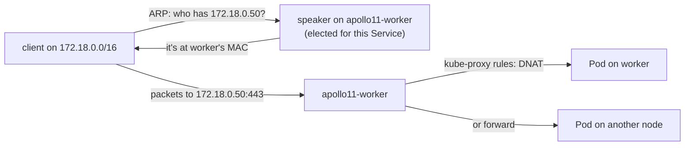

# NodePort and LoadBalancer

*Stage 2 · Guidance*

**You will be able to:** trace `localhost:30082` hop by hop to a booking Pod, explain why a NodePort works on nodes that run no Pod, choose between `externalTrafficPolicy: Cluster` and `Local` knowing what each costs, and explain what MetalLB does, and does not do, when it fulfils `type: LoadBalancer`.

A ClusterIP exists only as rules inside the cluster's nodes ([Service paths](./service-control-and-data-paths)). Your laptop is outside: it has no route to `10.96.0.0/16`, and even if it did, no node would accept a packet from it for that address. Every way into a cluster solves the same problem: give an outside client an address it *can* reach, and connect that address to the Service rules.

## The ladder of ways in

| Rung | What the client reaches | Who provides it | Good for |
|---|---|---|---|
| `kubectl port-forward` | `localhost` on the machine running kubectl, tunnelled through the API server | kubectl | Debugging one Pod; not for real traffic |
| **NodePort** | `<any node IP>:30000–32767` | kube-proxy | Local clusters; the building block underneath LoadBalancer |
| **LoadBalancer** | One external IP on normal ports | A controller outside core Kubernetes (cloud, MetalLB) | One Service exposed to clients |
| Ingress / Gateway | A LoadBalancer IP, then HTTP routing by host and path | A proxy you install | Many HTTP services on one address ([next chapter](./ingress-and-tls)) |

Each rung builds on the one below: a LoadBalancer Service is also a NodePort Service, which is also a ClusterIP Service.

## NodePort

A `NodePort` Service adds one thing to a ClusterIP Service: a port number, from `30000–32767` by default, that **every node** accepts traffic on and forwards to the Service's endpoints.

```yaml
spec:
  type: NodePort
  selector: {app: booking}
  ports:
    - port: 8082        # ClusterIP port, for in-cluster callers
      targetPort: 8082  # the container's port
      nodePort: 30082   # opened on every node
```

**Allocation.** If you omit `nodePort`, the API server picks a free one. If you set it, it must be inside the range and unused, or the create fails. To reduce clashes, automatic allocation prefers the upper part of the range, leaving the lowest ports for teams that pick numbers by hand, as Apollo does with `30080–30084` and `30443`. The port is unique cluster-wide: two Services cannot share `30082`, even in different namespaces.

**Mechanism.** No process listens on the node port. kube-proxy adds rules to a `KUBE-NODEPORTS` chain on every node: "TCP to any local address on port 30082 → the `booking` Service's endpoint chain". From there the packet takes exactly the ClusterIP path: random endpoint choice, DNAT to a Pod IP. A node with no booking Pod still accepts the connection and forwards it to a node that has one.

### Two hops in kind

On a cloud VM, the node IP is reachable from your network. In kind, the nodes are Docker containers on a private Docker network (`172.18.0.0/16`), so there is an extra hop owned by a different system:



| Hop | System | Configured by | Broken when |
|---|---|---|---|
| `localhost:30082` → control-plane container `:30082` | Docker | `extraPortMappings` in [`kind-config.yaml`](https://github.com/darshan-raul/Apollo11/blob/f6211e679f8ed66a5a19033ac49a3bfc3a506eab/stages/ignition/kind-config.yaml) | The port is not mapped: `Connection refused` on the laptop |
| node `:30082` → Pod `:8082` | kube-proxy | The NodePort Service | No ready endpoints, wrong `targetPort` |

Port mappings are fixed when the cluster is created. Apollo maps `30080–30084` and `30443` to the control-plane node only, so a NodePort outside that list works *inside* the Docker network but not from the laptop, and adding one means recreating the cluster.

Apollo's application Pods run on the two workers, so every NodePort request from the laptop enters on the control-plane and crosses to a worker. That second hop is why the source address is rewritten, which is the next topic.

## Keeping the client IP: externalTrafficPolicy

When a packet enters on one node and is forwarded to a Pod on another, the reply must come back through the first node so it can undo the translation. To force that, the entry node rewrites the packet's **source** to its own IP (SNAT). The Pod sees the node as its client. Access logs, rate limits and IP allow-lists all see the wrong address.

`spec.externalTrafficPolicy` chooses the trade-off for traffic arriving from outside (NodePort and LoadBalancer):

| | `Cluster` (default) | `Local` |
|---|---|---|
| Which nodes accept | Every node | Only nodes that have a ready endpoint of this Service; others drop the packet |
| Extra hop | Possible | Never: traffic stays on the entry node |
| Pod sees client IP | **No**, it sees a node IP | **Yes** |
| Spread across Pods | Even | Per node: a node with one Pod and a node with three get equal shares if the load balancer spreads evenly across nodes |
| Needs a smart front end | No | Yes: something must send traffic only to nodes with endpoints |

For LoadBalancer Services with `Local`, Kubernetes allocates a `healthCheckNodePort`: each node answers an HTTP check there with 200 only if it has local endpoints, so the cloud load balancer can skip the others.

In Apollo's kind cluster, `Local` on a NodePort Service whose Pods run on the workers would break laptop access completely: traffic enters on the control-plane, which has no endpoint, and is dropped. This is also why Apollo pins the Traefik DaemonSet to the control-plane node (`nodeSelector: node-role.kubernetes.io/control-plane`): the edge proxy runs on the node the laptop's traffic arrives at.

## LoadBalancer

`type: LoadBalancer` is a **request** recorded on the Service: "give me an external address". Kubernetes allocates the ClusterIP and node ports as usual, then waits. Some controller must notice the request, provision an address, and write it to the Service's status:

```yaml
status:
  loadBalancer:
    ingress:
      - ip: 172.18.0.50        # or hostname: for clouds that hand out DNS names
```

Until that happens, `kubectl get svc` shows `EXTERNAL-IP <pending>`. Nothing is broken; nobody has answered.

Who answers depends on where the cluster runs:

| Environment | Controller | What it builds | Where it sends traffic |
|---|---|---|---|
| AWS, GCP, Azure | The provider's cloud controller (and on AWS, optionally the AWS Load Balancer Controller) | A managed L4 load balancer | To every node's NodePort, or straight to Pod IPs when the CNI gives Pods VPC addresses ([EKS](../../eks)) |
| Bare metal, kind | **MetalLB**, kube-vip, Cilium LB-IPAM | Nothing physical: an IP that the nodes claim | To a node, then kube-proxy's rules |
| Plain kind | None | Nothing | `<pending>` forever |

`spec.loadBalancerClass` picks a specific implementation when a cluster has more than one. Provider-specific options (internal vs public, idle timeouts, certificate ARNs) go in annotations, which is why LoadBalancer YAML is rarely portable between clouds.

Each LoadBalancer Service gets its own external address, and in a cloud its own billed load balancer. Six Apollo services would mean six. That cost is the main reason one LoadBalancer usually fronts one proxy (Traefik, Envoy) that routes to everything else.

## MetalLB in layer-2 mode

MetalLB has two components, and only one of them handles packets, indirectly:

| Component | Runs as | Job |
|---|---|---|
| Controller | Deployment | Watches LoadBalancer Services, assigns an IP from an `IPAddressPool`, writes it to `status` |
| Speaker | DaemonSet, one per node | Makes the network deliver packets for that IP to a node |

In layer-2 mode the speakers elect **one node per Service** to own its IP. That node answers ARP requests ("who has `172.18.0.50`?") with its own MAC address. Every packet for the IP then arrives at that node. The IP is not configured on any interface: kube-proxy has installed rules matching the load-balancer IP, which DNAT it to an endpoint exactly as for a ClusterIP.



Consequences people do not expect:

- **It is failover, not load balancing across nodes.** All traffic for one IP enters through one node. Pods are still balanced by kube-proxy behind it.
- **Failover takes seconds.** If the owner node dies, another speaker takes over and sends a gratuitous ARP. Clients with cached ARP entries keep sending to the dead node until they update.
- **The pool must sit inside the clients' layer-2 network**, and must not overlap anything else on it. Apollo's pool `172.18.0.50–172.18.0.100` is inside kind's Docker network, above the node IPs Docker assigns from the bottom.
- **The IP is only reachable from that network.** On Linux the host is attached to the Docker bridge, so `curl 172.18.0.50` works. On Docker Desktop (macOS, Windows) the bridge lives inside a VM; the IP is not routable from the host even when everything is correct.

**BGP mode** instead has every node advertise the IP to a router, which spreads connections across nodes (ECMP). It needs a BGP-capable router, so it is a production option, not a kind one.

## Apollo example

Stage 2 climbs the ladder in substages:

| Substage | Object | Type | Reached at |
|---|---|---|---|
| 2 | [`nodeport-services.yaml`](https://github.com/darshan-raul/Apollo11/blob/f6211e679f8ed66a5a19033ac49a3bfc3a506eab/stages/stage2/k8s/substages/02-nodeport/nodeport-services.yaml): frontend, flight, booking, identity, search | NodePort `30080–30084` | `localhost:3008x` |
| 3 | [`01b-traefik-service.yaml`](https://github.com/darshan-raul/Apollo11/blob/f6211e679f8ed66a5a19033ac49a3bfc3a506eab/stages/stage2/k8s/substages/03-traefik-ingress-tls/01b-traefik-service.yaml): one proxy for everything | NodePort `30080`, `30443` | `*.apollo.local:30443` |
| 4 | [`traefik-loadbalancer-svc.yaml`](https://github.com/darshan-raul/Apollo11/blob/f6211e679f8ed66a5a19033ac49a3bfc3a506eab/stages/stage2/k8s/substages/04-metallb/traefik-loadbalancer-svc.yaml) + [`01-ip-pool.yaml`](https://github.com/darshan-raul/Apollo11/blob/f6211e679f8ed66a5a19033ac49a3bfc3a506eab/stages/stage2/k8s/substages/04-metallb/01-ip-pool.yaml) | LoadBalancer via MetalLB | `172.18.0.5x:80/443` |
| 5 | Envoy Gateway's proxy Service, set by an `EnvoyProxy` with `envoyService.type: LoadBalancer` | LoadBalancer via MetalLB | the Gateway's IP ([Gateway API](./gateway-api)) |

The pool and its advertisement:

```yaml
apiVersion: metallb.io/v1beta1
kind: IPAddressPool
metadata: {name: apollo-pool, namespace: metallb-system}
spec:
  addresses: ["172.18.0.50-172.18.0.100"]   # inside kind's Docker network, clear of node IPs
---
apiVersion: metallb.io/v1beta1
kind: L2Advertisement                       # answer ARP for addresses from this pool
metadata: {name: apollo-l2, namespace: metallb-system}
spec:
  ipAddressPools: [apollo-pool]
```

Without the `L2Advertisement`, the controller still assigns IPs, but no speaker announces them: `EXTERNAL-IP` is filled in and nothing answers.

## Try it

:::caution[Unverified]
Not yet run on a live cluster for this documentation revision. Uses throwaway objects in the `default` namespace. Part 3 needs MetalLB from Substage 4. The client runs as a container on kind's Docker network, so this works on Docker Desktop too.
:::

```bash
# A Pod that reports the client IP it sees, exposed as NodePort 30099
kubectl create deployment who --image=registry.k8s.io/e2e-test-images/agnhost:2.39 -- /agnhost netexec --http-port=8080
kubectl expose deployment who --type=NodePort --port=80 --target-port=8080
kubectl patch svc who --type=json -p '[{"op":"replace","path":"/spec/ports/0/nodePort","value":30099}]'
kubectl rollout status deploy/who
kubectl get pod -l app=who -o wide        # which worker is it on?

# An "outside" client: a throwaway container on kind's Docker network, not a node
out() { docker run --rm --network kind curlimages/curl:8.5.0 -s --max-time 3 "$@"; echo; }
nodeip() { docker inspect -f '{{range .NetworkSettings.Networks}}{{.IPAddress}}{{end}}' "$1"; }
CP=$(nodeip apollo11-control-plane); W=$(kubectl get pod -l app=who -o jsonpath='{.items[0].spec.nodeName}'); WIP=$(nodeip $W)

# 1. Every node answers on the NodePort, even nodes without the Pod
for n in apollo11-control-plane apollo11-worker apollo11-worker2; do
  echo -n "via $n → Pod sees: "; out $(nodeip $n):30099/clientip
done
curl -s --max-time 3 localhost:30099/clientip || echo "laptop: refused (30099 is not port-mapped)"

# 2. externalTrafficPolicy: Local keeps the client IP but drops on nodes without the Pod
kubectl patch svc who -p '{"spec":{"externalTrafficPolicy":"Local"}}'; sleep 3
echo -n "via $W → Pod sees: ";   out $WIP:30099/clientip     # the client container's own IP
echo -n "via control-plane → "; out $CP:30099/clientip || true  # no answer: no local endpoint

# 3. LoadBalancer through MetalLB, and which node owns the IP
kubectl patch svc who -p '{"spec":{"type":"LoadBalancer","externalTrafficPolicy":"Cluster"}}'
kubectl get svc who -w                    # Ctrl-C once EXTERNAL-IP is set
LB=$(kubectl get svc who -o jsonpath='{.status.loadBalancer.ingress[0].ip}')
kubectl get events --field-selector involvedObject.name=who | grep -i -E 'IPAllocated|nodeAssigned'
docker run --rm --network kind --entrypoint sh curlimages/curl:8.5.0 -c "curl -s $LB/clientip; echo; grep $LB /proc/net/arp"
for n in apollo11-control-plane apollo11-worker apollo11-worker2; do
  echo "$n $(docker inspect -f '{{range .NetworkSettings.Networks}}{{.MacAddress}}{{end}}' $n)"
done

kubectl delete svc who; kubectl delete deploy who
```

- Part 1: all three nodes answer. Under the default `Cluster` policy the Pod reports a node-side address, not the client container's IP. The laptop is refused: hop 1 does not exist for 30099.
- Part 2: entering through the Pod's own node, the Pod sees the client container's real IP. Entering through the control-plane, which has no local Pod, gets no answer.
- Part 3: `EXTERNAL-IP` comes from `172.18.0.50–100`. MetalLB's `nodeAssigned` event names the announcing node, and the MAC in the client's ARP table matches that node's MAC.

## Common misconceptions

- **"NodePort alone exposes the app to my laptop."** In kind it also needs a Docker port mapping, fixed at cluster creation.
- **"The NodePort is open only where the Pod runs."** Every node accepts it under the default policy.
- **"LoadBalancer creates a load balancer."** It requests one. A controller must create it, and in plain kind there is none.
- **"`<pending>` means the app is broken."** It means no controller fulfilled the request. The app may be fine on its ClusterIP.
- **"MetalLB layer 2 spreads traffic across nodes."** One node receives all traffic for an IP. MetalLB moves the IP when that node fails.
- **"`externalTrafficPolicy: Local` is strictly better because it keeps the client IP."** It also drops traffic on nodes without endpoints and can spread load unevenly.

## Check yourself

<details>
<summary>A NodePort Service on 30099 works from inside a node but <code>localhost:30099</code> on the laptop is refused. Why?</summary>

kind only maps the ports listed in <code>extraPortMappings</code>. Nothing on the laptop forwards 30099 into the cluster.
</details>

<details>
<summary>Booking's logs show every request coming from <code>172.18.0.4</code>. What is that address and why?</summary>

The control-plane node. The request entered there and was forwarded to a Pod on a worker, so with <code>externalTrafficPolicy: Cluster</code> its source was rewritten to the entry node's IP.
</details>

<details>
<summary>MetalLB filled in <code>EXTERNAL-IP</code>, but nothing answers on it. Name one likely cause.</summary>

No <code>L2Advertisement</code> covers the pool, so no speaker answers ARP for the IP. (On Docker Desktop, the IP is also unreachable from the host by design.)
</details>

<details>
<summary>Why does a LoadBalancer Service still get node ports?</summary>

Many load balancers, including cloud ones in instance mode, deliver traffic to nodes on the NodePort. <code>allocateLoadBalancerNodePorts: false</code> turns them off for implementations that do not need them.
</details>

## Where this leads

One external address per Service is expensive and gives no HTTP routing. [Ingress and TLS](./ingress-and-tls) puts one proxy behind one LoadBalancer, routes many hostnames through it, and terminates HTTPS there.

## References

- [Service type NodePort](https://kubernetes.io/docs/concepts/services-networking/service/#type-nodeport)
- [Service type LoadBalancer](https://kubernetes.io/docs/concepts/services-networking/service/#loadbalancer)
- [Using source IP](https://kubernetes.io/docs/tutorials/services/source-ip/)
- [kind: extra port mappings](https://kind.sigs.k8s.io/docs/user/configuration/#extra-port-mappings)
- [MetalLB concepts: layer 2](https://metallb.universe.tf/concepts/layer2/)
