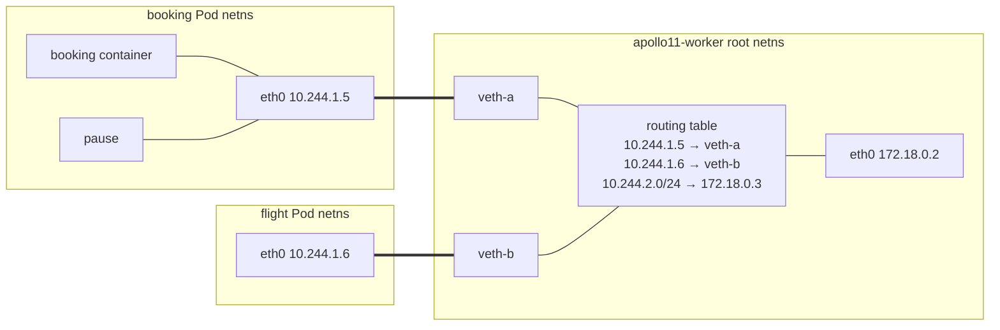

# Pod networks and CNI

*Stage 2 · Guidance*

**You will be able to:** explain where a Pod's IP comes from, trace a packet from one Pod to another on the same node and across nodes, say what a CNI plugin does and does not do, and find each piece on a kind node.

Booking in one Pod must call flight in another Pod, possibly on a different machine. On a single Docker host ([Launchpad](../containers/networks-and-clients)) this was easy: Docker's bridge connected every container on that one machine. A cluster spans several machines, and Pods are created and destroyed constantly. Something must hand each Pod an address and make that address reachable from every node, within seconds of the Pod being scheduled.

## The Kubernetes network model

Kubernetes does not ship a network. It states rules that any network must satisfy:

| Rule | Consequence |
|---|---|
| Every Pod gets its own IP address | No port juggling between Pods: two Pods can both listen on `8080` |
| Every Pod can reach every other Pod by that IP, on any node, **without NAT** | The source IP a Pod sees is the real IP of the caller |
| Agents on a node (kubelet, system daemons) can reach every Pod on that node | Probes work |
| Containers in the **same Pod** share one IP and one `localhost` | A sidecar can talk to the main container on `localhost:port` |

The model is a flat address space: think of every Pod as a flat with its own street address in one city, where any address can post a letter to any other. Where the analogy breaks: the "letters" are IP packets, and the city's roads are built by a plugin you choose, not by Kubernetes.

That plugin is a **CNI plugin** (Container Network Interface). CNI is a small specification: the container runtime runs a plugin binary with `ADD` when a Pod starts and `DEL` when it stops, and the plugin sets up or tears down that Pod's networking. Apollo's kind cluster uses **kindnet**, kind's default plugin. Production clusters typically use Calico, Cilium, or a cloud plugin such as the AWS VPC CNI.

## What one Pod's network looks like

Each Pod gets a **network namespace**: a private copy of the Linux network stack with its own interfaces, routing table, ports and `localhost`. The runtime creates it with a tiny placeholder container (the *pause* or *sandbox* container) that holds the namespace open. Every real container in the Pod joins that same namespace. That is why containers in one Pod share an IP, and why a port used by one container is unavailable to its neighbour.

A namespace on its own is isolated: it has only `lo`. The CNI plugin connects it to the node with a **veth pair**, a virtual cable with two ends. One end is moved inside the Pod and named `eth0`; the other end stays on the node.



## What the CNI plugin does on `ADD`

When the kubelet asks the runtime to start a Pod, the runtime creates the namespace and calls the plugin. The plugin:

1. **Allocates an IP (IPAM).** The cluster's Pod range is `10.244.0.0/16`. The controller manager carves it into one block per node (a `/24`, written into each Node's `spec.podCIDR`). The plugin picks a free address from *this node's* block.
2. **Wires the Pod.** It creates the veth pair, moves one end into the Pod, assigns the IP, and sets the Pod's default route to point out of `eth0`.
3. **Makes the IP routable.** It adds a route on the node for the new Pod IP, and ensures every other node knows that this node's block lives here.
4. **Reports back.** The runtime records the IP, and the kubelet writes it into the Pod's `status.podIP`.

The plugin's configuration lives on each node in `/etc/cni/net.d/`, and its binaries in `/opt/cni/bin/`. If the configuration is missing, new Pods stick in `ContainerCreating` with a `network plugin not ready` / `failed to setup network for sandbox` event, and the node reports `NotReady`.

## Following a packet

**Same node** (booking `10.244.1.5` → flight `10.244.1.6`, both on `apollo11-worker`):

1. Booking's packet leaves through its `eth0` and appears on the node end of its veth.
2. The node's routing table has a host route for `10.244.1.6` pointing at flight's veth.
3. The packet enters flight's namespace. Source and destination are unchanged.

**Across nodes** (booking `10.244.1.5` on `apollo11-worker` → search `10.244.2.4` on `apollo11-worker2`):

1. The packet reaches `apollo11-worker`'s routing table, which says `10.244.2.0/24 via 172.18.0.3`, the other worker's node IP.
2. It leaves the node on `eth0` and crosses the Docker network to `apollo11-worker2`.
3. That node's host route delivers it into search's veth.

kind's nodes are containers on one Docker network, so they are on one layer-2 segment and kindnet can use plain routes. Other environments need a different approach, which is where plugins differ:

| Approach | How a Pod packet crosses nodes | Examples |
|---|---|---|
| **Routed** | Each node holds routes to other nodes' Pod blocks; packets travel unchanged | kindnet, Calico (BGP mode) |
| **Overlay** | The packet is wrapped in an outer packet between node IPs (VXLAN, Geneve), unwrapped on arrival | Flannel, Calico (VXLAN mode), Cilium (tunnel mode) |
| **Cloud-native** | Pods get real IPs from the cloud network, which routes them natively | AWS VPC CNI ([EKS](../../eks)), Azure CNI |
| **eBPF dataplane** | Kernel programs attached to interfaces do forwarding and policy, often replacing kube-proxy too | Cilium |

Overlays cost a few bytes of header per packet, which lowers the usable MTU. A wrong MTU shows up as connections that open but hang on large responses.

**Leaving the cluster.** When a Pod calls something outside the Pod range (an internet API), the node rewrites the source from the Pod IP to the node IP (masquerade, a form of SNAT), because the outside network has no route back to `10.244.x.x`.

## What the CNI does not give you

| Missing | Why it matters | What fills it |
|---|---|---|
| Stable addresses | A replacement Pod gets a new IP, often on another node | [Services](./service-control-and-data-paths) |
| Load balancing | A Pod IP is one Pod | Services and EndpointSlices |
| Names | IPs are not discoverable | [Cluster DNS](./dns-and-namespaces) |
| Access from outside | The Pod range is private to the cluster | [NodePort, LoadBalancer](./nodeport-and-loadbalancer), [Gateway](./gateway-api) |
| Policy you can rely on | A `NetworkPolicy` is only stored data unless the CNI implements it | An enforcing CNI (Calico, planned for Stage 8) |

On NetworkPolicy: recent kind releases (v0.24 and later) build NetworkPolicy support into kindnet. The course has not verified that enforcement and does not rely on it; the planned Stage 8 replaces kindnet with Calico and proves default-deny there. Treat any policy applied on Stage 2's cluster as untested.

## Apollo example

The kind cluster is defined in [`kind-config.yaml`](https://github.com/darshan-raul/Apollo11/blob/f6211e679f8ed66a5a19033ac49a3bfc3a506eab/stages/ignition/kind-config.yaml):

```yaml
networking:
  podSubnet: "10.244.0.0/16"     # carved into one /24 per node
  serviceSubnet: "10.96.0.0/16"  # Service ClusterIPs: a separate, virtual range
  disableDefaultCNI: false       # keep kindnet (planned Stage 8 swaps it for Calico)
  kubeProxyMode: "iptables"
```

The two ranges must not overlap with each other or with the Docker network (`172.18.0.0/16`). A Pod IP (`10.244.x.x`) is a real address on a real interface. A ClusterIP (`10.96.x.x`) is not on any interface at all; the [next chapter](./service-control-and-data-paths) explains how it still works.

## Try it

:::caution[Unverified]
Not yet run on a live cluster for this documentation revision. Read-only, except the throwaway Pods at the end.
:::

```bash
# 1. Each node's slice of the Pod range
kubectl get nodes -o custom-columns=NODE:.metadata.name,PODCIDR:.spec.podCIDR,IP:.status.addresses[0].address

# 2. Pods and their IPs: the third octet matches the node's block
kubectl get pods -n apollo-airlines-apps -o wide

# 3. The node's routes: one per local Pod, one per other node's block
docker exec apollo11-worker ip route

# 4. The installed plugin and its config
kubectl get pods -n kube-system -l app=kindnet -o wide
docker exec apollo11-worker ls /etc/cni/net.d/

# 5. Pod-to-Pod by raw IP, skipping Services and DNS entirely
IP=$(kubectl get pod -n apollo-airlines-apps -l app=booking -o jsonpath='{.items[0].status.podIP}')
kubectl exec -n apollo-airlines-ui curl-client -- curl -s http://$IP:8082/healthz

# 6. Two containers in one Pod share localhost
kubectl run duo --restart=Never --image=nginx:1.27-alpine \
  --overrides='{"spec":{"containers":[{"name":"web","image":"nginx:1.27-alpine"},{"name":"probe","image":"busybox:1.36","command":["sh","-c","sleep 5; wget -qO- localhost:80 | head -3; sleep 3600"]}]}}'
kubectl logs duo -c probe
kubectl delete pod duo
```

- Step 3 shows routes like `10.244.2.0/24 via 172.18.0.x`: the cross-node path is an ordinary route to another node.
- Step 5 succeeding proves the flat network works. If it fails while the Service also fails, suspect the CNI before the Service.
- Step 6: the `probe` container fetches nginx's page from `localhost`, though nginx runs in another container.

## Common misconceptions

- **"Pods on the same node share the node's IP."** Each Pod has its own IP. Only containers *inside* one Pod share one. (A Pod with `hostNetwork: true` is the exception: it uses the node's namespace and IP.)
- **"Kubernetes routes Pod traffic."** Kubernetes only sets the rules. The CNI plugin builds the interfaces and routes.
- **"Pod traffic between nodes is always encapsulated."** Only overlay plugins wrap packets. kindnet and routed Calico do not.
- **"I can hard-code a Pod IP once it works."** It changes whenever the Pod is replaced.
- **"Applying a NetworkPolicy secured the network."** Only an enforcing plugin turns the object into rules, and this course does not verify enforcement before the planned Stage 8.

## Check yourself

<details>
<summary>Two containers in one Pod both try to listen on port 8080. What happens?</summary>

The second fails to bind: they share one network namespace, so one set of ports.
</details>

<details>
<summary>A new Pod is stuck in <code>ContainerCreating</code> with "failed to setup network for sandbox". Which component do you look at first?</summary>

The CNI plugin on that node: its DaemonSet Pod, its logs, and its config in <code>/etc/cni/net.d/</code>. The Pod cannot start until the plugin returns an IP.
</details>

<details>
<summary>booking's IP is <code>10.244.1.5</code>. Without looking, which node is it probably on?</summary>

The node whose <code>spec.podCIDR</code> is <code>10.244.1.0/24</code>. Each node allocates Pod IPs only from its own block.
</details>

## Where this leads

Pod IPs are reachable but temporary. [Services](./service-control-and-data-paths) put one stable virtual address in front of a changing set of Pods.

## References

- [Cluster networking](https://kubernetes.io/docs/concepts/cluster-administration/networking/)
- [The Kubernetes network model](https://kubernetes.io/docs/concepts/services-networking/#the-kubernetes-network-model)
- [CNI specification](https://www.cni.dev/docs/spec/)
- [kindnet network policies](https://kindnet.sigs.k8s.io/docs/user/network-policies/)
