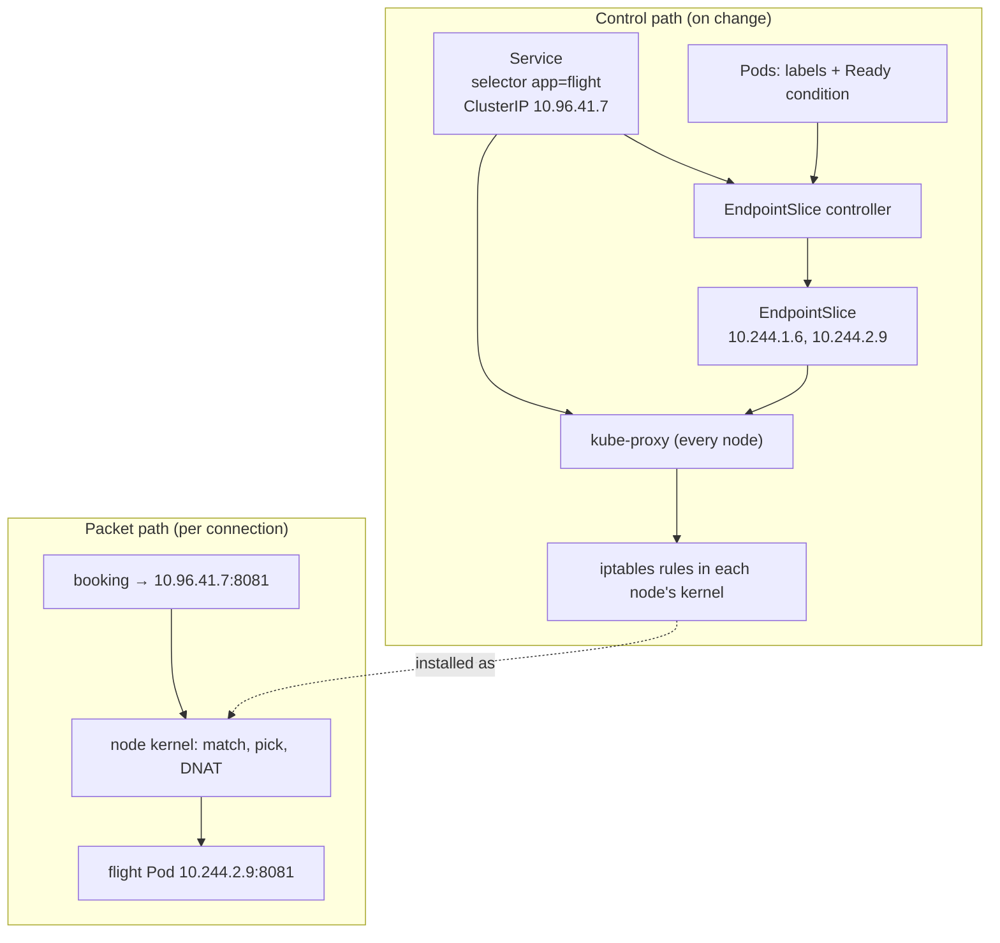

# Services: control path and packet path

*Stage 2 · Guidance*

**You will be able to:** explain what a Service is and what it is not, draw its control path and packet path separately, read the iptables chains kube-proxy writes for it, explain why load balancing is per connection and not per request, debug a Service that resolves but never answers, and choose between the Service variants and traffic policies.

The [Pod network](./pod-network-and-cni) makes every Pod reachable by IP, but those IPs do not last. A Deployment replaces Pods whenever they fail, are rescheduled or are rolled out, and every replacement gets a new IP. booking cannot be reconfigured each time flight's Pods change, and it should not send requests to a flight Pod that is still starting. Stage 1 [used Services](../workloads/services-and-readiness) without explaining them. This chapter explains how they work, because debugging needs it: when `booking` cannot reach `flight`, you need to know which actor failed (the selector, the EndpointSlice, kube-proxy, the kernel rules or the Pod), and each leaves different evidence.

## What a Service is

A **Service** is an API object that stands for "whichever Pods currently do this job". It records three things:

| Field | Meaning | Apollo `flight` |
|---|---|---|
| `selector` | Labels a Pod must carry to belong. Only Pods in the Service's own namespace are considered | `app: flight` |
| `ports` | What callers connect to (`port`) and where the container listens (`targetPort`) | `8081` → `8081` |
| `clusterIP` | A virtual IP, allocated by the API server and fixed for the Service's life | e.g. `10.96.41.7` |

Cluster DNS then gives the Service a name (`flight`, or `flight.apollo-airlines-apps` from other namespaces; [DNS and namespaces](./dns-and-namespaces)). Callers use the name, the name gives the ClusterIP, and the ClusterIP leads to one of the matching Pods.

Two properties matter more than the rest:

- **Membership is by label, not by name.** The Service never lists Pods. A replacement Pod carries the same labels from the Deployment's template, so it belongs automatically.
- **Only ready Pods receive traffic.** A Pod whose readiness probe fails stays running but is taken out of rotation, and put back when it passes again. Restarts are a separate matter, decided by liveness ([Probes](../reliability/probes)).

What a Service is **not** matters just as much. Diagrams often draw "client → Service → Pod" as if the Service were a small proxy program. That picture causes real mistakes: people look for a Service process to restart, or expect the Service's logs to show requests. There is no such process. A Service is data, and two separate stories turn it into traffic.

## Two paths

- The **control path** prepares information: which Pods currently qualify, and which kernel rules represent that. It runs when objects change, not when requests arrive.
- The **packet path** (data path) moves one packet. It reads only what the control path already installed in each node's kernel.

A phone directory and a phone call are a fair comparison: updating who is on duty is one activity, and connecting a call is another. The directory is not on the line while you talk. Where it breaks down: each node keeps its *own* copy of the directory, and the copies are updated asynchronously.



## Control path, step by step

1. **A ClusterIP is allocated.** When the Service is created, the API server picks a free address from the Service range (`10.96.0.0/16` in Apollo's kind cluster) and writes it to `spec.clusterIP`. The ClusterIP is immutable for the Service's life: delete and recreate, and you get a new one. Two addresses are fixed by convention: `10.96.0.1` is the `kubernetes` Service (the API server) and `10.96.0.10` is cluster DNS.
2. **Endpoints are published.** The EndpointSlice controller in `kube-controller-manager` watches Services and Pods. For each Service with a selector, it lists matching Pods in the same namespace and writes their IPs, ports and readiness into **EndpointSlice** objects. That object gets its own chapter: [Endpoints and EndpointSlices](./endpoints-and-endpointslices).
3. **Rules are programmed.** **kube-proxy** runs as a DaemonSet Pod on every node. It watches all Services and EndpointSlices and rewrites the node's packet-filtering rules to match. Apollo's cluster runs kube-proxy in `iptables` mode.

None of these steps involves a request. A Service with no traffic at all still has all of this set up.

## Packet path, step by step

A booking Pod connects to `flight:8081`. DNS has already turned `flight` into `10.96.41.7` ([next chapters](./dns-and-namespaces)).

1. Booking's kernel sends a TCP SYN to `10.96.41.7:8081`. No interface anywhere holds that address.
2. Before routing, the packet passes the node's `nat` table. kube-proxy's chains match the destination `10.96.41.7:8081`.
3. The rules pick one endpoint at random and **DNAT** the packet: the destination becomes, say, `10.244.2.9:8081`.
4. The packet is now an ordinary Pod-to-Pod packet. The [Pod network](./pod-network-and-cni) delivers it, across nodes if needed.
5. The kernel's **conntrack** table records the translation. Every later packet of this connection skips the rules and follows the conntrack entry. Replies are translated back, so booking sees answers coming from `10.96.41.7`.

Step 5 has a practical consequence: **load balancing is per connection, not per request.** An HTTP client with keep-alive, a connection pool or a gRPC channel sends every request on one connection to one Pod. Scaling flight from 2 to 6 replicas does not move existing connections. If load looks uneven after a scale-up, this is usually why.

## Reading the iptables chains

kube-proxy builds a chain per Service and per endpoint. For a Service with two endpoints:

```text
KUBE-SERVICES                          (entry, jumped to from PREROUTING and OUTPUT)
 └─ dst 10.96.41.7:8081  → KUBE-SVC-ABC…    "apollo-airlines-apps/flight cluster IP"
     ├─ probability 0.5  → KUBE-SEP-111…    DNAT to 10.244.1.6:8081
     └─ (remaining)      → KUBE-SEP-222…    DNAT to 10.244.2.9:8081
```

| Chain | Holds | Changes when |
|---|---|---|
| `KUBE-SERVICES` | One match per ClusterIP:port | A Service is added or removed |
| `KUBE-SVC-<hash>` | One random-choice rule per ready endpoint | Endpoints change |
| `KUBE-SEP-<hash>` | The DNAT to one Pod IP:port | That endpoint appears or disappears |
| `KUBE-NODEPORTS` | Matches on node ports ([NodePort](./nodeport-and-loadbalancer)) | A NodePort Service changes |
| `KUBE-POSTROUTING` | Masquerade for packets marked earlier (`KUBE-MARK-MASQ`) | Rarely |

With three endpoints the probabilities are `1/3`, then `1/2`, then the rest, which gives each Pod an equal share. Rules carry comments naming `namespace/service`, so `grep` finds them without decoding hashes.

**Zero endpoints.** When a Service has no ready endpoints, kube-proxy installs a `REJECT` rule for its ClusterIP instead. The caller gets `Connection refused` immediately, not a timeout. A refused connection to a ClusterIP almost always means "no ready endpoints" or "wrong `targetPort`".

Other modes do the same job with different kernel machinery: `ipvs` (a kernel load balancer, deprecated in recent releases), `nftables` (iptables' successor, scales better with many Services), and eBPF dataplanes such as Cilium's, which replace kube-proxy altogether. The control path is identical in all of them.

## Ports

A Service has up to three port numbers per entry:

| Field | Meaning | Apollo `flight` |
|---|---|---|
| `port` | What callers use with the ClusterIP | `8081` |
| `targetPort` | The container port the DNAT rewrites to. Defaults to `port` | `8081` |
| `nodePort` | Opened on every node, only for NodePort/LoadBalancer | `30081` in Substage 2 |

- `targetPort` may be a **name** (`targetPort: http`) that refers to a named `containerPort` in the Pod spec. It is resolved per Pod, so Pods running different versions can listen on different numbers behind one Service.
- A Service with more than one port must **name** every port (`name: web`, `name: websecure`, as Apollo's Traefik Service does). DNS SRV records and EndpointSlices refer to ports by name.
- A wrong `targetPort` is accepted silently. The Service has endpoints, DNS works, and every connection is refused because nothing listens on that port in the Pod.

## Service variants

| Variant | Set by | ClusterIP? | Endpoints come from | Typical use |
|---|---|---|---|---|
| Normal | `selector` | Yes | EndpointSlice controller | Almost everything in Apollo |
| Headless | `clusterIP: None` | No; DNS returns Pod IPs | EndpointSlice controller | StatefulSet members ([Stage 3](../storage/statefulsets-and-headless-dns)) |
| Selector-less | No `selector` | Yes | **You** write the EndpointSlices | An external database, a VM, a migration |
| ExternalName | `type: ExternalName` | No | Nothing; DNS returns a CNAME | An alias for an outside hostname |
| NodePort / LoadBalancer | `type:` | Yes | EndpointSlice controller | [Getting traffic in](./nodeport-and-loadbalancer) |

ExternalName is pure DNS: no kube-proxy rules, no port mapping, and TLS clients see the alias name, not the target, which often breaks certificate checks.

## Traffic policies and affinity

These fields change *which* endpoints the packet path may choose.

| Field | Default | Alternative | Effect |
|---|---|---|---|
| `internalTrafficPolicy` | `Cluster` | `Local` | `Local`: in-cluster callers only reach endpoints on **their own node**; if there are none, the packet is dropped |
| `externalTrafficPolicy` | `Cluster` | `Local` | Same idea for traffic arriving from outside; covered in [NodePort and LoadBalancer](./nodeport-and-loadbalancer#keeping-the-client-ip-externaltrafficpolicy) |
| `sessionAffinity` | `None` | `ClientIP` | All connections from one source IP go to the same Pod, for `timeoutSeconds` (default 3 hours) |

`internalTrafficPolicy: Local` suits node-local agents (a log collector DaemonSet). On a normal Deployment it creates nodes from which the Service silently does not work.

## When a Service resolves but does not answer

Most Service failures are silent: the API accepts the objects, DNS answers, and nothing reports an error. Work through the actors in order:

| Check | Command | What a bad result means |
|---|---|---|
| 1. Does the selector match? | `kubectl get pods -n <ns> -l <selector> --show-labels` | No Pods: a label or selector typo. **No event is emitted** for this |
| 2. Are those Pods ready? | `kubectl get pods -n <ns> -l <selector>` (READY column) | `0/1`: readiness is failing; `kubectl describe pod` shows why |
| 3. Did they become endpoints? | `kubectl get endpointslice -n <ns> -l kubernetes.io/service-name=<svc>` | Empty, or `ready=false`: see [EndpointSlices](./endpoints-and-endpointslices) |
| 4. Is the port right? | Compare the slice's port with the container's listen port | A wrong `targetPort`: endpoints exist, every connection is refused |
| 5. Are the rules there? | `docker exec <node> iptables-save \| grep <ns>/<svc>` | Missing rules: look at kube-proxy's Pod and logs on that node |
| 6. Does the live path work? | `curl` the Service name from a Pod in the caller's namespace | Fails only from one namespace: a DNS name problem |

Two timing effects also produce brief errors without anything being misconfigured. A Pod that becomes ready, or is deleted, reaches every node's rules a moment later, because each kube-proxy updates on its own. During fast rollouts a few requests can land on a Pod that is already shutting down; Stage 4's [termination and draining](../reliability/termination-and-draining) addresses this with a `preStop` delay.

## Apollo example

[`flight-svc.yaml`](https://github.com/darshan-raul/Apollo11/blob/f6211e679f8ed66a5a19033ac49a3bfc3a506eab/stages/stage2/k8s/apps/flight/flight-svc.yaml):

```yaml
apiVersion: v1
kind: Service
metadata:
  name: flight
  namespace: apollo-airlines-apps
spec:
  type: ClusterIP            # default; reachable only inside the cluster
  selector:
    app: flight              # Pods in apollo-airlines-apps with this label
  ports:
    - port: 8081             # callers use flight:8081
      targetPort: 8081       # the Go server's listen port
```

The flight Deployment's readiness probe calls `/readyz` on `8081` every 5 seconds. Only Pods passing it appear as ready endpoints, so only they get a `KUBE-SEP` chain. Scale flight to zero and the Service keeps its ClusterIP and DNS record, but its rules become a single `REJECT`.

## Try it

:::caution[Unverified]
Not yet run on a live cluster for this documentation revision. Uses throwaway objects in the `default` namespace.
:::

```bash
# A Deployment whose Pods reply with their own name
kubectl create deployment echo --replicas=3 \
  --image=registry.k8s.io/e2e-test-images/agnhost:2.39 -- /agnhost netexec --http-port=8080
kubectl expose deployment echo --port=80 --target-port=8080
kubectl rollout status deploy/echo
kubectl get svc echo                      # note the CLUSTER-IP

# 1. Per-connection balancing: each curl is a new connection
kubectl run c --rm -it --restart=Never --image=curlimages/curl:8.5.0 -- \
  sh -c 'for i in $(seq 9); do curl -s echo/hostname; echo; done'

# 2. The rules kube-proxy wrote for it
docker exec apollo11-worker iptables-save -t nat | grep 'default/echo'

# 3. Zero endpoints: refused immediately, not a timeout
kubectl scale deploy echo --replicas=0
kubectl run c --rm -it --restart=Never --image=curlimages/curl:8.5.0 -- \
  curl -sS --max-time 5 echo/hostname
docker exec apollo11-worker iptables-save | grep 'default/echo'   # a REJECT rule

# 4. A wrong targetPort: endpoints exist, connections still refused
kubectl scale deploy echo --replicas=1 && kubectl rollout status deploy/echo
kubectl patch svc echo -p '{"spec":{"ports":[{"port":80,"targetPort":9999}]}}'
kubectl run c --rm -it --restart=Never --image=curlimages/curl:8.5.0 -- \
  curl -sS --max-time 5 echo/hostname

kubectl delete deploy echo; kubectl delete svc echo
```

- Step 1 prints a mix of the three Pod names.
- Step 2 shows one `KUBE-SVC` chain with `statistic --mode random --probability 0.333…` and `0.5` rules, and three `KUBE-SEP` chains with `DNAT`.
- Step 3 prints `Connection refused` at once; step 4 does too, though `kubectl get endpointslice -l kubernetes.io/service-name=echo` now lists a ready endpoint on port `9999`.

## Common misconceptions

- **"The Service is a proxy I can restart or read logs from."** It is data. kube-proxy writes rules and steps aside; the kernel forwards.
- **"kube-proxy forwards the packets."** In iptables, ipvs and nftables modes it only writes rules. Stopping kube-proxy freezes the rules; existing ones keep working until something changes.
- **"Adding replicas spreads existing traffic."** Only new connections are balanced.
- **"A ClusterIP can be pinged."** In iptables mode, rules match only the listed TCP/UDP ports. ICMP to a ClusterIP is not forwarded, so `ping` failing proves nothing.
- **"Changes apply everywhere at once."** Each node's kube-proxy updates on its own schedule. For a short time, nodes disagree.

## Check yourself

<details>
<summary>Calls to a ClusterIP fail with "connection refused" in under a millisecond. Name the two most likely causes.</summary>

The Service has no ready endpoints (kube-proxy installed a REJECT rule), or its <code>targetPort</code> points at a port nothing in the Pod listens on.
</details>

<details>
<summary>search uses one long-lived HTTP connection pool to flight. You scale flight from 2 to 5. Why might the new Pods get no traffic from search?</summary>

The Service balances connections, not requests. search's existing connections stay pinned to the old Pods until they close.
</details>

<details>
<summary>Why does a Service keep resolving in DNS after its Deployment is scaled to zero?</summary>

DNS answers with the Service's ClusterIP, which exists as long as the Service object does. Endpoints are a separate question.
</details>

## Where this leads

The rules are only as good as the endpoint list they are built from. [Endpoints and EndpointSlices](./endpoints-and-endpointslices) opens that object up: what it records, how readiness and termination appear in it, and how to write one yourself.

## References

- [Service](https://kubernetes.io/docs/concepts/services-networking/service/)
- [Virtual IPs and service proxies](https://kubernetes.io/docs/reference/networking/virtual-ips/)
- [Service internal traffic policy](https://kubernetes.io/docs/concepts/services-networking/service-traffic-policy/)
- [Debug Services](https://kubernetes.io/docs/tasks/debug/debug-application/debug-service/)
