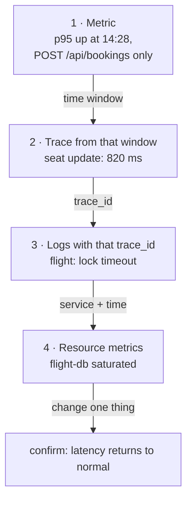

# Correlating a booking

*Stage 6 · Mission Operations*

**You will be able to:** move from a fleet-wide symptom to the request behind it and the cause behind that, name the identifier that joins each pair of signals, recognise when retention has cut a join, and tell a failure in Apollo from a failure in its telemetry.

Three signals are now collected, each into its own store. The skill this chapter teaches is **order**. Opening Grafana and clicking around is not an investigation. Each signal answers one question, and each answer narrows the next question.

## The triage order

| Step | Question | Signal | Typical output |
|---|---|---|---|
| 1 | Is something wrong, how widely, since when? | Metrics (Prometheus) | "Booking p95 rose from 60 to 900 ms at 14:28, only on `POST /api/bookings`" |
| 2 | Where did the time go, or which hop failed, in one affected request? | Trace (Tempo) | "The `PATCH /api/flights/:id/seats` call took 820 ms" |
| 3 | What did that service say while it happened? | Logs (Loki), by `trace_id` | "flight: seat update retried after a lock timeout" |
| 4 | Why, and is it the cause or a symptom? | Metrics on the resource; a controlled change | "flight-db CPU at its limit; raising it removes the latency" |



Going in this order saves time because each step is cheap at its own level. Metrics cover every request at once but cannot point to one. Traces point to one request but cannot say whether it is typical. Logs explain one process but cannot see the others.

## The joins

| From → to | Joined by | Notes |
|---|---|---|
| Metric → trace | **Time window** and labels (`service`, path) | No ID connects them. Pick traces from the spike's window, for the same service and route |
| Trace → logs | **`trace_id`** | In every span; in every request log line Apollo writes |
| Logs → trace | **`trace_id`** | Grafana turns it into a link |
| Logs or trace → metrics | `service`, `namespace`, time | The same label values in Prometheus and Loki |

And a join only works while both sides still exist:

| Store | Apollo retention | So you can still correlate… |
|---|---|---|
| Prometheus | 30 days | Trends and SLOs for a month |
| Loki | 7 days | Log lines for a week |
| Tempo | 48 hours | Traces for two days |

A complaint about a booking from four days ago can be checked against metrics and logs, but its trace is gone. The shortest retention decides how far back a full correlation can reach.

## Grafana does the joins for you

Apollo's Grafana datasources are provisioned with links in both directions, from [`grafana/datasources.yaml`](https://github.com/darshan-raul/Apollo11/blob/f6211e679f8ed66a5a19033ac49a3bfc3a506eab/stages/stage6/helm/apollo11/templates/observability/grafana/datasources.yaml):

```yaml
# Loki → Tempo: a "View trace" link on every log line that contains a trace ID
derivedFields:
  - name: TraceID
    matcherRegex: '"trace_id"\s*:\s*"([0-9a-f]{32})"'
    datasourceUid: tempo

# Tempo → Loki: from any span, query Loki for its trace ID
tracesToLogsV2:
  datasourceUid: loki
  spanStartTimeShift: '-2m'
  spanEndTimeShift: '2m'
  customQuery: true
  query: '{service=~".+"} | json | trace_id="${__span.traceId}"'
```

- The Loki link is a **regex over the raw line**. Lines with an empty `trace_id` simply have no link.
- The Tempo link searches **every** service's logs (`service=~".+"`), parses them as JSON, and filters on the field, within two minutes either side of the span. It avoids making `trace_id` a Loki label, at the cost of scanning all streams in that window.
- The Tempo datasource also points a **service map** at Prometheus, but nothing in Stage 6 generates the service-graph metrics it reads (Tempo's metrics generator is not enabled), so that tab stays empty.

## Four cases

### 1. Slow bookings

The p95 panel rises; the error ratio does not. A trace from the window shows most of the time inside flight's `PATCH …/seats` server span; flight's log lines for that `trace_id` show the slow statement. That is case 1 from the triage table, and the usual shape of a latency problem: one hop dominates.

### 2. Flight is down

Booking's 5xx ratio jumps and the burn alert fires ([Queries, alerts and objectives](./queries-alerts-and-objectives#burn-rate-alerting-on-the-promise)). Booking returns `502 Flight service unavailable` but writes **no log line** for it. The evidence is in the trace: booking's client span to flight has an exception event and no response status, and there is no flight server span under it.

Two details make this easy to miss. Booking calls `span.RecordError(err)` but never sets the span's **status** to error, so the span is not highlighted as failed, and a search for `status = error` does not find it. And booking's metrics label the request `status="502"`, which is booking reporting on itself; flight has no samples at all, because there is no flight to scrape. `up{job="flight"}` going to 0, or vanishing, is the direct signal.

### 3. A notification fails under a successful booking

The passenger sees `201 Created`. Booking sends the notification afterwards, in a background goroutine, and ignores the result. If notification fails, booking's metrics show only successes and its log says `Booking created`. The trace still holds the truth: a notification client span that started after the root span, with an error or a 5xx status attribute. Notification's own metrics and logs show the failure from its side. "The API returned 201" is not proof that everything the request started succeeded.

### 4. The telemetry is broken, not Apollo

The Collector's exporter to Tempo is misconfigured. New bookings succeed; new log lines with fresh `trace_id`s keep arriving in Loki; their "View trace" links find nothing. That pattern (logs yes, traces no) points at the trace pipeline, not at the request. After restoring it, generate a **new** booking and require both directions of the link to work: old traces and old logs prove nothing about recovery.

## What correlation proves

- It produces a **hypothesis**: "flight-db saturation caused the slow bookings". Confirm it with a measurement or one controlled change, and watch the symptom respond.
- An aggregate percentile cannot hand you one request. Picking a trace "from the window" may pick a fast one; sort or filter traces by duration.
- The first plausible cause is not necessarily the cause. Booking slow because flight is slow because flight-db is slow: the deepest step with evidence is where to act.

## Try it

:::caution[Unverified]
Not yet run on a live cluster for this documentation revision. Needs Stage 6 with all six substages applied. `trace-test.sh` creates and cancels a booking.
:::

Follow one booking through all three stores:

```bash
bash stages/stage6/scripts/trace-test.sh          # note trace_id=…
TRACE_ID=<paste it>
kubectl -n apollo-observability port-forward svc/prometheus 19090:9090 >/dev/null &
kubectl -n apollo-observability port-forward svc/tempo 13200:3100 >/dev/null &
kubectl -n apollo-observability port-forward svc/loki 13100:3100 >/dev/null &
sleep 3

# 1. Metric: the booking appears only as a count
curl -sG localhost:19090/api/v1/query \
  --data-urlencode 'query=sum by (path, status) (increase(http_requests_total{service="booking", method!="GET"}[10m]))' \
  | jq -c '.data.result[] | [.metric.path, .metric.status, .value[1]]'

# 2. Trace: which services the request touched
curl -s localhost:13200/api/traces/$TRACE_ID \
  | jq -r '[.batches[].resource.attributes[] | select(.key=="service.name").value.stringValue] | unique'

# 3. Logs: what each service said about it
curl -sG localhost:13100/loki/api/v1/query_range \
  --data-urlencode "query={namespace=\"apollo-airlines-apps\"} |= \"$TRACE_ID\"" \
  | jq -r '.data.result[] | "\(.stream.service): \(.values[][1] | (try (fromjson | .message) catch .))"'
kill %1 %2 %3
```

- The metric has no trace ID, only counts by path and status: it shows *that*, not *which*.
- The trace lists booking, identity, flight and notification under one ID.
- Loki returns lines from the services that logged for this request, joined only by the ID inside each line.

Then repeat in Grafana: open Explore → Loki, find a `Booking created` line, follow **View trace**, and from a span follow **Logs for this span** back.

## Common misconceptions

- **"One dashboard is enough."** Each signal has blind spots; the order matters.
- **"A 201 means the whole booking flow worked."** Asynchronous work can fail after the response.
- **"Every failure writes a log line."** Booking's 502 for an unreachable flight does not.
- **"A failed call shows as a red span."** Only if the code sets the span's status; Apollo's client spans record the error without it.
- **"No trace means the request did not happen."** It may have aged out after 48 h, or the pipeline dropped it.

## Check yourself

<details>
<summary>Which identifiers join a metric spike to the right log lines?</summary>

The time window and service labels pick traces from the spike. Each trace's `trace_id` then finds the matching log lines in Loki.
</details>

<details>
<summary>New log lines arrive with trace IDs, but their trace links are empty. What is broken?</summary>

The trace pipeline (SDK → Collector → Tempo), not the requests. Check the Collector's exporter and Tempo, then prove recovery with a new request.
</details>

<details>
<summary>A booking succeeded, but the passenger got no notification. Where is the evidence?</summary>

In the booking's trace, as a notification client span after the response, and in notification's own metrics and logs. Booking's metrics and logs only show the success.
</details>

## Where this leads

Apollo can now see its problems. [Stage 7](../../missions/orbital-maneuvering) asks the next question: when load grows, which change actually helps, and how do you prove it with these signals?

## References

- [Grafana: Loki derived fields](https://grafana.com/docs/grafana/latest/datasources/loki/configure-loki-data-source/#derived-fields)
- [Grafana: trace to logs](https://grafana.com/docs/grafana/latest/datasources/tempo/configure-tempo-data-source/#trace-to-logs)
- [OpenTelemetry: span status](https://opentelemetry.io/docs/concepts/signals/traces/#span-status)
