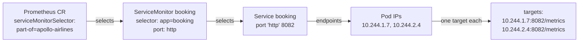

# Discovery and collection

*Stage 6 · Mission Operations*

**You will be able to:** explain how a ServiceMonitor becomes a list of Pod targets, read a target's labels and health, tell a discovery failure from a scrape failure, and find the broken link when a metric is missing from a dashboard.

A Grafana panel for booking is empty. The cause could be the app, the scrape configuration, Prometheus itself, or the query behind the panel. Without a model of the chain, you poke at random. The single most useful idea in this chapter: **creating a configuration object is not the same as data arriving.** Every link has to be proven with data.

## Prometheus needs a target list

Prometheus collects by **scraping**: every interval, it sends `GET /metrics` to each **target** (one address and port) and stores what comes back. On a static network you would list the targets by hand. In Kubernetes, Pods are replaced all the time with new IPs, so the list must be **discovered** from the API and kept current.

Prometheus can discover targets itself, but its configuration file is long and easy to get wrong. Apollo uses the **Prometheus Operator**, which lets you describe what to scrape with small Kubernetes objects instead:

| Custom resource | Describes | Apollo has |
|---|---|---|
| `Prometheus` | A Prometheus server: version, storage, retention, and which monitors and rules it selects | `apollo` in `apollo-observability` |
| `ServiceMonitor` | "Scrape the Pods behind Services with these labels, on this named port and path" | One per backend: booking, flight, identity, notification, search |
| `PodMonitor` | The same, selecting Pods directly | None |
| `Probe` | Black-box checks of a URL through a prober | Frontend health through the blackbox exporter |
| `PrometheusRule` | Recording and alerting rules ([next chapter](./queries-alerts-and-objectives)) | `apollo-services` |
| `Alertmanager` | Where alerts are sent | Configured in [`alerting.yaml`](https://github.com/darshan-raul/Apollo11/blob/f6211e679f8ed66a5a19033ac49a3bfc3a506eab/stages/stage6/helm/apollo11/templates/observability/alerting.yaml) |

The Operator watches these objects, generates Prometheus's real configuration from them, and stores it in a Secret that a sidecar in the Prometheus Pod reloads. You never edit `prometheus.yml`.

## From ServiceMonitor to targets



Two selections happen, and either can silently miss:

1. **Prometheus selects ServiceMonitors.** Apollo's `Prometheus` object accepts ServiceMonitors in the `apollo-observability` namespace carrying `app.kubernetes.io/part-of: apollo-airlines`. A ServiceMonitor without that label is ignored, with no error anywhere.
2. **The ServiceMonitor selects Services.** Booking's selects Services labelled `app: booking` in any namespace (`namespaceSelector: {any: true}`), and names the Service port `http`.

Then the important detail: Prometheus does **not** scrape the Service's ClusterIP. It reads the Service's **endpoints** and scrapes **each Pod IP** directly. Scraping the ClusterIP would reach a random Pod each time, mixing two Pods' counters into one series. One target per Pod keeps each Pod's counters separate, and a Pod that is not Ready drops out of the endpoints and so out of the targets.

To do all this, Prometheus's ServiceAccount needs permission to list and watch Services, endpoints and Pods across namespaces. Missing RBAC shows up as discovery errors in Prometheus's own log, not as a missing object.

```yaml
# servicemonitors/booking-sm.yaml (trimmed)
metadata:
  labels: {app.kubernetes.io/part-of: apollo-airlines}   # 1. Prometheus selects this
spec:
  selector: {matchLabels: {app: booking}}                # 2. selects the Service
  namespaceSelector: {any: true}
  endpoints:
    - port: http                                          # the Service port's NAME
      path: /metrics
      interval: 30s
      scrapeTimeout: 10s
      honorLabels: true
  jobLabel: app
```

Booking's Pods also carry `prometheus.io/scrape`-style annotations. The Operator ignores them; they only matter to hand-written Prometheus configurations that look for them.

## What a target looks like

Every sample scraped from a target gets **target labels** added by Prometheus:

| Label | Value for one booking Pod | From |
|---|---|---|
| `job` | `booking` | `jobLabel: app` (the Service's `app` label) |
| `instance` | `10.244.1.7:8082` | The address scraped |
| `namespace`, `service`, `pod`, `container`, `endpoint` | `apollo-airlines-apps`, `booking`, `booking-7d…`, … | Kubernetes discovery |

Booking's own metrics already carry a `service` label. `honorLabels: true` tells Prometheus to keep the app's value when the two collide, instead of renaming it to `exported_service`.

Prometheus also writes a few series of its own for every target, after every scrape:

| Series | Meaning |
|---|---|
| `up` | `1` if the last scrape succeeded, `0` if it failed |
| `scrape_duration_seconds` | How long the scrape took (compare with `scrapeTimeout`) |
| `scrape_samples_scraped` | How many samples the target returned |

`up` is the cheapest health signal in the system: it exists precisely because Prometheus pulls.

## Diagnose from the inside out

An empty panel means at least one of four links is broken. Test them in order, starting at the app:

| Link | Owner | What a break looks like | Evidence |
|---|---|---|---|
| 1. The app exposes the metric | The app | `/metrics` fails, or the metric name is absent | `curl` inside the Pod |
| 2. **Discovery** | ServiceMonitor, Service labels, RBAC | The target is **missing** from Prometheus's target list | `/api/v1/targets` |
| 3. **Scrape** | Prometheus, network | The target is listed with `health: down`; `up == 0` | `lastError` on the target |
| 4. Query | Whoever wrote the panel | Samples exist, but the panel's query selects nothing | Run the panel query yourself |

| Common error | Link | Fix |
|---|---|---|
| ServiceMonitor lacks the label the `Prometheus` object selects | 2 | Read the real `serviceMonitorSelector`; do not copy another chart's convention |
| `port: 8082` instead of `port: http` | 2 | `port` takes the Service port's **name** (`targetPort` takes a number) |
| Service has no `app: booking` label, or a different port name | 2 | Compare `kubectl get svc booking --show-labels` with the selector |
| App listens on another port or path | 3 | `lastError` shows connection refused or 404 |
| Scrape takes longer than `scrapeTimeout` | 3 | `lastError: context deadline exceeded` |
| Label typo in the panel query (`service="bookings"`) | 4 | Query `http_requests_total{service=~"book.*"}` |

Missing and down are different problems: missing means Prometheus never learned about the target; down means it knows and cannot read it.

## Apollo example

| Object | Selects |
|---|---|
| `Prometheus apollo` | ServiceMonitors, PrometheusRules and Probes labelled `part-of: apollo-airlines` in `apollo-observability`; Alertmanager `alertmanager` |
| 5 ServiceMonitors | Services `app: booking`, `flight`, `identity`, `notification`, `search`; port `http`; every 30 s |
| `Probe` | `http://frontend.apollo-airlines-ui.svc:3000/healthz` through the blackbox exporter |

The frontend is nginx serving static files and has no `/metrics`, so it is checked from the outside instead: the **blackbox exporter** requests the URL and reports `probe_success`. That is the difference between **white-box** monitoring (the app reports on itself) and **black-box** (something else tries it the way a user would). Prometheus keeps its samples for `30d` on a 1 Gi volume.

## Try it

:::caution[Unverified]
Not yet run on a live cluster for this documentation revision. Needs Stage 6 with at least the metrics substage installed. The break is undone by the last command.
:::

```bash
kubectl -n apollo-observability port-forward svc/prometheus 19090:9090 >/dev/null &
targets() { curl -s localhost:19090/api/v1/targets | jq -r '.data.activeTargets[] | "\(.labels.job) \(.labels.pod) \(.health) \(.lastError)"'; }

targets                                         # two healthy targets per backend: one per Pod
curl -sG localhost:19090/api/v1/query --data-urlencode 'query=up{job="search"}' | jq -c '.data.result[] | [.metric.pod, .value[1]]'

# Break link 2: the ServiceMonitor no longer selects any Service
kubectl -n apollo-observability patch servicemonitor search --type=merge \
  -p '{"spec":{"selector":{"matchLabels":{"app":"nonexistent"}}}}'
sleep 60
targets | grep search || echo "search targets are gone, not down"
kubectl -n apollo-observability get servicemonitor search          # the object still exists

# Restore from the chart
bash stages/stage6/scripts/signals-lab.sh apply 1 helm
sleep 60; targets | grep search
kill %1
```

- Each backend had one target per Pod, not one per Service.
- With a broken selector the object still existed and nothing reported an error; the targets simply disappeared. That is a discovery failure.

## Common misconceptions

- **"The ServiceMonitor exists, so Prometheus is collecting."** Check the target list and that new samples arrive.
- **"Prometheus scrapes the Service."** It uses the Service to find Pods, then scrapes each Pod.
- **"A missing target and a down target are the same problem."** Missing is discovery; down is the scrape.
- **"`port` in a ServiceMonitor is a number."** It is the Service port's name.
- **"`prometheus.io/scrape` annotations configure scraping."** Not with the Operator.

## Check yourself

<details>
<summary>A target is listed with <code>health: down</code>. Discovery problem or scrape problem?</summary>

Scrape. Discovery worked, because the target is listed. Read its `lastError`, then check the port, the path and the network.
</details>

<details>
<summary>Why does booking produce two targets instead of one?</summary>

Prometheus scrapes each Pod behind the Service separately, so each replica's counters stay a separate series.
</details>

<details>
<summary>You add a ServiceMonitor for a new service, and nothing appears. The object is valid. What is the first thing to check?</summary>

Whether it carries the label and sits in the namespace that the `Prometheus` object's `serviceMonitorSelector` and `serviceMonitorNamespaceSelector` require.
</details>

## Where this leads

Samples are now arriving. [Queries, alerts and objectives](./queries-alerts-and-objectives) turns them into answers, into notifications, and into a definition of "good enough" for booking.

## References

- [Prometheus Operator: getting started](https://prometheus-operator.dev/docs/developer/getting-started/) and [API reference](https://prometheus-operator.dev/docs/api-reference/api/)
- [Prometheus: jobs and instances, `up`](https://prometheus.io/docs/concepts/jobs_instances/)
- [Blackbox exporter](https://github.com/prometheus/blackbox_exporter)
