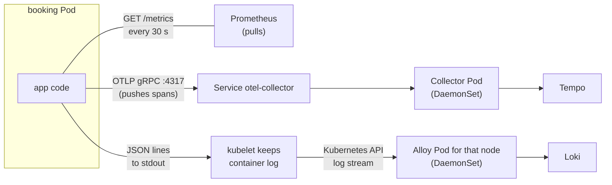

# How signals leave a service

*Stage 6 · Mission Operations*

**You will be able to:** name the code that produces each of Apollo's three signals, trace how each one leaves the Pod and reaches its store, explain why the three paths differ, and say which component to check when one signal goes quiet.

Stage 5 delivered Apollo reliably, but its services were nearly mute. Booking's `/metrics` returned a small JSON object that no tool could read, the log field called `trace_id` actually held the `X-Request-ID`, and nothing recorded how a request moved between services. No dashboard installed *around* the app can fix that. **Observability starts in the code**: the app has to produce the data. Then the data has to leave the Pod, and each signal leaves a different way.

## Three paths out of a Pod



| Signal | Produced by | Leaves the Pod by | Collected by | When it goes quiet, check |
|---|---|---|---|---|
| **Metrics** | `prometheus/client_golang` counters and histograms, updated by middleware on every request | **Pull:** Prometheus requests `/metrics` | Prometheus, pointed at the Pod by a ServiceMonitor | `curl /metrics` in the Pod, then Prometheus's targets page |
| **Traces** | The OpenTelemetry SDK: `otelgin` starts a span per incoming request; `callService` starts a child span and injects `traceparent` on each outgoing call | **Push:** OTLP over gRPC to `OTEL_EXPORTER_OTLP_ENDPOINT` | OpenTelemetry Collector, which batches and forwards to Tempo | Collector logs, then whether every hop forwards `traceparent` |
| **Logs** | `logJSON(...)`: one JSON line per event | **Stdout:** the container runtime captures it; the kubelet serves it through the API | Alloy, which tails each Pod's log stream and pushes to Loki | A line from a request made *now* appears in Loki |

Identity is Python and uses the matching OpenTelemetry packages for FastAPI, `requests` and `psycopg2`, so the same three paths apply.

## Why three different paths

**Metrics are pulled.** A counter is a running total; reading it late loses nothing, because the next read still includes everything. Prometheus decides how often to read, and the app never blocks on it. Pulling also gives a free health signal: if a scrape fails, Prometheus records `up == 0` for that target. A pushing app that dies simply goes silent, which looks the same as having nothing to say.

**Spans are pushed.** A span describes something that happened once. If nobody collects it, it is gone. So the SDK sends finished spans soon after they end, in batches, to a nearby Collector. The app does not wait for the network: spans are queued in memory and exported in the background.

**Logs go to stdout.** The app should not need to know where logs are stored or rotated. It writes lines; the container runtime saves them per container, and the kubelet serves them to anyone allowed to read `pods/log`, which is exactly what `kubectl logs` uses.

### How Alloy reads logs

Apollo's Alloy uses `loki.source.kubernetes`, which reads logs **through the Kubernetes API**, the same way `kubectl logs -f` does. It mounts nothing from the node. Each Alloy Pod discovers only the Pods on its own node (`spec.nodeName=$NODE_NAME`), keeps those in Apollo's app and UI namespaces, and attaches four labels:

| Label | Taken from |
|---|---|
| `namespace` | The Pod's namespace |
| `service` | The Pod's `app` label |
| `pod` | The Pod's name |
| `container` | The container's name |

Running one Alloy per node is how the work is **divided**: each Pod's logs are followed by exactly one Alloy, and a new node gets its own Alloy automatically. Many other setups instead mount `/var/log/pods` from the node and read the files directly; the effect is the same, the access path is not.

Either way, logs are only shipped while they exist. When a Pod is deleted, the kubelet removes its container logs. A line not yet read by then is lost.

### Why a Collector in the middle

Apps send spans to one address, `otel-collector.apollo-observability.svc.cluster.local:4317`. They do not know that Tempo exists. The Collector is a pipeline:

```text
receivers:  otlp (gRPC 4317, HTTP 4318)
processors: memory_limiter (refuse data before running out of memory) → batch (2 s)
exporters:  otlp/tempo
```

Changing the backend, the batching or the memory cap is a change to one ConfigMap, not to six services.

Two details of Apollo's setup are easy to misread:

- The Collector runs as a **DaemonSet**, but apps reach it through an ordinary **Service**. A span from booking may go to the Collector on any node, not necessarily its own. gRPC keeps one long-lived connection, so each app Pod tends to stick to one Collector.
- The Go SDK also exports **OTLP metrics** every 15 s. The Collector's metrics pipeline sends them to its `debug` exporter, which prints a summary and drops them. Every metric you query in Prometheus came from the **scrape**, not from this push.

## The joins between signals

Each signal answers its own question ([Signals and metrics](./signals-and-metrics)). To move from one to another, they must share something:

| Join | Shared by | Used for |
|---|---|---|
| Time | All three | A metric spike says *when* to look |
| `trace_id` | Spans and log lines | From a slow span to that request's log lines, and back |
| `service`, `namespace` | Prometheus target labels and Loki stream labels | Narrowing to the same service in both |

Booking's request handlers read the current trace ID from the request's context and pass it to `logJSON`:

```go
traceID := traceIDFromContext(c.Request.Context())   // the span otelgin started
logJSON("INFO", "booking-service", "Booking created", traceID, "", map[string]interface{}{"ref": ref})
```

Lines logged outside a request (start-up, shutdown) have an empty `trace_id`. A comment in `logJSON` claims a fallback fills it from "the active span", but the fallback reads `context.Background()`, which never holds a span: trace context lives in the request's `context.Context` and has to be passed down explicitly. And because handlers pass an empty span ID, `span_id` is always empty in Stage 6 logs. Both are harmless today; both are typical of how correlation quietly degrades.

Per-request IDs must never become metric labels ([the cardinality rule](./signals-and-metrics#labels-decide-the-cost)). They travel in spans and in log *content*, not in labels.

## Telemetry is out of band

If Tempo is down, booking keeps taking bookings and the spans are dropped. If Prometheus stops scraping, nothing in the app notices. If Alloy is stopped, apps keep writing to stdout. That is deliberate: a monitoring failure must never become a passenger failure. The cost is that a broken pipeline is **silent**, so each pipeline needs its own proof that *new* data is arriving.

## Apollo example

- [`code/booking/main.go`](https://github.com/darshan-raul/Apollo11/blob/f6211e679f8ed66a5a19033ac49a3bfc3a506eab/stages/stage6/code/booking/main.go): metric definitions and middleware, `logJSON`, `callService`, OpenTelemetry set-up with `AlwaysSample` (every request is traced).
- [`helm/apollo11/templates/apps/booking.yaml`](https://github.com/darshan-raul/Apollo11/blob/f6211e679f8ed66a5a19033ac49a3bfc3a506eab/stages/stage6/helm/apollo11/templates/apps/booking.yaml): sets `OTEL_EXPORTER_OTLP_ENDPOINT` and `OTEL_SERVICE_NAME` on the Deployment.
- [`otel-collector/config.yaml`](https://github.com/darshan-raul/Apollo11/blob/f6211e679f8ed66a5a19033ac49a3bfc3a506eab/stages/stage6/helm/apollo11/templates/observability/otel-collector/config.yaml) and [`loki/alloy.yaml`](https://github.com/darshan-raul/Apollo11/blob/f6211e679f8ed66a5a19033ac49a3bfc3a506eab/stages/stage6/helm/apollo11/templates/observability/loki/alloy.yaml): the two collectors.

## Try it

:::caution[Unverified]
Not yet run on a live cluster for this documentation revision. Needs Stage 6 with observability installed.
:::

Look at each path at its source:

```bash
NS=apollo-airlines-apps
# Metrics: the pull endpoint, as Prometheus sees it
kubectl -n $NS exec deploy/booking -- wget -qO- http://127.0.0.1:8082/metrics \
  | grep -E '^http_requests_total|^http_request_duration_ms_count' | head -5

# Logs: the stream Alloy reads, through the same API kubectl uses
kubectl -n $NS logs deploy/booking --tail=5

# Traces: where the SDK sends spans
kubectl -n $NS get deploy booking -o jsonpath='{range .spec.template.spec.containers[0].env[?(@.name=="OTEL_EXPORTER_OTLP_ENDPOINT")]}{.value}{"\n"}{end}'

# The collectors: one Pod per node each, and nothing mounted from the node for Alloy
kubectl -n apollo-observability get ds alloy otel-collector
kubectl -n apollo-observability get ds alloy -o jsonpath='{.spec.template.spec.volumes[*].name}'; echo   # config only
```

- `/metrics` shows the counters with the `service`, `method`, `path` and `status` labels from the previous chapter.
- Request log lines carry a 32-character `trace_id`; start-up lines carry an empty one.
- Alloy's only volume is its config: it reads logs through the API.

## Common misconceptions

- **"Installing Prometheus gives me metrics."** It gives a collector. Uninstrumented code has nothing to collect.
- **"All three signals travel the same way."** Each has its own path and its own failure point.
- **"Missing traces mean failed requests."** Tracing is out of band; bookings succeed while spans are dropped.
- **"Incoming-request middleware traces the whole call."** It starts one span. Outgoing calls must carry `traceparent`, or the next service starts a new trace.
- **"A DaemonSet collector always receives its own node's data."** Apollo's Collector sits behind a normal Service.

## Check yourself

<details>
<summary>Bookings work and Grafana shows request rates, but Tempo has no new traces. Which path broke, and what is still fine?</summary>

The push path: app → Collector → Tempo. Scraping is independent, so metrics are fine. Check the Collector's logs and whether it can reach Tempo.
</details>

<details>
<summary>Why does Apollo run Alloy as a DaemonSet when it reads logs through the API?</summary>

To divide the work: each Alloy follows only the Pods on its own node, so every Pod is followed exactly once and new nodes are covered automatically.
</details>

<details>
<summary>Booking's metrics pushed over OTLP: where do they end up?</summary>

At the Collector's `debug` exporter, which prints and discards them. Prometheus gets booking's metrics by scraping `/metrics`.
</details>

## Where this leads

The signals now leave the Pods. [Discovery and collection](./discovery-and-collection) follows the metrics path in detail: how Prometheus finds what to scrape, and how to tell which link broke when a panel is empty.

## References

- [OpenTelemetry Collector configuration](https://opentelemetry.io/docs/collector/configuration/)
- [OpenTelemetry Go: instrumentation](https://opentelemetry.io/docs/languages/go/instrumentation/)
- [Grafana Alloy `loki.source.kubernetes`](https://grafana.com/docs/alloy/latest/reference/components/loki/loki.source.kubernetes/)
- [Kubernetes logging architecture](https://kubernetes.io/docs/concepts/cluster-administration/logging/)
