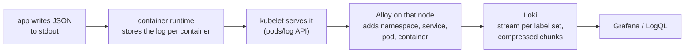

# Logs

*Stage 6 · Mission Operations*

**You will be able to:** write a log line that can be filtered and joined to a trace, follow it from stdout to Loki, explain what Loki indexes and what it scans, write LogQL that filters, parses and counts, and test whether log collection is working *now*.

A metric says booking errors rose at 14:30. It cannot say what the error was. That is in the program's own words, in its log. But `kubectl logs` reads one Pod at a time, only while the Pod exists, and cannot search across services. By the time someone looks, the Pod that failed may have been replaced. Logs need to be **structured** so they can be searched, and **collected** somewhere that outlives Pods.

## Structured lines

An unstructured line is written for a person reading a terminal. A structured line is written so a machine can filter it by field:

| Unstructured | Structured JSON (Apollo) |
|---|---|
| `2026-10-30 14:31:55 ERROR booking insert failed: duplicate key` | `{"timestamp":"2026-10-30T14:31:55Z","level":"ERROR","service":"booking-service","trace_id":"4bf9…","span_id":"","message":"Booking insert failed: …duplicate key…"}` |
| Finding all errors needs a text pattern that also matches "no error" | Filter `level` = `ERROR` |
| Joining to a request means guessing by timestamp | Join on `trace_id` |

Every Apollo service writes the same six fields, then any extras the call site adds (`ref`, `count`, `flight_id`). Level values are **upper case**: `INFO`, `WARN`, `ERROR`. That matters in queries, because LogQL comparisons are case-sensitive.

## From stdout to Loki



1. The app writes one JSON line per event to stdout. It knows nothing about files or Loki.
2. The container runtime stores each container's output on the node, rotating files as they grow.
3. The kubelet serves that output through the API. `kubectl logs` reads it this way, and so does Alloy.
4. Each Alloy Pod follows the Pods on its own node, in Apollo's app and UI namespaces, and labels every line with `namespace`, `service` (the Pod's `app` label), `pod` and `container` ([How signals leave a service](./instrumenting-services#how-alloy-reads-logs)).
5. Alloy pushes batches to Loki's `/loki/api/v1/push`. Loki keeps them for `168h` (7 days).

Two consequences of that path:

- **Deleted Pods:** when a Pod is deleted, its log files go with it. Lines Alloy has already shipped stay searchable in Loki; lines it had not yet read are lost.
- **Restarted containers:** `kubectl logs --previous` reads the last container in the *same* Pod. A replaced Pod's logs are only in Loki.

## What Loki indexes

Loki does not index the text of your lines. It indexes **labels**. Each distinct label set is a **stream**, and a stream's lines are stored as compressed chunks in time order:

```text
{namespace="apollo-airlines-apps", service="booking", pod="booking-7d…-x7k2", container="booking"}
  14:31:54  {"level":"INFO", "message":"Booking created", …}
  14:31:55  {"level":"ERROR","message":"Booking insert failed…", …}
```

A query first uses labels to pick streams (cheap: an index lookup), then **scans** the chunks of those streams for text (costly: proportional to the volume read). That design keeps the index tiny and storage cheap, and puts the same constraint on labels as Prometheus does: every distinct label value creates new streams. `trace_id` is therefore **not** a label. It stays inside the JSON, and queries extract it at read time.

| Good stream labels | Keep inside the line |
|---|---|
| `namespace`, `service`, `container` (few values) | `trace_id`, booking reference, user ID, `level` |

`pod` is a moderate case: it changes with every rollout, but each value lives only as long as its Pod.

## LogQL

A LogQL query is a **stream selector**, followed by a pipeline that runs on each line.

```logql
{namespace="apollo-airlines-apps", service="booking"}           # 1. pick streams by label
  |= "insert"                                                   # 2. line filter: contains (also != |~ !~)
  | json                                                        # 3. parse the JSON into fields
  | level = "ERROR"                                             # 4. filter on a parsed field (case-sensitive)
  | line_format "{{.trace_id}} {{.message}}"                    # 5. reshape the output
```

Put cheap line filters (`|=`) before the parser: they discard most lines before the expensive JSON parse.

The same pipeline can produce **numbers**, which turns logs into an ad-hoc metric:

```logql
sum by (service) (count_over_time({namespace="apollo-airlines-apps"} | json | level="ERROR" [5m]))
```

That counts error lines per service over five minutes. It is useful for a one-off question; for anything you will chart or alert on permanently, a real metric is far cheaper.

Following one request across every service is a search for its trace ID:

```logql
{namespace=~"apollo-airlines-.*"} |= "4bf92f3577b34da6a3ce929d0e0e4736"
```

## What to log, and what never to

| Log | Never log |
|---|---|
| `trace_id`; the operation; the error and its cause; safe business identifiers (flight number, booking reference); counts and durations | Passwords, JWTs and other credentials; card numbers; personal data such as names and email addresses |

Logs are copied, retained and searched by more people than the database is. Anything sensitive written to them becomes a new place to protect.

Apollo breaks this rule in one place. Identity logs the passenger's **email address** on every registration and login:

```python
log_json("INFO", "identity-service", "User logged in", trace_id=trace_id, span_id=span_id, email=body.email)
```

Those lines are kept for seven days in Loki, which runs with authentication off (`auth_enabled: false`): anything in the cluster that can reach the `loki` Service can query them, as can every Grafana user allowed to use Explore. A user ID or a hash of the address would serve debugging just as well. Stage 8's security work is the place to remove it.

## What a log can and cannot prove

- A matching line proves that **this line was shipped**. Last week's lines still being searchable says nothing about collection today. To test the pipeline, make a request with a fresh marker and find *that* line.
- Absence proves little: the line may not have been written, may not have been shipped yet, or may sit outside the query's time range.
- A "graceful shutdown" line proves the handler ran, not that no request failed ([Termination and draining](../reliability/termination-and-draining#sigterm-has-to-reach-the-code)).
- Since Stage 6, Apollo's logs no longer carry the `X-Request-ID` (tracker G34). Search by `trace_id`, or by a marker you put in the request.

## Apollo example

| Setting | Value | Where |
|---|---|---|
| Collector | Alloy DaemonSet, `loki.source.kubernetes` | [`loki/alloy.yaml`](https://github.com/darshan-raul/Apollo11/blob/f6211e679f8ed66a5a19033ac49a3bfc3a506eab/stages/stage6/helm/apollo11/templates/observability/loki/alloy.yaml) |
| Namespaces kept | Apollo's app and UI namespaces (a regex on the namespace name) | relabel rule |
| Loki | 2.9, single process, filesystem storage on a 1 Gi PVC, TSDB index, no auth | [`loki/config.yaml`](https://github.com/darshan-raul/Apollo11/blob/f6211e679f8ed66a5a19033ac49a3bfc3a506eab/stages/stage6/helm/apollo11/templates/observability/loki/config.yaml) |
| Retention | `168h` | `values.yaml` |

## Try it

:::caution[Unverified]
Not yet run on a live cluster for this documentation revision. Needs Stage 6 with the logs substage installed.
:::

Prove collection works *now*, with a marker no old line can contain:

```bash
NS=apollo-airlines-apps
MARK=probe-$(date +%s)
kubectl -n $NS run marker --image=curlimages/curl:8.10.1 --restart=Never --rm -i -- \
  curl -s "http://flight.$NS:8081/api/flights?probe=$MARK" >/dev/null

kubectl -n apollo-observability port-forward svc/loki 13100:3100 >/dev/null &
sleep 10
lq() { curl -sG localhost:13100/loki/api/v1/query_range --data-urlencode "query=$1" --data-urlencode 'limit=5' \
  | jq -r '.data.result[] | .values[][1]'; }

lq "{namespace=\"$NS\"} |= \"$MARK\""                                   # the fresh line
lq "{namespace=\"$NS\", service=\"booking\"} | json | level=\"error\""   # nothing: wrong case
lq "{namespace=\"$NS\", service=\"booking\"} | json | level=\"ERROR\""   # booking's errors, if any
curl -sG localhost:13100/loki/api/v1/labels | jq -c .data              # the labels Loki indexes
kill %1
```

- The marker line appears within seconds: collection is working today, not just stored history.
- `level="error"` returns nothing because Apollo writes `ERROR`.
- Loki's label list holds `namespace`, `service`, `pod` and `container`; `trace_id` is not among them.

## Common misconceptions

- **"If old lines are in Loki, the pipeline is healthy."** Only a fresh line proves current collection.
- **"Loki indexes everything I log."** It indexes labels; text is scanned.
- **"Adding `trace_id` as a label makes lookups faster."** It creates a stream per request and overloads the index.
- **"More detail in logs is always safer."** Personal data in logs is a new copy to protect.
- **"`kubectl logs` can show a deleted Pod's output."** Only Loki has it, and only what was shipped.

## Check yourself

<details>
<summary>Loki still returns last week's booking lines. Is Alloy working today?</summary>

Unknown. Send a request with a fresh marker and check that its line arrives.
</details>

<details>
<summary>Why is <code>&#123;service="booking"&#125; |= "ERROR" | json</code> cheaper than <code>&#123;service="booking"&#125; | json | level="ERROR"</code>?</summary>

The line filter discards non-matching lines before the JSON parser runs, so far fewer lines are parsed.
</details>

<details>
<summary>A booking Pod crashed and was replaced an hour ago. Where are its last lines?</summary>

In Loki, if Alloy shipped them before the Pod was removed. `kubectl logs` cannot reach a deleted Pod, and `--previous` only covers a restart within the same Pod.
</details>

## Where this leads

A log shows what one process saw. A booking crosses four services; [Traces](./traces) follows the whole journey as one record.

## References

- [Grafana Loki: labels and streams](https://grafana.com/docs/loki/latest/get-started/labels/)
- [LogQL: log queries](https://grafana.com/docs/loki/latest/query/log_queries/) and [metric queries](https://grafana.com/docs/loki/latest/query/metric_queries/)
- [OWASP logging cheat sheet: data to exclude](https://cheatsheetseries.owasp.org/cheatsheets/Logging_Cheat_Sheet.html#data-to-exclude)
