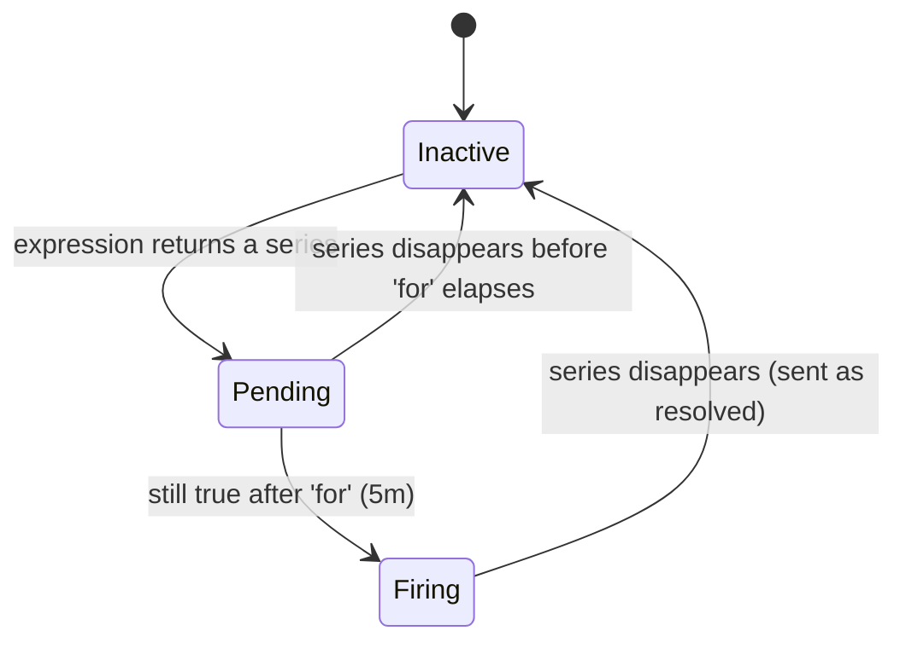

# Queries, alerts and objectives

*Stage 6 · Mission Operations*

**You will be able to:** write and read the PromQL behind Apollo's dashboards, follow an alert from rule to receiver, define an SLI and SLO for booking, compute an error budget, and explain why Apollo alerts on burn rate over two windows.

Samples in a database do not help at 3 a.m. Three layers turn them into something people can act on:

- **Queries** turn samples into answers: how many bookings failed in the last five minutes?
- **Alerts** are queries that run on a schedule and tell a person when an answer crosses a line.
- **Objectives** define what "good enough" means, so that a team can tell a bad minute from a broken promise, and decide whether to ship or to fix.

## PromQL in five ideas

PromQL is Prometheus's query language. Most queries combine five ideas.

**1. Selectors pick series.** A metric name plus label matchers returns the latest sample of every matching series: an **instant vector**.

```promql
http_requests_total{service="booking", status=~"5.."}   # =  equal, != not equal, =~ regex, !~ not regex
```

**2. A range turns each series into a window.** `[5m]` returns every sample of the last five minutes per series: a **range vector**. You cannot graph it directly; you pass it to a function.

**3. Functions summarise windows.** For counters, almost always `rate()` (per second) or `increase()` (total in the window) ([Signals and metrics](./signals-and-metrics#counters-always-take-a-rate)).

**4. Aggregations collapse labels.** `sum by (service) (…)` adds series together and keeps only `service`; `sum without (pod) (…)` keeps everything but `pod`. Two booking Pods become one booking series.

**5. Arithmetic matches series by labels.** Dividing two vectors pairs up series with the same labels. If the label sets do not match, the result is **empty**, not an error.

Put together, the three queries behind most of Apollo's panels:

```promql
# Traffic: requests per second, per service
sum by (service) (rate(http_requests_total[5m]))

# Errors: fraction of booking requests that returned 5xx
sum(rate(http_requests_total{service="booking", status=~"5.."}[5m]))
  / sum(rate(http_requests_total{service="booking"}[5m]))

# Latency: booking p95, in milliseconds
histogram_quantile(0.95, sum by (le) (rate(http_request_duration_ms_bucket{service="booking"}[5m])))
```

Two habits avoid wrong answers. Aggregate **after** `rate`, never before. And remember that a series with no samples does not exist: if booking returned no 5xx at all, the numerator is empty, and so is the whole ratio. `or vector(0)` and `clamp_min(…, 0.001)` are the two tricks Apollo uses to keep such expressions defined.

## Alert rules

An **alerting rule** is a PromQL expression that Prometheus evaluates on a schedule (every 30 s for Apollo's rule groups). Every series the expression returns is an active alert.

```yaml
- alert: ApolloErrorRateHigh
  expr: sum by (service) (rate(http_requests_total{status=~"5.."}[5m]))
        / clamp_min(sum by (service) (rate(http_requests_total[5m])), 0.001) > 0.05
  for: 5m
  labels: {severity: critical, team: platform}
  annotations: {summary: Apollo backend 5xx rate exceeds 5 percent}
```



`for` is a debounce: a five-second blip never reaches a person. The cost is delay; the error rate must hold for five minutes (plus the 5-minute averaging inside `rate`) before anyone hears about it.

Apollo's rules, from [`prometheus/rules.yaml`](https://github.com/darshan-raul/Apollo11/blob/f6211e679f8ed66a5a19033ac49a3bfc3a506eab/stages/stage6/helm/apollo11/templates/observability/prometheus/rules.yaml):

| Alert | Fires when | `for` |
|---|---|---|
| `ApolloServiceDown` | A backend target's `up == 0` | 2m |
| `ApolloServiceFlapping` | A target's `up` changed more than 6 times in 10 minutes | none |
| `ApolloErrorRateHigh` | Any service's 5xx ratio > 5% | 5m |
| `ApolloBookingLatencyP95High` | Booking p95 > 500 ms | 5m |
| `ApolloBookingErrorBudgetBurn` | Booking creation burns its budget > 14.4× too fast, in both windows | 2m |

### Alertmanager: deliver, group, repeat

Prometheus only decides that an alert is firing. It sends it to **Alertmanager**, which decides who hears about it and how often:

| Setting | Apollo | Effect |
|---|---|---|
| `group_by` | `[alertname, namespace]` | Five services failing at once arrive as one notification, not five |
| `group_wait` | 5s | Wait briefly to collect related alerts before the first notification |
| `group_interval` | 10s | Wait before notifying about changes to an existing group |
| `repeat_interval` | 1h | Remind about an alert that is still firing |
| receiver | `lab`: a webhook to the in-cluster `alert-receiver`, with `send_resolved: true` | Shows firing and resolved payloads without any external account |

Real setups add routing trees (critical to a pager, warnings to a chat channel), **inhibition** (suppress "high error rate" while "service down" fires for the same service) and **silences** for planned work. None of it repairs anything: **an alert only tells a person**. Restarting, scaling and rolling back stay with people or with other controllers.

## Recording rules

Some expressions are long, expensive, and needed in many places. A **recording rule** evaluates one on a schedule and stores the result as a new series:

```yaml
- record: apollo:booking_error_ratio:5m        # level:metric:operations naming
  expr: |
    (sum(rate(http_requests_total{service="booking",method="POST",path="/api/bookings",status=~"5.."}[5m])) or vector(0))
    / sum(rate(http_requests_total{service="booking",method="POST",path="/api/bookings",status=~"2..|5.."}[5m]))
    and sum(rate(http_requests_total{service="booking",method="POST",path="/api/bookings",status=~"2..|5.."}[5m])) > 0
```

- The expression is computed once, dashboards and alerts share one definition, and the alert reads a cheap series.
- `or vector(0)`: no failures gives 0 instead of an empty numerator.
- `and … > 0`: no eligible traffic gives **no value**, not 0%. An idle service is unknown, not perfect.

## SLI, SLO and error budget

"Is booking reliable?" needs an agreed number. Three terms provide it:

| Term | Meaning | Apollo booking |
|---|---|---|
| **SLI** (service level indicator) | A ratio of good events to eligible events | Successful `POST /api/bookings` ÷ eligible ones. **Eligible** = 2xx or 5xx; **4xx are excluded**, because a wrong password or a full flight is the caller's problem, not a service failure |
| **SLO** (objective) | The target for the SLI over a window | 99.5% over 28 days |
| **Error budget** | The failures the SLO allows: `1 − SLO` | 0.5% of eligible bookings |

In concrete terms: at 10,000 bookings in 28 days, 50 may fail. At a steady rate, 0.5% of 28 days is about **3 hours 22 minutes** of total booking failure.

```yaml
- record: apollo:booking_error_budget_remaining:28d
  expr: 1 - apollo:booking_error_ratio:28d / 0.005      # 1 = untouched, 0 = spent, negative = overspent
```

The budget turns an argument into a rule. While budget remains, the team can take risks: ship faster, run experiments. Once it is spent, the next work is reliability. It also says what *not* to do: a 100% target leaves no room to change anything.

## Burn rate: alerting on the promise

A threshold alert ("error ratio above 5%") is either too noisy or too late. The useful question is: **at the current pace, will booking break its promise?** That pace is the **burn rate**: the current error ratio divided by the ratio the budget allows.

| Burn rate | Error ratio (budget 0.5%) | Whole 28-day budget gone in |
|---|---|---|
| 1 | 0.5% | 28 days, exactly on target |
| 6 | 3% | about 4.7 days |
| 14.4 | 7.2% | about 47 hours; 2% of the budget per hour |
| 200 | 100% | about 3.4 hours |

Apollo pages at 14.4, in **two windows at once**:

```yaml
- alert: ApolloBookingErrorBudgetBurn
  expr: apollo:booking_error_ratio:5m > (14.4 * 0.005)
    and apollo:booking_error_ratio:1h > (14.4 * 0.005)
  for: 2m
```

- The **1-hour** window proves the problem is big enough to matter: at least 2% of the month's budget is already gone.
- The **5-minute** window proves it is still happening. Without it, the alert would keep firing for up to an hour after a fix.
- Either window alone is worse: 5 minutes alone pages on every blip; 1 hour alone fires late and resolves late.

## Limits to respect

- **No traffic means no SLI.** The recording rules return nothing, which is not "100% available".
- **A lab cannot prove a 28-day SLO.** Apollo's 150-second outage drill shows burn and recovery; only 28 days of real traffic test the objective.
- **The remaining budget can stay negative after recovery.** Past failures stay inside the 28-day window until they age out.
- **Retention bounds every window.** Prometheus keeps 30 days, so a 28-day rule just fits.
- **Latency and availability are separate objectives.** A latency histogram cannot say whether a request succeeded.

## Try it

:::caution[Unverified]
Not yet run on a live cluster for this documentation revision. Needs Stage 6 at the alerts substage. The drill scales flight to zero for 150 seconds and restores it on exit.
:::

```bash
kubectl -n apollo-observability port-forward svc/prometheus 19090:9090 >/dev/null &
q() { curl -sG localhost:19090/api/v1/query --data-urlencode "query=$1" | jq -c '.data.result[] | [.metric, .value[1]]'; }

q 'sum by (service) (rate(http_requests_total[5m]))'
q 'apollo:booking_error_ratio:5m'                  # empty if nobody booked recently
q 'ALERTS'                                          # pending and firing alerts

cd stages/stage6 && bash scripts/slo-lab.sh         # flight down: booking returns 502 for 150 s
q 'apollo:booking_error_ratio:5m'
q 'ALERTS{alertname="ApolloBookingErrorBudgetBurn"}'   # pending, then firing
kubectl -n apollo-observability logs deploy/alert-receiver --tail=5   # the webhook payload
```

- Before the drill the error ratio may not exist at all: no eligible traffic, no SLI.
- During the drill, flight's absence made booking itself return 5xx, so booking's SLI dropped even though every booking Pod stayed Ready.

## Common misconceptions

- **"An alert fixes the problem."** It notifies; people or other controllers act.
- **"Every non-200 counts against the SLO."** Client errors (4xx) are excluded; they are not service failures.
- **"No errors in the graph means 100% availability."** With no traffic there is no measurement.
- **"Healthy Pods mean the SLO is fine."** Booking failed because a dependency was gone, with every booking Pod Ready.
- **"A higher SLO is always better."** Every nine shrinks the budget for change.

## Check yourself

<details>
<summary>Why does the booking SLI exclude 4xx responses?</summary>

They are caller mistakes, such as a bad token or invalid input, not failures of the service.
</details>

<details>
<summary>Booking fails 7.2% of creations for an hour. How much of the 28-day budget is gone?</summary>

Burn rate 14.4 for one hour: 14.4 ÷ 672 hours ≈ 2% of the budget.
</details>

<details>
<summary>The burn alert fires, you fix the cause, and it resolves within minutes. Why not after an hour?</summary>

The alert needs both windows above the threshold. The 5-minute ratio drops quickly after the fix, so the condition stops holding even while the 1-hour ratio is still high.
</details>

<details>
<summary>A query dividing two rates returns nothing, although both parts return data. What is a likely cause?</summary>

The two sides have different label sets, so no series pair up. Aggregate both sides to the same labels, for example `sum by (service)`.
</details>

## Where this leads

Metrics say how much, how fast and since when. They cannot say what a process saw. [Logs](./logs) follows the second signal from stdout to a query.

## References

- [Querying basics](https://prometheus.io/docs/prometheus/latest/querying/basics/) and [functions](https://prometheus.io/docs/prometheus/latest/querying/functions/)
- [Alerting rules](https://prometheus.io/docs/prometheus/latest/configuration/alerting_rules/) and [Alertmanager](https://prometheus.io/docs/alerting/latest/alertmanager/)
- [Google SRE workbook: alerting on SLOs](https://sre.google/workbook/alerting-on-slos/)
