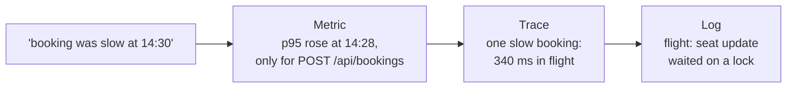

# Signals and metrics

*Stage 6 · Mission Operations*

**You will be able to:** choose the right signal for a question, describe a time series by name and labels, query a counter with `rate` and a histogram with `histogram_quantile`, explain why a percentile from buckets is an estimate, and keep a label from multiplying a metric into millions of series.

A passenger reports that booking was slow at 14:30. Everything Kubernetes knows says the airline is fine: Pods are `Running` and Ready, Deployments are available, no restarts. That is all true, and none of it answers the question. Readiness ([Stage 4](../reliability/probes)) is a yes/no per Pod every few seconds. It says nothing about how long requests took, how many failed, or which service a slow request spent its time in.

To answer those questions, the system has to produce **evidence about its own behaviour** while it runs. That evidence is called **telemetry**, and there are three kinds, because there are three kinds of question.

## Three signals, three questions

| Signal | One record is | Answers | Cost per request | Apollo stores it in |
|---|---|---|---|---|
| **Metric** | A number, sampled over time | How much? How fast? What fraction failed? Since when? | Almost none: a counter is incremented | Prometheus |
| **Trace** | The timed path of **one** request across services | Where did the time go in *this* request? | A few spans per request | Tempo |
| **Log** | A line of text a process chose to write | What exactly happened, in the program's words? | One or more lines per event | Loki |

They are used as a funnel, from wide to narrow:



Metrics are cheap enough to record everything, all the time, so they show **that** something changed and **how widely**. They cannot hold detail about each request. Traces and logs hold that detail, so they show **where** and **why**, one request at a time. [Correlating a booking](./correlating-a-booking) walks the full funnel.

## What a metric is

Prometheus stores **time series**. A series is identified by a metric **name** plus a set of **labels** (key/value pairs), and holds a list of **samples**: a timestamp and a floating-point value.

```text
http_requests_total{service="booking", method="POST", path="/api/bookings", status="201"}
  @14:30:00  1042
  @14:30:30  1057
  @14:31:00  1075
```

Every distinct combination of label values is a **separate series**. `status="201"` and `status="502"` for the same path are two series, stored and queried independently.

Prometheus does not see each request. Every 30 seconds it reads the current values from each service's `/metrics` endpoint ([Discovery and collection](./discovery-and-collection)) and appends one sample per series. What happened between two scrapes is only visible as the change in the numbers.

## Four metric types

| Type | Behaves like | Apollo example | Query it with |
|---|---|---|---|
| **Counter** | Only goes up; resets to 0 when the process restarts | `http_requests_total` | `rate()`, `increase()` |
| **Gauge** | Goes up and down; a current reading | `db_connections_active`, `process_resident_memory_bytes` | The value itself, `avg_over_time()` |
| **Histogram** | A set of counters, one per duration bucket, plus a sum and a count | `http_request_duration_ms` | `histogram_quantile()` over `rate()` of the buckets |
| **Summary** | Quantiles computed inside the app | Not used | Read directly; cannot be combined across replicas |

### Counters: always take a rate

A counter's raw value is a running total since the process started. On its own it says nothing useful: 1,075 bookings since some unknown start time. Ask instead how fast it grows:

```promql
rate(http_requests_total{service="booking"}[5m])        # per-second rate, averaged over 5 minutes
increase(http_requests_total{service="booking"}[1h])    # how many in the last hour
```

`rate` handles restarts: when a value drops (a new Pod starts at 0), Prometheus treats it as a reset rather than a negative rate. Two practical rules follow. The range (`[5m]`) must cover several scrapes; with a 30-second interval, `[1m]` holds only two samples and jumps around. And apply `rate` **before** `sum`: summing raw counters across Pods mixes their reset points.

### Histograms: percentiles from buckets

To know how slow requests are, an average is the wrong number. If 99% of bookings take 50 ms and 1% take 5 s, the average is about 100 ms: it looks healthy while one passenger in a hundred waits five seconds. **Percentiles** describe the tail instead: p95 is the duration that 95% of requests beat.

A histogram cannot record every duration, so it counts how many requests fell at or under each **bucket boundary** (`le`, "less or equal"). Booking's boundaries, in milliseconds:

```text
le:     1    5   10   25   50  100  250  500 1000 2500 5000 +Inf
count: 40  310  620  880  950  975  990  996  998  999  1000 1000    (cumulative)
```

Each bucket is itself a counter, and the histogram also exports `_sum` (total milliseconds) and `_count` (total requests). The p95 is then estimated:

```promql
histogram_quantile(0.95,
  sum by (le) (rate(http_request_duration_ms_bucket{service="booking"}[5m])))
```

`histogram_quantile` finds the bucket containing the 95th percentile and **interpolates linearly** inside it. In the example, request 950 falls exactly at the 50 ms boundary. Had it fallen between 250 and 500, the answer could be anywhere from 251 to 500 ms; the reported number would be a straight-line guess. Percentiles from buckets are only as precise as the buckets around the values you care about, which is why bucket boundaries should sit near your targets.

The average still has a use, computed from the same histogram: `rate(…_sum[5m]) / rate(…_count[5m])`.

## Labels decide the cost

Each series costs memory in Prometheus, roughly a few kilobytes whatever its value. The number of series for one metric is the **product** of the number of values of each label. This is **cardinality**.

For booking's request counter:

| Label | Distinct values | Bounded? |
|---|---|---|
| `service` | 1 (`booking`) | Yes |
| `method` | ~3 | Yes |
| `path` | 10 route templates, probes included | Yes |
| `status` | ~6 | Yes |

That is at most a few hundred combinations, and far fewer in practice, because most paths see only one method and a few statuses. The histogram multiplies its own labels by 12 buckets. All of that is fine. Now imagine `path` held the **raw URL** instead of the route template: `/api/bookings/8f3a…` for every booking ID. Each cancelled booking would create new series that never go away until retention drops them. Over weeks, millions of series, and Prometheus runs out of memory.

Apollo avoids this in its middleware: the label is gin's `c.FullPath()`, the route **template** (`/api/bookings/:id`), and any request that matches no route is recorded as `path="unknown"` instead of its URL.

| Safe as labels (few values) | Never as labels (unbounded) |
|---|---|
| `service`, `method`, route template, `status` | User ID, booking ID, request ID, trace ID, raw URL, email |

Per-request identifiers belong in traces and logs, which are built to store one record per request.

Apollo's metric name also breaks a convention worth knowing: Prometheus recommends base units, so durations are usually `_seconds` with fractional values. `http_request_duration_ms` works the same way; only the numbers in queries and bucket boundaries change. And because the middleware records whole milliseconds, every request faster than 1 ms is counted as 0 ms.

## Apollo example

From [booking's `main.go`](https://github.com/darshan-raul/Apollo11/blob/f6211e679f8ed66a5a19033ac49a3bfc3a506eab/stages/stage6/code/booking/main.go), trimmed:

```go
httpRequestsTotal = prometheus.NewCounterVec(
    prometheus.CounterOpts{Name: "http_requests_total"},
    []string{"service", "method", "path", "status"})
httpRequestDurationMs = prometheus.NewHistogramVec(
    prometheus.HistogramOpts{Name: "http_request_duration_ms",
        Buckets: []float64{1, 5, 10, 25, 50, 100, 250, 500, 1000, 2500, 5000}},
    []string{"service", "method", "path"})          // no status: halves the bucket series

// middleware, after each request
path := c.FullPath()                                 // route template, not the URL
if path == "" { path = "unknown" }
httpRequestsTotal.WithLabelValues(service, method, path, status).Inc()
httpRequestDurationMs.WithLabelValues(service, method, path).Observe(ms)
```

The same `/metrics` endpoint also exposes the Go runtime and process collectors (`go_goroutines`, `process_resident_memory_bytes`, …), which the Saturation dashboard reads.

## Try it

:::caution[Unverified]
Not yet run on a live cluster for this documentation revision. Runs a throwaway Prometheus that scrapes itself, on any cluster.
:::

```bash
kubectl create namespace prom-demo
kubectl -n prom-demo run prom --image=quay.io/prometheus/prometheus:v3.13.1 --port=9090
kubectl -n prom-demo wait --for=condition=Ready pod/prom
kubectl -n prom-demo port-forward pod/prom 19091:9090 >/dev/null &
sleep 60      # let it scrape itself a few times (default config: every 15 s)

q() { curl -sG localhost:19091/api/v1/query --data-urlencode "query=$1" | jq -c '.data.result[] | [.metric.handler, .value[1]]'; }
q 'prometheus_http_requests_total'                          # raw counters: running totals
q 'rate(prometheus_http_requests_total[1m])'                # per-second rates
q 'prometheus_http_request_duration_seconds_bucket{handler="/metrics"}'   # cumulative buckets
q 'histogram_quantile(0.95, sum by (le) (rate(prometheus_http_request_duration_seconds_bucket{handler="/metrics"}[1m])))'
q 'count({__name__=~".+"})'                                 # how many series this one process exposes

kill %1; kubectl delete namespace prom-demo
```

- The raw counter only grows; the rate is the useful number.
- The buckets are cumulative: each `le` value is at least as large as the one before.
- Even an idle Prometheus exposes hundreds of series: cardinality is the first cost to watch.

## Common misconceptions

- **"Average latency describes what passengers feel."** It hides the tail. Use p95 or p99.
- **"A percentile from a histogram is exact."** It is interpolated inside a bucket.
- **"More labels make better metrics."** Each label multiplies the series count; unbounded ones break Prometheus.
- **"A metric can tell me which request failed."** It aggregates; one request needs a trace or a log.
- **"Prometheus records every request."** It samples the counters every scrape interval.

## Check yourself

<details>
<summary>Why not label <code>http_requests_total</code> with <code>booking_id</code>?</summary>

Every booking would create new series. Memory grows without bound. Put the ID in the trace and the log line instead.
</details>

<details>
<summary>A booking Pod restarts and its counter drops from 1,075 to 3. What does <code>rate()</code> show?</summary>

A normal rate. `rate` treats a drop as a counter reset, not as negative traffic.
</details>

<details>
<summary>Booking's p95 is reported as 400 ms. What range could the true value be in?</summary>

Somewhere in the bucket that holds it, 250–500 ms. The 400 is linear interpolation inside that bucket.
</details>

<details>
<summary>Why does booking's histogram have no <code>status</code> label?</summary>

Each label multiplies the series by its values, and a histogram already has 12 bucket series per combination. Status adds little to a latency question, so leaving it out keeps the cost down.
</details>

## Where this leads

Metrics, traces and logs exist only if the code produces them and something carries them out of the Pod. [How signals leave a service](./instrumenting-services) follows each one from the code to its store.

## References

- [Prometheus data model](https://prometheus.io/docs/concepts/data_model/) and [metric types](https://prometheus.io/docs/concepts/metric_types/)
- [Histograms and summaries](https://prometheus.io/docs/practices/histograms/)
- [Metric and label naming](https://prometheus.io/docs/practices/naming/)
