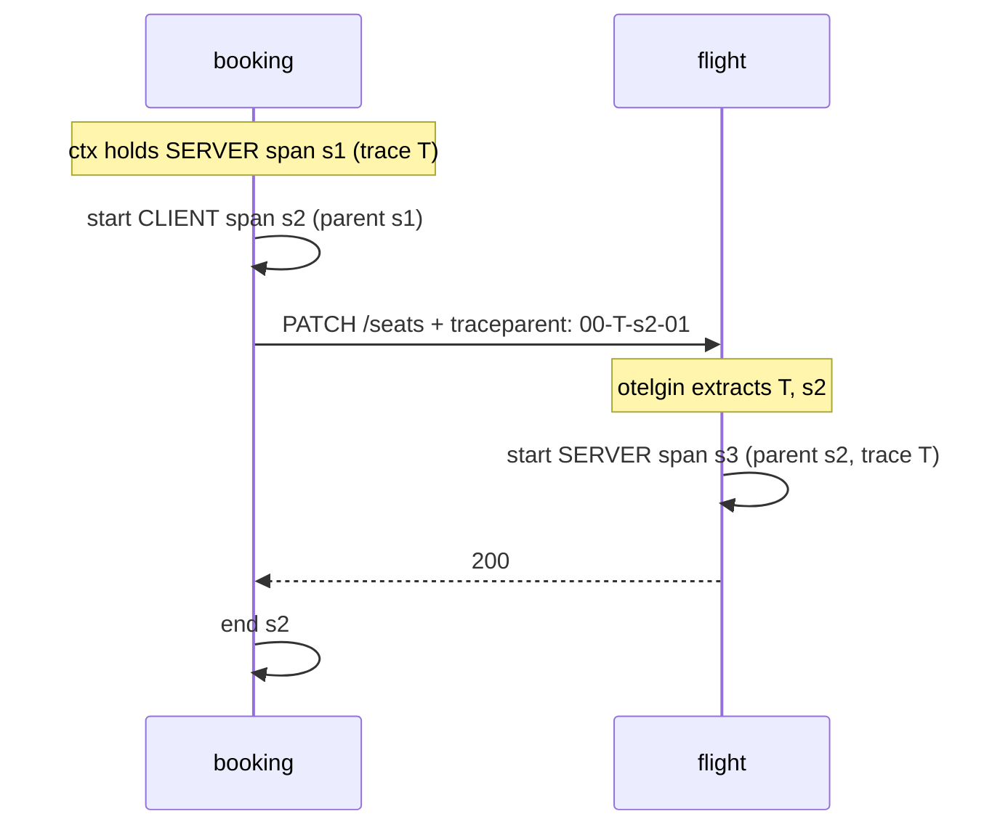
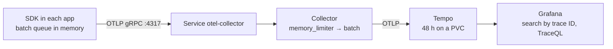

# Distributed traces

*Stage 6 · Mission Operations*

**You will be able to:** read a trace as a tree of spans, find where a request spent its time, explain how trace context travels inside a service and between services, recognise what breaks a trace in two, and say what a trace does not prove.

One booking touches booking, identity, flight twice, booking's database, and notification. If it takes two seconds, which step was slow? Each service's metrics show its own averages, and each service's logs show its own lines, but nothing says which lines belong to *this* booking or how the steps nested. A **trace** records one request's whole path, with timings, as a single object.

## Spans and traces

A **span** is one timed operation in one service. A **trace** is all the spans of one request, linked into a tree.

| Span field | Booking example |
|---|---|
| Trace ID (32 hex characters) | `4bf92f3577b34da6a3ce929d0e0e4736`, the same in every span of the request |
| Span ID (16 hex) | `00f067aa0ba902b7`, unique to this span |
| Parent span ID | The span that caused this one; empty for the root |
| Name | `POST /api/bookings` |
| Kind | `SERVER` (handling a request), `CLIENT` (making one), or `INTERNAL` |
| Start and end time | Duration follows from them |
| Attributes | `http.status_code: 201`, `http.route: /api/bookings`, … |
| Status | `OK`, `ERROR` or unset |
| Resource | `service.name: booking`, from `OTEL_SERVICE_NAME` |

## Reading a booking's trace

Apollo's Go services create two kinds of span: a `SERVER` span for every incoming request (the `otelgin` middleware) and a `CLIENT` span for every outgoing HTTP call (`callService`). Identity, in Python, also creates a span for each SQL query.

```text
booking   POST /api/bookings ......................................... 182 ms  SERVER
├─ booking   HTTP GET  identity/api/users/… ....... 14 ms                     CLIENT
│  └─ identity  GET /api/users/{id} ................ 11 ms                     SERVER
│     └─ identity  SELECT ........................... 2 ms                      CLIENT (SQL)
├─ booking   HTTP GET  flight/api/flights/… ......... 9 ms                     CLIENT
│  └─ flight    GET /api/flights/:id ................ 7 ms                     SERVER
├─ booking   HTTP PATCH flight/api/flights/…/seats  141 ms                    CLIENT
│  └─ flight    PATCH /api/flights/:id/seats ....... 138 ms                    SERVER
└─ booking   HTTP POST notification/api/notify ......... 6 ms (after response) CLIENT
   └─ notification  POST /api/notify .................... 4 ms                SERVER
```

The durations are an illustration; the shape is what `trace-test.sh` produces. How to read it:

- **Find the widest child.** 141 of 182 ms went to the seat update in flight. That is where to look next.
- **Mind the gaps.** Booking's span lasted 182 ms; its children cover about 164. The remaining 18 ms is booking's own work, including its `INSERT`. Booking's database calls are not instrumented, so they appear only as uncovered time.
- **A client span minus its server span is the network.** 141 − 138 = 3 ms between booking and flight.
- **Asynchronous work outlives its parent.** Booking sends the notification in a background goroutine after answering. Its spans start near the end of, or after, the root span. They still belong to the trace, but they did not delay the passenger.

## How context propagates

For spans in different processes to join one trace, the trace ID and the current span ID must travel with the request. That happens in two hops.

**Inside a process**, the current span lives in Go's `context.Context` (or Python's context variables). `otelgin` puts the server span into the request's context; `callService(c.Request.Context(), …)` reads it and starts a child. A function that starts from `context.Background()` instead starts with no parent, and its spans form a new trace. Booking's `logJSON` fallback has exactly that bug: it looks for a span in `context.Background()` and so never finds one ([How signals leave a service](./instrumenting-services#the-joins-between-signals)).

**Between processes**, the context rides in an HTTP header. OpenTelemetry uses the W3C **`traceparent`** header:

```text
traceparent: 00-4bf92f3577b34da6a3ce929d0e0e4736-00f067aa0ba902b7-01
             │  │                                │                └ flags: 01 = sampled
             │  │                                └ parent span ID: booking's CLIENT span
             │  └ trace ID
             └ version
```

Booking injects it with the configured propagator; the receiving service's middleware extracts it and makes its server span a child of booking's client span.



**Every hop must propagate.** If one service builds its outgoing request without the incoming context, the next service sees no `traceparent` and starts a **new trace**. In Tempo that looks like two unrelated traces: one that ends early, and one whose root is a server span in the middle of the chain.

Booking still sends `X-Request-ID` as well, for compatibility with earlier stages, but nothing in Stage 6 logs it.

## Sampling

Tracing every request costs CPU, network and storage. **Sampling** keeps a fraction:

| Kind | Decided | Example |
|---|---|---|
| Head sampling | At the root, before anything is known | Keep 10% of traces at random |
| Parent-based | Each service follows the `sampled` flag it receives | Keeps traces whole across services |
| Tail sampling | In a Collector, after the whole trace has arrived | Keep every slow or failed trace, 1% of the rest |

Apollo's Go services use `AlwaysSample`: every request is traced, regardless of the incoming flag. Identity uses the SDK default, which follows its parent. At lab traffic this is fine and every booking has a trace. At production traffic, a sampler is needed, and the consequence matters: **with sampling, not every request has a trace**, so "find the trace for this complaint" can come up empty.

## Getting spans to Tempo



1. The SDK queues finished spans in memory and exports them in batches. If the queue fills (the Collector is unreachable for long), new spans are **dropped**.
2. The Collector receives OTLP on 4317 (gRPC) and 4318 (HTTP), applies `memory_limiter` so a burst cannot crash it, batches for up to 2 s, and exports to Tempo.
3. **Tempo** stores traces by trace ID on local disk for `48h`. It does not index span attributes like a database; lookup by trace ID is direct, and Grafana's TraceQL searches scan recent blocks.

The Collector forwards what it receives. It cannot reconnect a trace that a service broke by not propagating. And tracing is **out of band**: if Tempo is down, bookings succeed and their spans are lost. Missing traces say something about the pipeline, not about the bookings.

## What a trace proves

- **Where time went** in one request, and which hop failed. That is strong evidence for a bottleneck.
- Not **why**. Flight's 138 ms seat update could be a lock, a slow disk or CPU throttling. Logs and metrics for flight answer that.
- Not **how common**. One slow trace may be an outlier; a metric says whether it is typical.
- Only for **traced** requests, and only within retention: after 48 hours, Tempo has nothing.

## Apollo example

| Setting | Value | Where |
|---|---|---|
| SDK | OpenTelemetry Go 1.47 (`otelgin`), Python 1.45 (FastAPI, requests, psycopg2) | each service's code |
| Propagators | W3C TraceContext + Baggage | `initOTEL` in each Go `main.go` |
| Sampler | `AlwaysSample` (Go); parent-based default (identity) | same |
| Endpoint | `otel-collector.apollo-observability.svc.cluster.local:4317` | app Deployment env |
| Span names | `HTTP <METHOD> <full URL>` for client spans | `callService` |
| Tempo | 2.3, local storage, `48h` retention | [`tempo/config.yaml`](https://github.com/darshan-raul/Apollo11/blob/f6211e679f8ed66a5a19033ac49a3bfc3a506eab/stages/stage6/helm/apollo11/templates/observability/tempo/config.yaml) |

The client span name includes the full URL, booking and flight IDs included. OpenTelemetry's conventions recommend a low-cardinality name (method and route template) and putting the URL in an attribute. In a trace viewer it reads fine; in any tool that groups spans by name, every ID becomes its own group.

## Try it

:::caution[Unverified]
Not yet run on a live cluster for this documentation revision. Needs Stage 6 with the traces substage installed. `trace-test.sh` creates a booking and cancels it.
:::

```bash
bash stages/stage6/scripts/trace-test.sh           # prints trace_id=… services=booking,flight,identity,notification
TRACE_ID=<paste the trace_id>

kubectl -n apollo-observability port-forward svc/tempo 13200:3100 >/dev/null &
sleep 2
curl -s localhost:13200/api/traces/$TRACE_ID | jq -r '
  .batches[] | (.resource.attributes[] | select(.key=="service.name") | .value.stringValue) as $svc
  | .scopeSpans[].spans[]
  | "\($svc)\t\(.kind)\t\(((.endTimeUnixNano|tonumber)-(.startTimeUnixNano|tonumber))/1e6 | floor) ms\t\(.name)"'
kill %1
```

- Every span shares one trace ID, across four services.
- Each `SPAN_KIND_CLIENT` span in booking has a matching server span in the service it called.
- Notification's spans are there, although booking had already answered when they ran.

## Common misconceptions

- **"Tracing is automatic once the SDK is installed."** Middleware covers incoming requests. Outgoing calls must carry the context, and anything uninstrumented shows up as a gap.
- **"A trace says why a request was slow."** It says where.
- **"Missing traces mean failed requests."** The pipeline may be down, or the request was not sampled.
- **"Spans after the root ends are a clock problem."** They are asynchronous work started by the request.
- **"The Collector can repair broken traces."** It forwards what it receives.

## Check yourself

<details>
<summary>Flight's spans appear as a separate trace, with a server span as their root. Likely cause?</summary>

The call into flight carried no `traceparent`: booking built that request without the incoming context, or did not inject the header.
</details>

<details>
<summary>Booking's server span is 300 ms; its children add up to 40 ms. Where did the rest go?</summary>

Into booking's own work: its uninstrumented database queries and its own code. Booking's logs and database metrics are the next place to look.
</details>

<details>
<summary>A passenger complains about a booking made three days ago. Can you find its trace?</summary>

No. Tempo keeps traces for 48 hours. Metrics (30 days) and logs (7 days) still cover that time.
</details>

## Where this leads

There are now three signals, each with its own store, retention and blind spots. [Correlating a booking](./correlating-a-booking) uses them together to go from "booking was slow" to a cause.

## References

- [OpenTelemetry: traces](https://opentelemetry.io/docs/concepts/signals/traces/) and [context propagation](https://opentelemetry.io/docs/concepts/context-propagation/)
- [W3C Trace Context](https://www.w3.org/TR/trace-context/)
- [OpenTelemetry sampling](https://opentelemetry.io/docs/concepts/sampling/)
- [Grafana Tempo](https://grafana.com/docs/tempo/latest/)
