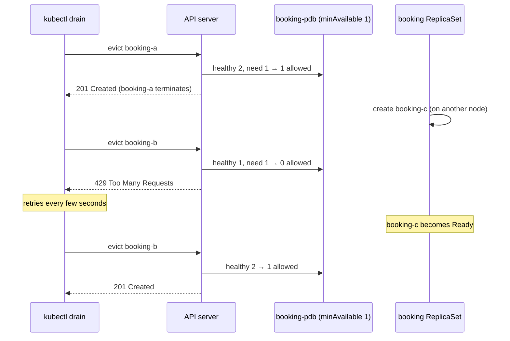

# Disruption budgets

*Stage 4 · Flight Control*

**You will be able to:** tell voluntary from involuntary disruptions, compute `disruptionsAllowed` from a budget, list the removals a PodDisruptionBudget cannot stop, and size a budget so maintenance can still finish.

Nodes need maintenance: kernel patches, Kubernetes upgrades, replacing hardware, an autoscaler removing a spare node. Each starts with **draining** the node: every Pod on it is evicted so its controller recreates it elsewhere. Nothing is broken, yet if both booking replicas sit on the drained node (Apollo's spread is only a [preference](./priority-and-spreading#topology-spread-balancing-replicas)), booking disappears until the replacements are Ready.

The cluster administrator does not know which Pods matter or how many of each can be missing. The application owner does. A **PodDisruptionBudget (PDB)** is how the owner tells the cluster: "during planned maintenance, never take away more than this many of these Pods at once."

## Voluntary and involuntary

A PDB only governs **voluntary disruptions** that go through the **Eviction API**: a request to remove a Pod that the API server may refuse.

| Goes through the Eviction API (PDB checked) | Does not (PDB ignored) |
|---|---|
| `kubectl drain` | Node crash, power loss, kernel panic, network partition |
| Cluster autoscaler removing a node | OOM kill, liveness restart |
| Managed node upgrades in the cloud | **Node-pressure eviction** by the kubelet |
| A direct `POST …/pods/<name>/eviction` | `kubectl delete pod`, scaling a Deployment down |
| | A Deployment's **rolling update** (it uses `maxUnavailable` instead) |
| | Preemption (best effort only) |

The right-hand column is long. A PDB is a contract about planned maintenance, not a promise of uptime.

## How an eviction is checked

`kubectl drain` first **cordons** the node (no new Pods), then asks the API server to evict each Pod on it. For every eviction request, the API server finds the PDBs whose selector matches the Pod and checks their budget:



An allowed eviction is an ordinary graceful termination ([Termination and draining](./termination-and-draining)): `preStop`, SIGTERM, grace period. A refused one changes nothing; the client must retry. `kubectl drain` retries until the budget allows it or its `--timeout` expires.

## Writing the budget

A PDB has a **selector**, which Pods it covers, and **one** of two fields:

```yaml
apiVersion: policy/v1
kind: PodDisruptionBudget
metadata: {name: booking-pdb, namespace: apollo-airlines-apps}
spec:
  minAvailable: 1                          # or: maxUnavailable: 1
  selector: {matchLabels: {app: booking}}
```

| Field | Meaning | With 2 replicas | With 5 replicas |
|---|---|---|---|
| `minAvailable: 1` | At least 1 must stay healthy | 1 may go | 4 may go |
| `maxUnavailable: 1` | At most 1 may be missing | 1 may go | 1 may go |
| `minAvailable: "50%"` | Percentage of expected Pods, **rounded up** | 1 must stay → 1 may go | 3 must stay → 2 may go |

`maxUnavailable` scales with the replica count automatically; `minAvailable` as a number does not. For a Deployment that may later scale up, `maxUnavailable: 1` is usually what was meant.

The PDB's status shows the arithmetic:

| Status field | Meaning |
|---|---|
| `expectedPods` | Replicas the owning controller wants |
| `currentHealthy` | Covered Pods that are **Ready** |
| `desiredHealthy` | The minimum that must stay healthy |
| `disruptionsAllowed` | `currentHealthy − desiredHealthy`, never below 0 |

Health means the Pod's `Ready` condition, so [readiness](./probes) feeds directly into the budget. A Pod failing readiness is not healthy, which lowers `disruptionsAllowed` for everyone else.

## How budgets block maintenance

A PDB slows maintenance in order to protect availability. Sized wrong, it stops maintenance altogether:

| Situation | Effect on a drain |
|---|---|
| `minAvailable` equals the replica count (for example 1 replica, `minAvailable: 1`) | `disruptionsAllowed` is always 0. The drain never finishes |
| The replacement Pod cannot be scheduled (no room, a [volume pinned to the drained node](./scheduling#apollo-example)) | The first eviction succeeds, the replacement stays `Pending`, `currentHealthy` never recovers, the second eviction is refused forever |
| Covered Pods are failing readiness (a crash loop, a dead dependency) | They count as unhealthy, so the budget allows nothing, even though evicting an already-broken Pod costs nothing |

The third row has a fix: `unhealthyPodEvictionPolicy: AlwaysAllow` lets Pods that are not Ready be evicted regardless of the budget. The default, `IfHealthyBudget`, only allows it while the budget is otherwise satisfied.

For a single-replica workload a PDB cannot give availability, only a veto. An administrator facing a stuck drain then has to remove the PDB or force-delete the Pod, and both skip the protection. Real protection needs more replicas.

## Apollo example

Stage 4 adds two budgets, both `minAvailable: 1` on two-replica Deployments:

| PDB | Covers | Allows |
|---|---|---|
| [`booking-pdb`](https://github.com/darshan-raul/Apollo11/blob/f6211e679f8ed66a5a19033ac49a3bfc3a506eab/stages/stage4/k8s/pdb/booking-pdb.yaml) | `app: booking` in `apollo-airlines-apps` | 1 eviction at a time |
| [`frontend-pdb`](https://github.com/darshan-raul/Apollo11/blob/f6211e679f8ed66a5a19033ac49a3bfc3a506eab/stages/stage4/k8s/pdb/frontend-pdb.yaml) | `app: frontend` in `apollo-airlines-ui` | 1 eviction at a time |

What the rest of the airline gets:

- **identity, flight, search, notification:** two replicas, no PDB. If both landed on the same worker, a drain evicts both at once and the service is gone until replacements are Ready.
- **Postgres and Redis:** one replica each, no PDB. A drain evicts the database, and because its `local-path` volume lives on that node, the replacement is `Pending` until the node is uncordoned. A `minAvailable: 1` PDB here would not help: it would just block the drain.

## Try it

:::caution[Unverified]
Not yet run on a live cluster for this documentation revision. Uses a throwaway namespace on any cluster, and the Eviction API rather than draining a real node.
:::

```bash
kubectl create namespace pdb-demo
kubectl -n pdb-demo create deployment web --image=busybox:1.36 --replicas=2 -- sleep 3600
kubectl -n pdb-demo create poddisruptionbudget web --selector=app=web --min-available=1
kubectl -n pdb-demo rollout status deploy/web
kubectl -n pdb-demo get pdb web                    # MIN AVAILABLE 1, ALLOWED DISRUPTIONS 1

evict() { kubectl create --raw "/api/v1/namespaces/pdb-demo/pods/$1/eviction" -f - <<JSON
{"apiVersion":"policy/v1","kind":"Eviction","metadata":{"name":"$1","namespace":"pdb-demo"}}
JSON
}
PODS=($(kubectl -n pdb-demo get pods -l app=web -o jsonpath='{.items[*].metadata.name}'))
evict ${PODS[0]}      # allowed
evict ${PODS[1]}      # refused: Cannot evict pod as it would violate the pod's disruption budget
kubectl -n pdb-demo rollout status deploy/web
evict ${PODS[1]}      # allowed now that the replacement is Ready

# A budget that allows nothing
kubectl -n pdb-demo patch pdb web --type=merge -p '{"spec":{"minAvailable":2}}'
kubectl -n pdb-demo get pdb web                    # ALLOWED DISRUPTIONS 0
P=$(kubectl -n pdb-demo get pods -l app=web -o jsonpath='{.items[0].metadata.name}')
evict $P              # refused, and would be refused forever

# A plain delete ignores the budget completely
kubectl -n pdb-demo delete pod $P                  # deleted
kubectl delete namespace pdb-demo
```

- The second eviction was refused until the first one's replacement was Ready: the budget held one healthy Pod at all times.
- `minAvailable: 2` with two replicas left zero allowed disruptions: a drain of this namespace's node would hang.
- `kubectl delete pod` never asked the budget.

## Common misconceptions

- **"A PDB protects against outages."** Only against voluntary evictions through the Eviction API.
- **"A PDB stops `kubectl delete pod` or a rollout."** Neither uses the Eviction API.
- **"Stricter is safer."** A budget that allows zero disruptions blocks every drain and upgrade.
- **"A PDB on a single-replica database keeps it available."** It can only refuse the eviction; there is no second copy to serve.
- **"Unready Pods don't count."** They count against the budget as unhealthy, which can block evictions.

## Check yourself

<details>
<summary>Two replicas, <code>minAvailable: 2</code>. What does a drain do?</summary>

It can never evict either Pod (0 allowed) and hangs. Use `minAvailable: 1` or `maxUnavailable: 1`.
</details>

<details>
<summary>Five replicas, <code>minAvailable: "50%"</code>. How many may be evicted at once?</summary>

50% of 5 is 2.5, rounded up to 3 that must stay, so 2 may be evicted at once.
</details>

<details>
<summary>A drain evicted one booking Pod and now hangs. The replacement is <code>Pending</code>. Why?</summary>

The replacement cannot be scheduled (for example `Insufficient cpu` on the remaining node), so only one booking Pod is healthy and `minAvailable: 1` refuses the second eviction. Free capacity and the drain continues.
</details>

<details>
<summary>Why does a booking rolling update not consult booking's PDB?</summary>

A Deployment replaces Pods by scaling ReplicaSets, which deletes Pods directly. Its own `maxUnavailable` limits the pace instead.
</details>

## Where this leads

Stage 4 made Apollo careful at every edge of a Pod's life: starting, serving, stopping, competing for room and surviving maintenance. It also left 53 YAML files with the same numbers copied into each. [Stage 5](../../missions/payload-integration) packages them, so a release can be shipped, promoted and rolled back as one unit.

## References

- [Disruptions](https://kubernetes.io/docs/concepts/workloads/pods/disruptions/)
- [Specifying a disruption budget](https://kubernetes.io/docs/tasks/run-application/configure-pdb/)
- [API-initiated eviction](https://kubernetes.io/docs/concepts/scheduling-eviction/api-eviction/)
- [Safely drain a node](https://kubernetes.io/docs/tasks/administer-cluster/safely-drain-node/)
