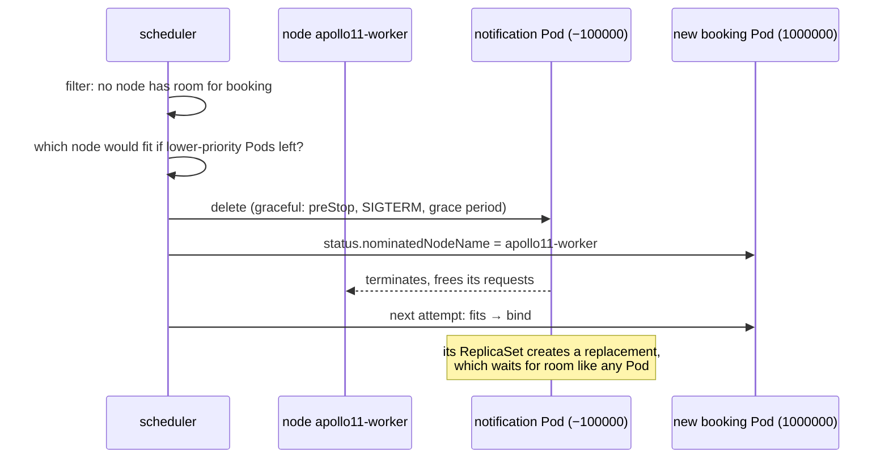

# Priority and spreading

*Stage 4 · Flight Control*

**You will be able to:** explain what a PriorityClass changes in scheduling, preemption and eviction; walk through a preemption; compute skew for a topology spread constraint; and avoid the two counting traps that leave spread replicas `Pending` or bunched together.

[Scheduling](./scheduling) answered "which nodes *can* run this Pod?". Two questions are left over:

- **When there is not enough room, who gets it?** In a full cluster a new booking Pod sits `Pending` while notification Pods, which matter far less to a passenger, keep their places. Nothing in Stages 1–3 says booking matters more.
- **Where do the replicas end up?** Two booking replicas survive one Pod crashing. They do not survive one *node* failing if both sit on that node.

Both are placement decisions, but they are independent: priority is about **who**, spreading is about **where**.

## PriorityClass: a named number

A **PriorityClass** is a cluster-scoped object that gives a name to an integer. A Pod refers to it by name; at admission, the API server copies the number into the Pod's `spec.priority`. A higher number means more important.

```yaml
# stages/stage4/k8s/config/priorityclass.yaml
apiVersion: scheduling.k8s.io/v1
kind: PriorityClass
metadata: {name: apollo-airlines-app-critical}
value: 1000000              # booking, search
globalDefault: false
---
apiVersion: scheduling.k8s.io/v1
kind: PriorityClass
metadata: {name: apollo-airlines-app-low}
value: -100000              # notification
globalDefault: false
```

| Value | Who |
|---|---|
| 2,000,001,000 | `system-node-critical`: kube-proxy and other per-node essentials |
| 2,000,000,000 | `system-cluster-critical`: CoreDNS and similar |
| up to 1,000,000,000 | User-defined classes |
| 1,000,000 | Apollo booking, search |
| 0 | Any Pod without a class (unless one class sets `globalDefault: true`) |
| −100,000 | Apollo notification |

A Pod naming a class that does not exist is **rejected** at creation, which is why Stage 4's `apply.sh` creates the PriorityClasses before any workload.

## Three things priority changes

| Where | Effect |
|---|---|
| Scheduling queue | Higher-priority Pods are tried first |
| **Preemption** | If no node fits a Pod, the scheduler may evict lower-priority Pods to make room |
| Node-pressure eviction | Among Pods over their requests, lower priority is evicted first ([Requests, limits and pressure](./requests-limits-and-pressure#when-a-node-runs-short)) |

Priority does **not** give a Pod more CPU or memory, and does not make it start faster once bound. Resources come from requests and limits.

### A preemption, step by step



1. Filtering finds no node for booking.
2. The scheduler looks for a node where removing some **lower-priority** Pods would make booking fit, choosing the set whose removal does the least damage. It prefers victims whose loss does not break a [PodDisruptionBudget](./disruption-budgets), but will break one if there is no other way.
3. The victims are deleted **gracefully**: their `preStop` hooks and grace periods are honoured. Preemption is not instant.
4. Booking records the chosen node in `status.nominatedNodeName` and is bound once the room exists. (If room appears on another node first, it may go there instead.)
5. The victims' controllers create replacements. Those are ordinary `Pending` Pods now, and may wait for a long time.

A class with `preemptionPolicy: Never` keeps the queue-order benefit but never evicts anyone.

## Topology spread: balancing replicas

A **topology** is a way of grouping nodes, named by a node label (the **topology key**). Each distinct value of the label is a **domain**:

| `topologyKey` | One domain is | Protects against |
|---|---|---|
| `kubernetes.io/hostname` | One node | A node failing or being drained |
| `topology.kubernetes.io/zone` | One zone (cloud only) | A data-centre zone failing ([Stage 9](../../stage-9)) |

A **topology spread constraint** tells the scheduler to keep the number of matching Pods balanced across domains:

```yaml
# stages/stage4/k8s/apps/booking/booking-dep.yaml
topologySpreadConstraints:
  - maxSkew: 1                           # domain counts may differ by at most 1
    topologyKey: kubernetes.io/hostname  # domain = one node
    whenUnsatisfiable: ScheduleAnyway    # a preference, not a filter
    labelSelector: {matchLabels: {app: booking}}   # which Pods to count
```

**Skew** for a candidate node = (matching Pods in that node's domain, counting the new one) − (the fewest matching Pods in any eligible domain).

Counting only the two workers (see the first trap below for why that matters):

| booking Pods on worker / worker2 | Third Pod goes to | Resulting skew | Within `maxSkew: 1`? |
|---|---|---|---|
| 1 / 1 | either | 2 − 1 = 1 | Yes |
| 2 / 0 (lopsided start) | worker | 3 − 0 = 3 | No |
| 2 / 0 | worker2 | 1 − 0 = 1 | Yes: the scheduler prefers this |

`whenUnsatisfiable` decides what a violation means:

| Value | Phase | When the rule cannot be met |
|---|---|---|
| `DoNotSchedule` | Filter | The Pod stays `Pending` |
| `ScheduleAnyway` | Score | The Pod is placed anyway, on the least-bad node |

Even with no constraint at all, the scheduler applies a weak built-in preference to spread Pods of the same Service or controller across nodes. It competes with every other score, so it often loses. Write an explicit constraint when the spread matters.

### Two counting traps

**The tainted control plane counts as an empty domain.** By default (`nodeTaintsPolicy: Ignore`), every node with the topology key counts as a domain, including nodes the Pod could never run on. On kind, the control plane has zero booking Pods forever, so the minimum is always 0. With `DoNotSchedule` and `maxSkew: 1`, two workers can then hold only one replica each: a third replica stays `Pending`. Set `nodeTaintsPolicy: Honor` so only nodes whose taints the Pod tolerates count. Stage 7's search constraint does exactly this, with a comment explaining why.

**Old and new replicas are counted together.** During a rolling update, `labelSelector: {app: booking}` matches Pods of both the old and the new ReplicaSet. The new Pods are placed to balance the *combined* count, so once the old Pods are gone the new ones can be lopsided. `matchLabelKeys: [pod-template-hash]` adds each Pod's own template hash to the selector, so each ReplicaSet's Pods are balanced on their own.

### Spread is decided once

Like every placement rule, spreading is checked **only when a Pod is scheduled**. If a node is drained and comes back empty, the replicas that moved stay where they are. Rebalancing needs Pods to be replaced: a rollout, or a tool such as the descheduler.

### Spread versus anti-affinity

**Pod anti-affinity** is the older way to keep replicas apart: "do not schedule on a node that already runs a Pod matching this selector". Required anti-affinity on `hostname` means at most one replica per node, so a third booking replica on two workers could never run. Spread constraints express "balanced" rather than "never together", and handle more replicas than domains.

## Choosing a tool

| Goal | Tool |
|---|---|
| Booking wins when capacity is short | PriorityClass |
| Replicas on different nodes | Topology spread on `hostname` |
| Replicas in different zones | Topology spread on `zone` |
| Keep other workloads off a node | Taint ([Scheduling](./scheduling#pushing-taints-and-tolerations)) |
| Limit how many replicas maintenance removes at once | [PodDisruptionBudget](./disruption-budgets) |

## Apollo example

| Workload | Priority | Spread |
|---|---|---|
| booking, search | `apollo-airlines-app-critical` (1,000,000) | `hostname`, `maxSkew: 1`, `ScheduleAnyway` |
| identity, flight, frontend | default (0) | same |
| notification | `apollo-airlines-app-low` (−100,000) | same |
| Postgres, Redis | default (0) | none: one replica each |

Why `ScheduleAnyway`: with two workers and two replicas, a full or drained worker would leave a `DoNotSchedule` replica `Pending`. Two replicas on one node beat one replica. The price is that Apollo's spread is a preference: check the `NODE` column rather than assume.

## Try it

:::caution[Unverified]
Not yet run on a live cluster for this documentation revision. Needs a kind cluster with one tainted control plane and two workers, such as Ignition's. Uses a throwaway namespace.
:::

Watch the control-plane trap, then fix it:

```bash
kubectl create namespace spread-demo
cat > /tmp/spread.yaml <<'EOF'
apiVersion: apps/v1
kind: Deployment
metadata: {name: web}
spec:
  replicas: 4
  selector: {matchLabels: {app: web}}
  template:
    metadata: {labels: {app: web}}
    spec:
      topologySpreadConstraints:
        - maxSkew: 1
          topologyKey: kubernetes.io/hostname
          whenUnsatisfiable: DoNotSchedule
          labelSelector: {matchLabels: {app: web}}
      containers:
        - {name: app, image: busybox:1.36, command: ["sleep", "3600"]}
EOF
kubectl -n spread-demo apply -f /tmp/spread.yaml
sleep 15
kubectl -n spread-demo get pods -o wide        # 2 Running (one per worker), 2 Pending
kubectl -n spread-demo describe pod $(kubectl -n spread-demo get pods --field-selector status.phase=Pending -o name | head -1) \
  | grep -A2 FailedScheduling                  # ... didn't match pod topology spread constraints

# Count only nodes the Pods can run on
kubectl -n spread-demo patch deploy web --type=json \
  -p '[{"op":"add","path":"/spec/template/spec/topologySpreadConstraints/0/nodeTaintsPolicy","value":"Honor"}]'
kubectl -n spread-demo rollout status deploy/web
kubectl -n spread-demo get pods -o wide        # 4 Running, 2 per worker

kubectl get priorityclass                      # the two system classes, plus Apollo's if Stage 4 is applied
kubectl delete namespace spread-demo
```

- With the default policy, the control plane counted as a domain with 0 Pods, so each worker could hold only one before skew reached 2.
- With `Honor`, only the two workers counted, and four replicas balanced two and two.

## Common misconceptions

- **"Priority gives a Pod more resources."** It changes queue order, preemption and eviction order only.
- **"Preemption moves the victim elsewhere."** It deletes it; its controller makes a new one, which may stay `Pending`.
- **"Spread guarantees separate nodes."** `ScheduleAnyway` does not; `DoNotSchedule` does, at the price of `Pending` replicas.
- **"Only nodes the Pod can use count for skew."** By default, tainted nodes count too.
- **"The scheduler rebalances later."** Placement is decided once.

## Check yourself

<details>
<summary>The cluster is full and a new booking Pod is created. What happens to notification?</summary>

The scheduler can preempt notification Pods (−100,000) on a node where removing them frees enough room for booking (1,000,000). They are terminated gracefully, booking is bound, and notification's ReplicaSet creates replacements that wait for room.
</details>

<details>
<summary>Why does Apollo use <code>ScheduleAnyway</code> rather than <code>DoNotSchedule</code>?</summary>

With two workers, one full or drained worker would leave the second replica `Pending`. Two replicas on one node are better than one replica.
</details>

<details>
<summary>Three replicas, two workers, a tainted control plane, <code>DoNotSchedule</code>, <code>maxSkew: 1</code>, default policies. Where do they go?</summary>

One on each worker; the third stays `Pending`, because the control plane counts as a domain with 0 Pods and either worker would reach skew 2. `nodeTaintsPolicy: Honor` fixes it.
</details>

## Where this leads

Priority decides who keeps a place under pressure, and spreading decides where replicas sit. Neither stops a planned drain from evicting both booking replicas at once. That is the job of [Disruption budgets](./disruption-budgets).

## References

- [Pod priority and preemption](https://kubernetes.io/docs/concepts/scheduling-eviction/pod-priority-preemption/)
- [Pod topology spread constraints](https://kubernetes.io/docs/concepts/scheduling-eviction/topology-spread-constraints/)
- [Inter-pod affinity and anti-affinity](https://kubernetes.io/docs/concepts/scheduling-eviction/assign-pod-node/#inter-pod-affinity-and-anti-affinity)
