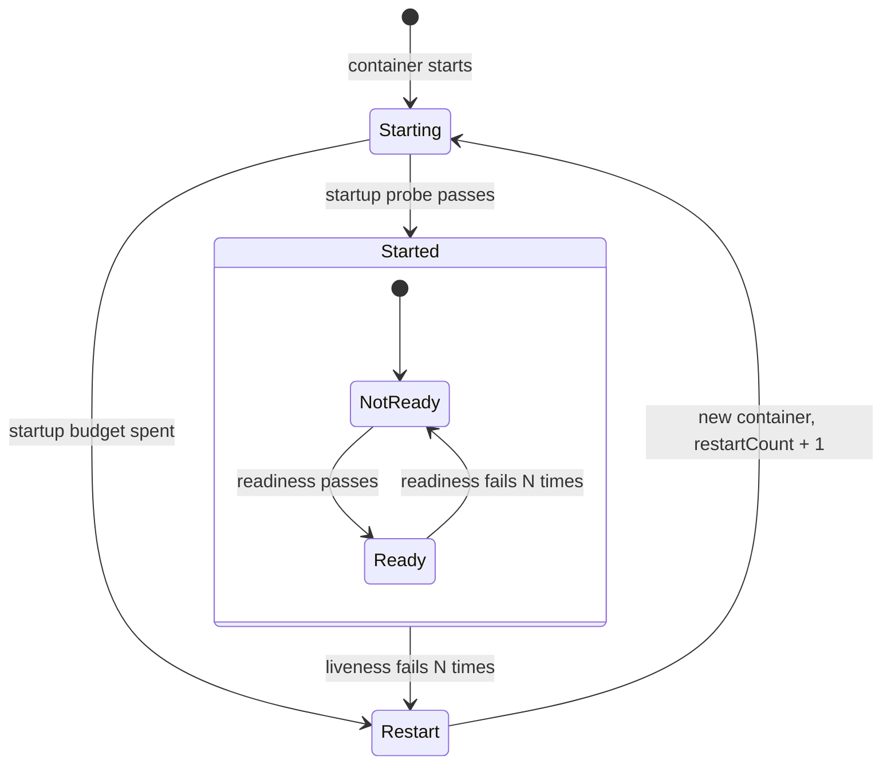

# Probes: startup, liveness and readiness

*Stage 4 · Flight Control*

**You will be able to:** choose the right probe for a question, size a startup budget, predict what the kubelet does when each probe fails, and keep a dependency outage from turning into a restart storm.

Until now, Kubernetes knew one fact about a container: whether its process was running. Stage 1's [readiness, briefly](../workloads/services-and-readiness#readiness-decides-who-gets-traffic) added a single check. Stage 4 needs more, because "running" hides three different situations, and each needs a different reaction:

| Situation | Process running? | Right reaction |
|---|---|---|
| Booking is still starting: loading config, opening its database pool | Yes | **Wait.** Don't send traffic, don't kill it |
| Booking is deadlocked: the process exists but answers nothing | Yes | **Restart** the container |
| Booking is fine, but `booking-db` is down | Yes | **Stop sending traffic** until the database returns. A restart fixes nothing |

A single yes/no check cannot tell these apart. Kubernetes offers three probes, one per question.

## What a probe is

A **probe** is a small check the **kubelet** (the agent on each node) runs against one container on a timer. The kubelet itself decides the outcome. No controller or Service is involved in running it.

| Mechanism | Succeeds when | Apollo uses it for |
|---|---|---|
| `httpGet` | The response status is 200–399 | All six application services |
| `exec` | The command exits `0` | `pg_isready` in Postgres, `redis-cli ping` in Redis |
| `tcpSocket` | A TCP connection opens | Not used |
| `grpc` | The gRPC health service answers `SERVING` | Not used |

An `httpGet` probe is sent by the kubelet on the node straight to the **Pod IP**, not through the Service or the Gateway. A probe can pass while the route from outside is broken, and the reverse.

## Three questions, three reactions

| Probe | Question | On repeated failure | While failing |
|---|---|---|---|
| **startup** | Has the app finished starting? | Kill and restart the container once the budget is spent | Liveness and readiness **do not run** |
| **liveness** | Is the process stuck beyond self-repair? | **Restart** the container (same Pod) | Pod stays in endpoints if it is still Ready |
| **readiness** | Should this Pod get new requests right now? | Nothing is restarted | Pod's `Ready` condition is `False`; it is marked not-ready in EndpointSlices, so Services and the Gateway stop sending it requests |



Readiness never stops: it runs for the container's whole life. A Pod can go Ready, NotReady and Ready again any number of times without a restart.

## From samples to actions

A single failed sample is not a verdict. These fields turn samples into a decision:

| Field | Default | Meaning |
|---|---|---|
| `initialDelaySeconds` | 0 | Wait after the container starts before the first sample |
| `periodSeconds` | 10 | Time between samples |
| `timeoutSeconds` | 1 | A sample that takes longer counts as a failure |
| `failureThreshold` | 3 | **Consecutive** failures before the kubelet acts |
| `successThreshold` | 1 | Consecutive successes to count as passing again (must be 1 for liveness and startup) |

Two numbers worth computing for every container:

- **Startup budget** = `initialDelaySeconds + periodSeconds × failureThreshold`. Apollo's apps: 0 + 5 × 6 = **30 s** to start before the kubelet gives up.
- **Time to react** = roughly `periodSeconds × failureThreshold`. Apollo's liveness: 10 × 3 = about **30 s** of hanging before a restart. Readiness: 5 × 3 = about **15 s** of failures before traffic stops.

The default 1-second timeout is easy to forget. A container at its CPU limit is throttled ([Requests, limits and pressure](./requests-limits-and-pressure)), and a probe that is answered in 1.2 s counts as a failure. Slow, not dead, can look like dead.

### Why the startup probe exists

Without one, liveness has to guess the start time with `initialDelaySeconds`. Guess too short, and a slow start (a cold image cache, a busy node, a database that takes a while) looks like a hang: liveness kills the container at second 15, it starts again, gets killed again, and lands in `CrashLoopBackOff` with nothing wrong. Guess too long, and every genuine hang after start is detected late.

A startup probe separates the two questions. It allows a generous start without slowing hang detection later: once it passes, liveness takes over with its own, tighter numbers.

### What a restart costs

A liveness restart is not free. The kubelet backs off between restarts of the same container: 10 s, 20 s, 40 s, up to five minutes. The state that shows meanwhile is `CrashLoopBackOff`. The Pod keeps its name, IP and `emptyDir` volumes, but the container's memory is gone ([Ephemeral state](../workloads/ephemeral-state#two-kinds-of-it-came-back)).

## What each probe should check

The most common probe mistake is checking a dependency in the wrong probe.

| Probe | Should check | Must not check |
|---|---|---|
| startup | "My own initialization has finished" | Anything slow that is not needed to serve |
| liveness | "My own process can still answer" | **Databases, caches, other services** |
| readiness | "I can do useful work now", including what I *cannot* work without | Services I can degrade without; anything shared by every replica unless losing it truly means no service |

Put a database check in liveness and a database outage restarts every replica, repeatedly. The restarts fix nothing, the backoff grows, and when the database returns the service is still in `CrashLoopBackOff`. Put a neighbouring service in readiness, and one slow neighbour takes every replica out of rotation: the outage spreads along the call graph. Stage 3's booking `/readyz` did exactly that, calling identity, flight and notification.

## Apollo example

From [Stage 4's booking Deployment](https://github.com/darshan-raul/Apollo11/blob/f6211e679f8ed66a5a19033ac49a3bfc3a506eab/stages/stage4/k8s/apps/booking/booking-dep.yaml); the other five apps use the same numbers:

```yaml
startupProbe:
  httpGet: {path: /healthz/startup, port: 8082}
  periodSeconds: 5
  failureThreshold: 6          # 30 s to start
livenessProbe:
  httpGet: {path: /healthz/live, port: 8082}
  initialDelaySeconds: 15      # counted from container start; liveness waits for startup anyway
  periodSeconds: 10
  failureThreshold: 3          # ~30 s of hanging → restart
readinessProbe:
  httpGet: {path: /healthz/ready, port: 8082}
  initialDelaySeconds: 5
  periodSeconds: 5
  failureThreshold: 3          # ~15 s of failures → out of endpoints
```

| Service | `/healthz/ready` checks | Why |
|---|---|---|
| booking, flight, identity | Their own Postgres | Every request needs it |
| notification | Redis | It stores notifications there |
| search, frontend | Nothing: always 200 | Search reads from flight; the frontend serves static files |
| Postgres, Redis StatefulSets | `pg_isready` / `redis-cli ping` (exec, no startup probe) | The server refuses connections until it has initialized, so readiness already covers start-up |

`/healthz/startup` and `/healthz/live` return 200 as soon as the HTTP server answers. The older `/readyz` is kept as an alias of `/healthz/ready` so earlier stages' smoke tests still pass; in Stage 4 it no longer calls other services.

## Try it

:::caution[Unverified]
Not yet run on a live cluster for this documentation revision. Uses a throwaway namespace on any cluster.
:::

A container whose liveness and readiness are controlled by two files. Removing a file makes that probe fail:

```bash
kubectl create namespace probe-demo
kubectl -n probe-demo apply -f - <<'EOF'
apiVersion: v1
kind: Pod
metadata: {name: probed, labels: {app: probed}}
spec:
  containers:
    - name: app
      image: busybox:1.36
      command: ["sh", "-c", "touch /tmp/alive /tmp/ready; sleep 3600"]
      livenessProbe:
        exec: {command: ["cat", "/tmp/alive"]}
        periodSeconds: 5
        failureThreshold: 3
      readinessProbe:
        exec: {command: ["cat", "/tmp/ready"]}
        periodSeconds: 2
        failureThreshold: 2
---
apiVersion: v1
kind: Service
metadata: {name: probed}
spec:
  selector: {app: probed}
  ports: [{port: 80}]
EOF
kubectl -n probe-demo wait --for=condition=Ready pod/probed

# 1. Readiness fails: out of the Service, not restarted
kubectl -n probe-demo exec probed -- rm /tmp/ready
sleep 8
kubectl -n probe-demo get pod probed                      # 0/1 Running, RESTARTS 0
kubectl -n probe-demo get endpointslice -l kubernetes.io/service-name=probed \
  -o jsonpath='{.items[0].endpoints[0].conditions}'; echo  # "ready":false

# 2. Liveness fails: restarted in place
kubectl -n probe-demo exec probed -- rm /tmp/alive
sleep 25
kubectl -n probe-demo get pod probed                      # 1/1 Running, RESTARTS 1
kubectl -n probe-demo get events --field-selector involvedObject.name=probed | grep -E 'Unhealthy|Killing'

kubectl delete namespace probe-demo
```

- Removing `/tmp/ready` took the Pod out of the Service's endpoints and left `RESTARTS` at 0.
- Removing `/tmp/alive` restarted the container. The new container ran its command again, recreated both files, and became Ready: same Pod, new container.

## Common misconceptions

- **"Readiness fails, so Kubernetes restarts it."** Only liveness and an exhausted startup probe restart. Readiness withholds traffic.
- **"One failed probe triggers action."** Only `failureThreshold` consecutive failures do.
- **"A thorough liveness check is safer."** Checking dependencies in liveness turns their outages into restart storms.
- **"The probe tests the same path a user takes."** The kubelet calls the Pod IP directly, skipping the Service, the Gateway and TLS.
- **"Ready means everything works."** It means that check passed at that moment.

## Check yourself

<details>
<summary>Readiness fails and <code>RESTARTS</code> stays 0. Is that a bug?</summary>

No. Readiness failure only removes the Pod from endpoints. A dependency is probably down; the process is fine.
</details>

<details>
<summary>An app needs up to 50 s to start. Liveness has <code>periodSeconds: 10</code>, <code>failureThreshold: 3</code>, no startup probe, no initial delay. What happens?</summary>

Liveness fails three times by about 30 s and the container is restarted before it ever finishes starting, over and over. Add a startup probe with a budget above 50 s (for example 5 s × 12).
</details>

<details>
<summary>Why would putting <code>db.Ping()</code> in booking's liveness probe make a database outage worse?</summary>

Every booking replica would restart repeatedly during the outage, enter growing restart backoff, and recover only slowly after the database returns. A restart cannot fix the database.
</details>

<details>
<summary>A probe with the default timeout fails only under load. What is a likely cause?</summary>

The container is CPU-throttled at its limit, so the handler answers after more than 1 s, which counts as a failure.
</details>

## Where this leads

Probes govern how a container starts and serves. Its last moments need the same care: [Termination and draining](./termination-and-draining) follows a Pod from "please stop" to gone, without dropping requests on the way.

## References

- [Liveness, readiness and startup probes](https://kubernetes.io/docs/concepts/configuration/liveness-readiness-startup-probes/)
- [Configure probes](https://kubernetes.io/docs/tasks/configure-pod-container/configure-liveness-readiness-startup-probes/)
- [Container restart policy and backoff](https://kubernetes.io/docs/concepts/workloads/pods/pod-lifecycle/#restart-policy)
