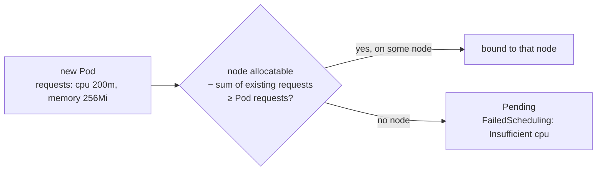
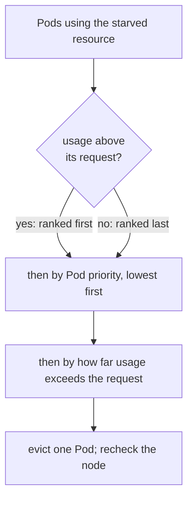

# Requests, limits and pressure

*Stage 4 · Flight Control*

**You will be able to:** say which component reads a request and which enforces a limit, explain why a container is throttled or OOM-killed, derive a Pod's QoS class, and predict which Pods a node evicts first when it runs short of memory.

Every Pod on a node shares that node's CPU and memory. Up to Stage 3, no Apollo Pod declared what it needed. The scheduler placed them blind, and a memory leak in notification could starve `booking-db` on the same node. Two separate questions need answers, and people often expect one setting to answer both:

- **Before the Pod starts:** which node has room for it?
- **While it runs:** what stops it from taking more than its share?

**Requests** answer the first; **limits** answer the second.

## Units

| Resource | Unit | Examples |
|---|---|---|
| CPU | Cores; `m` is a thousandth of a core | `100m` = 0.1 core, `1` = one core (or one hyperthread) |
| Memory | Bytes, with binary (`Ki`, `Mi`, `Gi`) or decimal (`k`, `M`, `G`) suffixes | `128Mi` = 134,217,728 bytes; `128M` = 128,000,000 bytes |

Watch the case: memory `128m` means 0.128 **bytes**. The API accepts it, and the container cannot start.

## Requests reserve, limits cap

| | `requests` | `limits` |
|---|---|---|
| Read by | The **scheduler**, when placing the Pod; the kubelet when ranking evictions; the HPA (Stage 7) | The **kernel**, through the container's cgroup, all the time |
| CPU at runtime | A **share** under contention: a container with twice the request gets twice the CPU when the node is busy | A hard **quota**: above it the container is **throttled** (paused until the next period) |
| Memory at runtime | Used in eviction ranking | A hard ceiling: above it the kernel **OOM-kills** a process in the container |
| If omitted | Defaults to the limit if a limit is set, otherwise zero | No ceiling, up to what the node has |

CPU is **compressible**: a throttled process just runs slower, and gets CPU back next period. Memory is **incompressible**: memory a process holds cannot be taken back without killing something.

### How the scheduler uses requests

Each node publishes its **allocatable** capacity: its total, minus what is reserved for the operating system and the kubelet, minus an eviction margin. The scheduler adds up the **requests** of every Pod already bound to the node and places a new Pod only if its own requests still fit.



Actual usage plays no part. A node whose CPUs are idle can be **full** because its requests are booked, and a node running hot can accept more Pods because its Pods requested little. Requests are a promise the scheduler keeps on paper.

### How the kernel enforces limits

**CPU.** A CPU limit becomes a quota per 100 ms period. Booking's `200m` means 20 ms of CPU time in each 100 ms. A multi-threaded process can spend those 20 ms in the first few milliseconds, across several threads, and then sit frozen for the rest of the period. The average looks low; individual requests see latency spikes. A health check that lands in the frozen window can miss its 1-second timeout ([Probes](./probes#from-samples-to-actions)).

**Memory.** When the container's memory use reaches its limit and nothing can be reclaimed, the kernel's OOM killer ends a process in the container, normally the biggest. If that is the main process, the container exits with code `137` and reason `OOMKilled`, and the kubelet restarts it in the same Pod. A leak therefore shows up as a climbing restart count, not as a slow node.

## QoS classes

From the numbers you set, Kubernetes derives each Pod's **Quality of Service class**. You never set it directly.

| Class | Rule | Effect |
|---|---|---|
| `Guaranteed` | Every container has CPU and memory limits, and requests equal to them | Least likely to be evicted or OOM-killed; cannot burst above its limit |
| `Burstable` | At least one request or limit set, but not `Guaranteed` | Can use idle capacity above its request; at risk once above it |
| `BestEffort` | No requests or limits anywhere in the Pod | Uses whatever is free; first to go |

The class matters in two places: when the **kubelet** chooses which Pod to evict, and when the **kernel** chooses a process to kill because the whole node ran out of memory before the kubelet could act (the class sets each container's OOM score: `Guaranteed` lowest, `BestEffort` highest).

## When a node runs short

The kubelet watches the node's free memory, disk and process IDs against **eviction thresholds** (by default, for example, less than 100 Mi of memory available). Crossing one sets a node condition such as `MemoryPressure`, which steers new Pods away from the node, and starts **node-pressure eviction**: the kubelet stops Pods, one at a time, until the node is back above the threshold.

It ranks candidates in this order:



1. **Is the Pod using more than it requested?** Those go first. A `BestEffort` Pod requested nothing, so any usage is above its request.
2. **Priority:** lower [PriorityClass](./priority-and-spreading) values go first.
3. **How far over its request** it is: the biggest overshoot goes first.

A `Guaranteed` Pod never uses more than it requested, so it lands at the back of the queue. It is evicted last, not never. An evicted Pod is not restarted on the same node: it is marked `Failed` with reason `Evicted`, and its controller creates a replacement, which the scheduler places elsewhere. Node-pressure eviction does not consult [PodDisruptionBudgets](./disruption-budgets).

### Disk counts too

Container writable layers, logs and `emptyDir` volumes all use the node's disk. A container can declare `ephemeral-storage` requests and limits like CPU and memory; exceeding the limit gets the Pod evicted. Without them, one chatty logger can put a node under `DiskPressure` and evict its neighbours. (kind relaxes the disk thresholds so a full laptop disk does not empty the cluster, so you are unlikely to see this locally.)

### Namespace guard rails

Two objects can enforce good habits for a whole namespace. Apollo does not use them yet:

| Object | Does |
|---|---|
| **LimitRange** | Supplies default requests and limits to containers that set none, and minimums and maximums |
| **ResourceQuota** | Caps the namespace's total requests and limits (and object counts); Pods without requests are then rejected |

## Apollo example

Every Stage 4 container sets `requests == limits`, so all ten workloads are `Guaranteed`. From [booking's Deployment](https://github.com/darshan-raul/Apollo11/blob/f6211e679f8ed66a5a19033ac49a3bfc3a506eab/stages/stage4/k8s/apps/booking/booking-dep.yaml):

```yaml
resources:
  requests: {cpu: 200m, memory: 256Mi}   # the scheduler reserves this
  limits:   {cpu: 200m, memory: 256Mi}   # the kernel enforces this
```

| Tier | Workloads | Per Pod | Pods | Total requested |
|---|---|---|---|---|
| Flagship | booking | 200m / 256Mi | 2 | 400m / 512Mi |
| Default | identity, flight, search | 100m / 128Mi | 6 | 600m / 768Mi |
| Low and UI | notification, frontend | 50m / 64Mi | 4 | 200m / 256Mi |
| Data | three Postgres | 200m / 256Mi | 3 | 600m / 768Mi |
| Cache | redis | 100m / 128Mi | 1 | 100m / 128Mi |
| | | | **16** | **1.9 cores / 2.4 Gi** |

That total is what the airline books, before the Envoy Gateway, MetalLB and the system Pods. The numbers are informed guesses: `Guaranteed` buys predictability at the cost of bursting, and a 200m limit can throttle booking under load. Stage 7 [measures real usage](../scaling/measurement-baseline) before changing them.

## Try it

:::caution[Unverified]
Not yet run on a live cluster for this documentation revision. Uses a throwaway namespace on any cluster.
:::

```bash
kubectl create namespace res-demo
kubectl -n res-demo apply -f - <<'EOF'
apiVersion: v1
kind: Pod
metadata: {name: huge}             # requests more CPU than any node has
spec:
  containers:
    - {name: app, image: busybox:1.36, command: ["sleep", "3600"],
       resources: {requests: {cpu: "100"}}}
---
apiVersion: v1
kind: Pod
metadata: {name: hog}              # grows its memory until killed
spec:
  containers:
    - {name: app, image: busybox:1.36, command: ["tail", "/dev/zero"],
       resources: {limits: {memory: 32Mi}}}
---
apiVersion: v1
kind: Pod
metadata: {name: spin}             # burns CPU against a 100m limit
spec:
  containers:
    - {name: app, image: busybox:1.36, command: ["sh", "-c", "while :; do :; done"],
       resources: {requests: {cpu: 100m, memory: 16Mi}, limits: {cpu: 100m, memory: 16Mi}}}
---
apiVersion: v1
kind: Pod
metadata: {name: free}             # no resources at all
spec:
  containers:
    - {name: app, image: busybox:1.36, command: ["sleep", "3600"]}
EOF
sleep 30
kubectl -n res-demo get pods -o custom-columns=NAME:.metadata.name,STATUS:.status.phase,QOS:.status.qosClass,NODE:.spec.nodeName
kubectl -n res-demo describe pod huge | grep -A2 FailedScheduling       # Insufficient cpu
kubectl -n res-demo get pod hog -o jsonpath='{.status.containerStatuses[0].lastState.terminated.reason}'; echo   # OOMKilled
kubectl -n res-demo exec spin -- cat /sys/fs/cgroup/cpu.max             # 10000 100000
kubectl -n res-demo exec spin -- grep throttled /sys/fs/cgroup/cpu.stat # nr_throttled climbing
kubectl delete namespace res-demo
```

- `huge` stays `Pending` with no node: its request fits nowhere, however idle the nodes are.
- `hog` is `Burstable`: its memory request defaults to the limit, but it has no CPU values. It is OOM-killed and restarted again and again.
- `spin` is `Guaranteed`; its cgroup allows 10 ms of CPU per 100 ms, and the throttle counters climb.
- `free` is `BestEffort`: first in line if the node ever runs short.

## Common misconceptions

- **"A request reserves real memory or CPU."** It reserves room on paper for scheduling, and sets the CPU share under contention.
- **"`Pending: Insufficient cpu` means the nodes are busy."** It means their requests are fully booked.
- **"A CPU limit only matters at 100% of a core."** It is a quota per 100 ms period, and bursty threads hit it at low averages.
- **"`Guaranteed` Pods are never evicted."** They are evicted last.
- **"An evicted Pod restarts on the same node."** It is replaced by its controller, and the scheduler picks a node.

## Check yourself

<details>
<summary>What happens at a memory limit, and at a CPU limit?</summary>

Memory: the kernel OOM-kills a process; the container restarts with reason `OOMKilled`. CPU: the container is throttled until the next period; nothing is killed.
</details>

<details>
<summary>A container sets CPU and memory limits (<code>500m</code>, <code>256Mi</code>) and no requests. What are its requests and QoS class?</summary>

Requests default to the limits, so it is `Guaranteed`, provided every container in the Pod is the same.
</details>

<details>
<summary>A node is short of memory. A <code>Guaranteed</code> booking Pod and a <code>Burstable</code> Pod using twice its request share it. Which goes first?</summary>

The `Burstable` Pod: it uses more than it requested, and booking cannot. Priority and overshoot only break ties within those groups.
</details>

<details>
<summary>Booking's latency spikes under load, but its average CPU is below its limit. What should you look at?</summary>

CPU throttling: `nr_throttled` in the container's `cpu.stat`. Bursts can exhaust the per-period quota.
</details>

## Where this leads

Requests tell the scheduler whether a Pod fits on a node. [Scheduling and placement](./scheduling) looks at the full decision: which nodes are considered, how one is chosen, and how to steer it.

## References

- [Resource management for Pods and containers](https://kubernetes.io/docs/concepts/configuration/manage-resources-containers/)
- [Pod Quality of Service classes](https://kubernetes.io/docs/concepts/workloads/pods/pod-qos/)
- [Node-pressure eviction](https://kubernetes.io/docs/concepts/scheduling-eviction/node-pressure-eviction/)
- [LimitRange](https://kubernetes.io/docs/concepts/policy/limit-range/) and [ResourceQuota](https://kubernetes.io/docs/concepts/policy/resource-quotas/)
