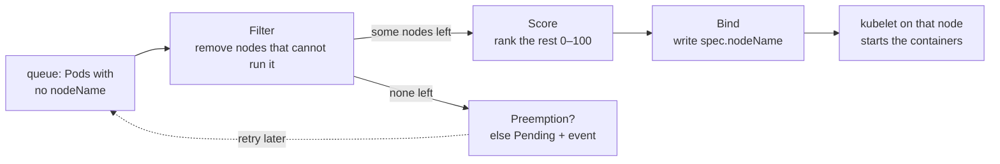

# Scheduling and placement

*Stage 4 · Flight Control*

**You will be able to:** describe how one node is chosen for a Pod, read a `FailedScheduling` message clause by clause, choose between a node selector, node affinity and a taint for a placement goal, and explain why Pods on a failed node take minutes to be replaced.

A new Pod has no node. Until something assigns one, no kubelet will run it. The choice is not arbitrary: the node must have room for the Pod's [requests](./requests-limits-and-pressure), must not be reserved for other work, must be able to reach the Pod's volumes, and should ideally keep replicas apart. When no node qualifies, the Pod sits in `Pending`, and the only explanation is the scheduler's message.

## The scheduler's job

The **scheduler** (`kube-scheduler`, a control-plane component) watches for Pods whose `spec.nodeName` is empty. It takes them from a queue, highest [priority](./priority-and-spreading) first, and for each one runs a scheduling cycle:



| Phase | Asks | Built-in checks, for example |
|---|---|---|
| **Filter** | Can this node run the Pod at all? | Requests fit allocatable; node not cordoned; taints tolerated; required node affinity matches; the Pod's volumes can attach there; hard spread rules hold; host ports free |
| **Score** | Of those, which is best? | Least-requested node; balanced CPU/memory use; preferred affinity; spread preference; image already present |
| **Bind** | | Write the chosen node into the Pod through the API server |

Each check is a **plugin**. A node must pass every filter; scores from all score plugins are weighted and summed, and the highest total wins (ties are broken at random).

Binding is the scheduler's only output. After it, the scheduler forgets the Pod. It never moves a running Pod to a better node, even if one appears later.

A Pod created with `spec.nodeName` already set skips the scheduler entirely: the named node's kubelet runs it, ignoring taints and affinity. That is how static and debugging Pods work, and why setting `nodeName` by hand is rarely a good idea.

## Reading `Pending`

A Pod that is `Pending` with `NODE <none>` has not been bound. `kubectl describe pod` shows the scheduler's latest verdict as a `FailedScheduling` event, which counts nodes per reason. On Apollo's three-node kind cluster, a Pod whose request fits nowhere reads:

```text
0/3 nodes are available: 1 node(s) had untolerated taint {node-role.kubernetes.io/control-plane: },
2 Insufficient cpu. preemption: 0/3 nodes are available: 1 Preemption is not helpful for scheduling,
2 No preemption victims found for incoming pod.
```

- **0/3 nodes are available:** every node was filtered out.
- **1 … untolerated taint:** the control plane is reserved; this Pod does not tolerate its taint.
- **2 Insufficient cpu:** both workers' remaining requests are too small.
- **preemption …:** the scheduler also checked whether evicting lower-priority Pods would help. It would not.

| Reason in the message | Cause | Fix |
|---|---|---|
| `Insufficient cpu` / `memory` | Summed requests leave no room | Lower requests, free capacity, or add nodes |
| `untolerated taint {key: value}` | The node repels Pods without a matching toleration | Add the toleration, or this node is not for this Pod |
| `didn't match Pod's node affinity/selector` | No node has the required label | Label a node, or fix the selector |
| `node(s) were unschedulable` | The node is cordoned | `kubectl uncordon` when maintenance is over |
| `volume node affinity conflict` | The Pod's PersistentVolume lives on another node | The Pod can only run where its volume is ([Stage 3](../storage/claims-and-provisioning)) |
| `didn't match pod topology spread constraints` | A hard spread rule would be broken | See [Priority and spreading](./priority-and-spreading) |

## Steering placement

There are two directions of control. **Pod-side** rules pull a Pod toward nodes; **node-side** taints push Pods away.

### Pulling: node selector and node affinity

Both match **node labels**. Every node carries built-in labels (`kubernetes.io/hostname`, `kubernetes.io/os`, and in the cloud `topology.kubernetes.io/zone`), and you can add your own; Apollo's kind config labels nodes `node-role=control-plane` and `node-role=worker`.

```yaml
# Simple and hard: only nodes with exactly this label
nodeSelector: {node-role: worker}

# Expressive: required and preferred rules, with operators
affinity:
  nodeAffinity:
    requiredDuringSchedulingIgnoredDuringExecution:
      nodeSelectorTerms:
        - matchExpressions: [{key: node-role, operator: In, values: [worker]}]
    preferredDuringSchedulingIgnoredDuringExecution:
      - weight: 100
        preference:
          matchExpressions: [{key: apollo11.io/search-pool, operator: In, values: [dedicated]}]
```

- `required…` rules are **filters**: no matching node means `Pending`.
- `preferred…` rules add to the **score**: the Pod goes elsewhere if it must.
- `IgnoredDuringExecution` means the rule is checked once, at scheduling. Removing the label from a node later does not evict Pods already running there.

### Pushing: taints and tolerations

A **taint** is a mark on a node, `key=value:effect`, that repels Pods. A **toleration** in a Pod spec says "this taint does not apply to me". A toleration only removes the barrier; it does **not** attract the Pod.

| Effect | New Pods without a toleration | Pods already running without one |
|---|---|---|
| `PreferNoSchedule` | Avoided if possible (a score penalty) | Stay |
| `NoSchedule` | Filtered out | Stay |
| `NoExecute` | Filtered out | **Evicted**, immediately or after the toleration's `tolerationSeconds` |

To **dedicate** a node, combine both directions: a taint keeps everyone else off, and the chosen workload gets a toleration (allowed on) plus node affinity (drawn there). Stage 7's scaling lab does exactly that for search, with the taint `workload=search:NoSchedule` and a preferred affinity for `apollo11.io/search-pool=dedicated`.

### Taints Kubernetes sets itself

Several taints are set by the cluster, not by people, and they explain behaviour that otherwise looks mysterious:

| Taint | Set when | Effect |
|---|---|---|
| `node-role.kubernetes.io/control-plane:NoSchedule` | On control-plane nodes, by kubeadm (and so by kind) | Keeps application Pods off the control plane |
| `node.kubernetes.io/unschedulable:NoSchedule` | `kubectl cordon` (and so `kubectl drain`) | No new Pods; running ones stay |
| `node.kubernetes.io/not-ready:NoExecute`, `…/unreachable:NoExecute` | The node stops reporting to the API server | Pods without a toleration are evicted |
| `node.kubernetes.io/memory-pressure`, `disk-pressure`, … | The kubelet reports [resource pressure](./requests-limits-and-pressure#when-a-node-runs-short) | Keeps new Pods away while the node recovers |

The `not-ready` and `unreachable` rows have a twist. Every Pod is admitted with two default tolerations for them, with `tolerationSeconds: 300`. So when a node dies, it is first marked unreachable after its heartbeats stop (under a minute), and its Pods are then **tolerated for five more minutes** before they are evicted and their controllers create replacements elsewhere. That delay avoids churning every Pod on a node that is only briefly cut off; the cost is several minutes of reduced capacity after a real failure. A workload that must move faster can set a shorter `tolerationSeconds` for those two taints.

## Apollo example

Stage 4 does not use selectors, affinity or custom taints. It relies on three placement facts:

- The kind control plane carries its `NoSchedule` taint, so all application Pods and databases run on `apollo11-worker` and `apollo11-worker2`.
- Every Pod has [requests](./requests-limits-and-pressure#apollo-example), so the filter phase now knows how full each worker is. Stage 3's Pods requested nothing and always "fit".
- Each database Pod can only run on the node holding its `local-path` volume. If that node is drained, the database Pod is `Pending` with `volume node affinity conflict` until the node returns.

## Try it

:::caution[Unverified]
Not yet run on a live cluster for this documentation revision. Needs a cluster with at least two worker nodes, such as Ignition's kind cluster. Changes node labels and taints, and removes them at the end.
:::

```bash
kubectl get nodes -o custom-columns=NAME:.metadata.name,TAINTS:.spec.taints[*].key
W=$(kubectl get nodes -l node-role=worker -o jsonpath='{.items[0].metadata.name}')

kubectl create namespace sched-demo

# 1. A required label no node has: Pending, and the message says why
kubectl -n sched-demo run picky --image=busybox:1.36 --restart=Never \
  --overrides='{"spec":{"nodeSelector":{"demo":"yes"}}}' -- sleep 3600
sleep 5
kubectl -n sched-demo describe pod picky | grep -A3 FailedScheduling

# 2. Label a worker: the Pod is scheduled there on the next attempt
kubectl label node $W demo=yes
kubectl -n sched-demo wait --for=condition=Ready pod/picky --timeout=60s
kubectl -n sched-demo get pod picky -o wide                 # NODE = $W

# 3. A NoSchedule taint repels new Pods but leaves picky running
kubectl taint node $W demo=yes:NoSchedule
kubectl -n sched-demo run newcomer --image=busybox:1.36 --restart=Never \
  --overrides='{"spec":{"nodeSelector":{"demo":"yes"}}}' -- sleep 3600
sleep 5
kubectl -n sched-demo get pods -o wide                      # picky Running, newcomer Pending

# 4. Every Pod carries the default five-minute tolerations
kubectl -n sched-demo get pod picky -o jsonpath='{range .spec.tolerations[*]}{.key}{" "}{.tolerationSeconds}{"\n"}{end}'

kubectl taint node $W demo=yes:NoSchedule-
kubectl label node $W demo-
kubectl delete namespace sched-demo
```

- `picky` waited until a label existed, then landed on the only matching node: a required rule is a filter.
- The `NoSchedule` taint stopped `newcomer` but did not touch `picky`.
- The tolerations list shows `not-ready` and `unreachable`, each with `300`: the five minutes a Pod stays bound to a dead node.

## Common misconceptions

- **"A toleration sends the Pod to the tainted node."** It only permits it. Affinity draws it there.
- **"A taint evicts what is already running."** Only `NoExecute` does.
- **"The scheduler rebalances Pods as nodes come and go."** It places each Pod once.
- **"A Pod on a dead node is replaced right away."** It waits for the node to be marked unreachable, then for the 300-second default toleration.
- **"`Pending` means the cluster is broken."** It means no node passed the filters; the event says which filter.

## Check yourself

<details>
<summary>What does <code>0/3 nodes are available: 1 node(s) had untolerated taint …, 2 Insufficient memory</code> tell you?</summary>

The control plane was excluded by its taint, and neither worker has enough unrequested memory left. Lower the memory request or free or add capacity.
</details>

<details>
<summary>You want only search on one node, and search preferably there. What do you combine?</summary>

A `NoSchedule` taint on the node (keeps other Pods off), a toleration on search (lets it on), and node affinity on search for that node's label (draws it there).
</details>

<details>
<summary>A worker loses power. Why are its booking Pods replaced only after about six minutes?</summary>

The node is marked unreachable after its heartbeats stop, and every Pod tolerates the `unreachable` taint for 300 seconds by default before it is evicted and replaced.
</details>

## Where this leads

Filtering and scoring decide where a Pod *can* go. Two questions remain: who gets the room when there is not enough, and how replicas spread across nodes. That is [Priority and spreading](./priority-and-spreading).

## References

- [Kubernetes scheduler](https://kubernetes.io/docs/concepts/scheduling-eviction/kube-scheduler/) and [scheduling framework](https://kubernetes.io/docs/concepts/scheduling-eviction/scheduling-framework/)
- [Assigning Pods to nodes](https://kubernetes.io/docs/concepts/scheduling-eviction/assign-pod-node/)
- [Taints and tolerations](https://kubernetes.io/docs/concepts/scheduling-eviction/taint-and-toleration/), including [taint-based evictions](https://kubernetes.io/docs/concepts/scheduling-eviction/taint-and-toleration/#taint-based-evictions)
