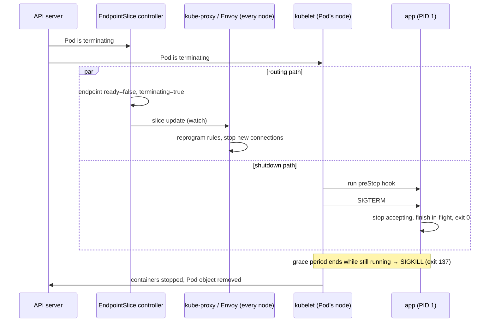

# Termination and draining

*Stage 4 · Flight Control*

**You will be able to:** order the events when a Pod terminates, explain why requests can still arrive after shutdown begins, split a grace period between `preStop` and the app's own drain, and recognise a process that never handles SIGTERM.

Pods are removed all the time, and almost never because something broke. Every rolling update retires old Pods. Every node drain evicts them. Scaling down, preemption, and a person running `kubectl delete pod` all end Pods on purpose. If each of those drops a few in-flight bookings, a busy airline loses requests every time it deploys.

A Pod's end is a sequence involving the API server, the endpoint machinery, every proxy that routes to the Pod, the kubelet and the app itself. Most dropped requests come from those parts running **in parallel**, not one after another.

## What starts a termination

| Trigger | Who asks | Grace period used |
|---|---|---|
| `kubectl delete pod`, scale down, rollout | A person or a controller | The Pod's `terminationGracePeriodSeconds` (default 30), unless `--grace-period` overrides it |
| `kubectl drain`, cluster upgrade, autoscaler scale-down | The Eviction API | The Pod's own, after the [PodDisruptionBudget](./disruption-budgets) allows it |
| Preemption by a higher-priority Pod | The scheduler | The Pod's own |
| Node-pressure eviction | The kubelet | Possibly shorter: the kubelet's eviction settings decide |
| `kubectl delete --force --grace-period=0` | A person | None: the object is removed at once, the process killed without waiting |

## Two paths start at once

Deleting a Pod does not delete it straight away. The API server sets a `deletionTimestamp` and a grace period on the Pod object. Everything that watches Pods then reacts, independently:



1. **Marked terminating.** `kubectl get pods` shows `Terminating`. The grace period clock starts now.
2. **Routing path.** The EndpointSlice controller marks the Pod's endpoint `ready: false, terminating: true` ([EndpointSlices](../networking/endpoints-and-endpointslices)). Every kube-proxy and the Envoy Gateway receive the update over their watches and stop picking this Pod for **new** connections. How long that takes depends on load and the number of nodes: usually well under a second, sometimes several.
3. **Shutdown path.** At the same moment the kubelet runs the container's `preStop` hook, if there is one, and waits for it to finish.
4. **SIGTERM.** Then the container runtime sends the main process its stop signal: `SIGTERM` ("please stop") unless the image sets another with `STOPSIGNAL`.
5. **SIGKILL.** If the process is still running when the grace period runs out, the kubelet sends `SIGKILL`, which cannot be caught. The container ends with exit code `137` (128 + 9). If a `preStop` hook is still running at that point, the kubelet allows one extra 2 seconds first.
6. **Gone.** Once all containers have stopped, the kubelet tells the API server, and the Pod object disappears.

## The race, and what each setting buys

Steps 2 and 3 are not ordered. If the app stops listening the instant it receives SIGTERM, and some proxy has not yet heard that the Pod is terminating, that proxy still sends it new connections. They are refused, and passengers see errors during an otherwise healthy rollout.

There is a second, quieter source of late traffic: **connections that already exist**. Clients and proxies keep HTTP connections open and reuse them (keep-alive). Removing an endpoint stops *new* connections; an existing pooled connection can still carry new requests to the terminating Pod until either side closes it.

| Part | What it buys | What it costs or cannot do |
|---|---|---|
| `preStop: sleep 5` | Delays SIGTERM, so routing updates finish while the app still serves normally | Counts inside the grace period; needs a `sleep` binary in the image |
| SIGTERM handler that drains | Stops accepting, finishes in-flight requests, closes idle keep-alive connections, exits `0` | Does nothing if the signal never reaches it |
| `terminationGracePeriodSeconds` | A hard deadline, so a stuck process cannot block a rollout forever | Not a guarantee that draining finished |

None of these removes the race completely; together they make it rare. Proving it needs a traffic generator running across a rollout and a count of failures, not a log line.

### One budget, shared

The grace period is a single budget, counted from the moment of deletion, and everything spends from it:

```text
terminationGracePeriodSeconds: 30
├── preStop sleep ............ 5 s
├── app drain after SIGTERM .. must finish within the remaining 25 s
└── then SIGKILL
```

Set the app's own drain timeout **below** what remains after `preStop`, with a margin, so the app ends its slowest requests on its own terms rather than being killed mid-write. Apollo's booking uses a 30 s `srv.Shutdown` timeout inside a 30 s grace period that already spent 5 s on `preStop`: a request still running at about 25 s ends by SIGKILL, not by the app's timeout. In practice booking's requests take milliseconds, so this costs nothing today, but the numbers should agree.

Databases need longer: Postgres and Redis get 60 s in Stage 4, enough to checkpoint and flush to disk before stopping.

## SIGTERM has to reach the code

Inside a container, the main process is **PID 1**. The kernel treats PID 1 specially: a signal whose action is "default" is **ignored** rather than ending the process. An app that never installs a SIGTERM handler therefore ignores SIGTERM completely, and every shutdown waits out the whole grace period before SIGKILL.

Three common ways the signal goes missing:

| Cause | What happens | Fix |
|---|---|---|
| No handler in the app, running as PID 1 | SIGTERM ignored; SIGKILL at the deadline | Handle SIGTERM (Go: `signal.Notify`; most servers have a graceful mode) |
| Shell form `CMD app --flag` | A shell becomes PID 1 and may not pass the signal on | Exec form: `CMD ["app", "--flag"]`, or `exec app` in a wrapper script |
| A custom handler replaces the framework's | The custom handler runs, but the server's own shutdown never starts | Extend the framework's handler instead of replacing it |

The third row happened in Apollo. At the pinned revision, identity registered a module-level `signal.signal(SIGTERM, …)` that logged "Received SIGTERM, shutting down gracefully" and returned. That replaced uvicorn's own handler, so the drain never began: every identity Pod logged the message, kept running and was killed at 30 s. Apollo fixed it later (tracker item G21, commit [`90b5120`](https://github.com/darshan-raul/Apollo11/commit/90b5120005a44e6af31025309b59cdcbdbbb86ab)) by subclassing `uvicorn.Server` so the log line is added and the original drain still runs. The lesson: **a "shutting down" log line proves the signal arrived, not that shutdown happened.** The proof is how long termination took and which exit code it ended with.

## Apollo example

From [booking's Deployment](https://github.com/darshan-raul/Apollo11/blob/f6211e679f8ed66a5a19033ac49a3bfc3a506eab/stages/stage4/k8s/apps/booking/booking-dep.yaml) and [`main.go`](https://github.com/darshan-raul/Apollo11/blob/f6211e679f8ed66a5a19033ac49a3bfc3a506eab/stages/stage4/code/booking/main.go), trimmed:

```yaml
terminationGracePeriodSeconds: 30
containers:
  - lifecycle:
      preStop:
        exec: {command: ["/bin/sh", "-c", "sleep 5"]}   # Alpine image: sh and sleep exist
```

```go
signal.Notify(quit, syscall.SIGTERM, syscall.SIGINT)
<-quit                                            // block until the kubelet's SIGTERM
shutdownCtx, cancel := context.WithTimeout(context.Background(), 30*time.Second)
srv.Shutdown(shutdownCtx)   // close listener, close idle conns, wait for active requests
db.Close()
```

| Workload | `preStop` | Grace | Drain |
|---|---|---|---|
| Six apps | `sleep 5` | 30 s | Go `srv.Shutdown`; the nginx image's `STOPSIGNAL SIGQUIT`, its graceful stop; identity via uvicorn (fixed after the pin, see above) |
| Postgres, Redis | None | 60 s | The servers' own handling of their stop signal: Postgres's fast shutdown with a checkpoint, Redis's final save |

## Try it

:::caution[Unverified]
Not yet run on a live cluster for this documentation revision. Uses a throwaway namespace on any cluster.
:::

Two Pods: one drains on SIGTERM after a `preStop` hook, one ignores SIGTERM.

```bash
kubectl create namespace stop-demo
kubectl -n stop-demo apply -f - <<'EOF'
apiVersion: v1
kind: Pod
metadata: {name: graceful}
spec:
  terminationGracePeriodSeconds: 20
  containers:
    - name: app
      image: busybox:1.36
      command: ["sh", "-c", "trap 'echo $(date +%T) SIGTERM; sleep 3; echo $(date +%T) drained; exit 0' TERM; echo $(date +%T) started; while true; do sleep 1; done"]
      lifecycle:
        preStop:
          exec: {command: ["sh", "-c", "echo $(date +%T) preStop > /proc/1/fd/1; sleep 5"]}
---
apiVersion: v1
kind: Pod
metadata: {name: deaf}
spec:
  terminationGracePeriodSeconds: 10
  containers:
    - name: app
      image: busybox:1.36
      command: ["sh", "-c", "while true; do sleep 1; done"]   # PID 1, no handler
EOF
kubectl -n stop-demo wait --for=condition=Ready pod/graceful pod/deaf

kubectl -n stop-demo logs -f graceful &
time kubectl -n stop-demo delete pod graceful     # about 8 s: preStop 5 + drain 3
kill %1

time kubectl -n stop-demo delete pod deaf         # about 10 s: the full grace period
kubectl delete namespace stop-demo
```

- `graceful` logged `preStop`, then `SIGTERM` five seconds later, then `drained`: the hook ran first, and the signal waited for it.
- `deaf` took exactly its grace period. SIGTERM went to a PID 1 with no handler, so nothing happened until SIGKILL.

## Common misconceptions

- **"Handling SIGTERM gives zero-downtime rollouts."** It does not control how fast every proxy stops routing to the Pod.
- **"`preStop` time is extra."** It is spent from the same grace period.
- **"The Pod leaves the Service after the app exits."** Endpoint removal starts at the same moment as shutdown, and finishes on its own schedule.
- **"A 'shutting down' log line proves a clean shutdown."** It proves the handler ran. Time-to-terminate and the exit code prove the rest.
- **"Exiting immediately on SIGTERM is the safe choice."** It drops in-flight requests and refuses late arrivals.

## Check yourself

<details>
<summary>Why add <code>preStop: sleep 5</code> when the Go code already handles SIGTERM?</summary>

SIGTERM handling decides what the app does once told to stop. The sleep delays that moment so endpoint removal can reach every proxy while the app still accepts connections.
</details>

<details>
<summary>Every identity Pod takes exactly 30 s to terminate, and its log shows "Received SIGTERM, shutting down gracefully". What is going on?</summary>

The signal arrived, but nothing shut the server down, so the kubelet waited the full grace period and sent SIGKILL. A custom handler most likely replaced the server's own.
</details>

<details>
<summary>Grace period 30 s, <code>preStop</code> 5 s. What is the most the app's drain timeout should be?</summary>

Less than 25 s, with a margin, so the app finishes or abandons slow requests itself before SIGKILL.
</details>

<details>
<summary>Endpoint removal is instant on paper. Why can a terminating Pod still receive a request?</summary>

Proxies learn of the change over watches, which takes time, and existing keep-alive connections can keep carrying new requests until they are closed.
</details>

## Where this leads

A Pod's life is now handled from first probe to last request. Next comes what it consumes while alive: [Requests, limits and pressure](./requests-limits-and-pressure).

## References

- [Pod termination](https://kubernetes.io/docs/concepts/workloads/pods/pod-lifecycle/#pod-termination)
- [Container lifecycle hooks](https://kubernetes.io/docs/concepts/containers/container-lifecycle-hooks/)
- [EndpointSlice conditions: ready, serving, terminating](https://kubernetes.io/docs/concepts/services-networking/endpoint-slices/#conditions)
