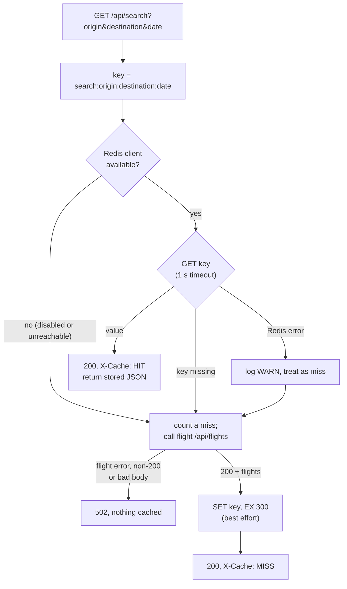

# Cache-aside

*Stage 7 · Orbital Maneuvering*

**You will be able to:** trace a search through hit, miss, upstream failure and cache outage; choose a TTL from how fast data changes and what staleness costs; design a cache key that cannot grow without bound; and explain why a cache can hide an under-sized backend.

Passengers search the same few routes on the same few dates again and again, and flight schedules rarely change. Before Stage 7, every search still went from `search` to `flight` to PostgreSQL and recomputed the same answer. Adding replicas ([Horizontal Pod Autoscaling](./hpa)) would let more copies repeat that work in parallel. A cache removes the work instead.

## Where a cache can sit

| Location | Shared by | Survives | Example |
|---|---|---|---|
| In the client (browser) | One user | Page reloads, depending on headers | `Cache-Control` |
| At the edge (CDN, gateway) | Everyone behind it | Backend restarts | Not used by Apollo |
| In the service's memory | One Pod | Nothing: gone on restart; each replica has its own | A Go map |
| **In a shared store** | **Every replica** | **Restarts and rollouts of the service** | **Redis, used by Apollo** |

Apollo keeps search's cache in the Redis StatefulSet. Every search replica reads the same entries, so a key warmed by one Pod is a hit for all of them, and rolling out search does not empty the cache.

## Cache-aside, and its relatives

In **cache-aside**, the application manages the cache itself. The database does not know the cache exists.

| Pattern | Reads | Writes | Who talks to the cache |
|---|---|---|---|
| **Cache-aside** (Apollo) | App checks the cache; on a miss, reads the source and fills the cache | App writes the source; the cache entry just expires | The application |
| Read-through | App asks the cache; the cache loads from the source on a miss | | A caching layer |
| Write-through | | Every write goes to cache and source together | A caching layer |
| Write-behind | | Writes go to the cache and reach the source later | A caching layer; risks data loss |

Cache-aside is the simplest to add to an existing service: one read path changes, and nothing else in the system needs to know.

## Every branch of search's cache

From [`code/search/main.go`](https://github.com/darshan-raul/Apollo11/blob/f6211e679f8ed66a5a19033ac49a3bfc3a506eab/stages/stage7/code/search/main.go):



| Branch | What happens | Watch out for |
|---|---|---|
| **Hit** | The stored JSON is returned as is, in milliseconds; flight and PostgreSQL are untouched | Data can be up to 300 s old |
| **Miss** | Search calls flight, builds the result, stores it with a 300 s TTL, returns it | First-request latency; concurrent misses for one key each call flight |
| **Upstream failure on a miss** | `502 Flight service unavailable`; the error is **not** cached | Caching an error as an empty result would serve "no flights" for five minutes |
| **Redis error or outage** | Logged, treated as a miss; search keeps answering from flight | Every request now reaches flight: see below |
| **Cache disabled** (`CACHE_ENABLED=false`) | No Redis client; every request is a miss | Used as the baseline in [the benchmark](./measurement-baseline#the-cache-benchmark-step-by-step) |

A failed `SET` never fails the request, and a lost Redis connection is retried on later requests, so the cache repopulates after Redis returns without restarting search. Readiness reflects the same choice: `/healthz/ready` always answers 200 and reports `"cache": "ok"`, `"unreachable"` or `"disabled"` in its body. Search without a cache is degraded, not unready.

## Choosing a TTL

A **TTL** (time to live) is how long an entry may be served before Redis deletes it. It is a direct trade between load saved and staleness accepted.

| Data | How often it changes | Cost of a stale answer | Sensible TTL |
|---|---|---|---|
| Airport codes, route list | Rarely | Low | Hours |
| Search results (schedules and seat counts) | Minutes | A passenger sees a seat that is gone, and booking refuses it | **300 s** (Apollo) |
| Seats at the moment of booking | Every booking | Overselling | **None**: always ask the source |

Apollo's search result includes `availableSeats`, so a warm entry can show the count from before the last booking. That is acceptable only because booking never trusts search: it calls flight's `PATCH /api/flights/:id/seats` directly, and a sold-out flight returns `409 No seats available`. **A cache may be stale only where the source of truth is checked again before anything irreversible happens.**

Apollo invalidates by expiry only. Deleting the key when a booking changes a flight would make results fresher, but then flight or booking would have to know about search's cache.

## Keys define the cache

The key decides which requests share an entry, and how many entries can exist.

Search builds its key from the raw query values: `search:BOM:SIN:2026-11-02`. Three consequences:

- `origin=bom` and `origin=BOM` are **different keys**. Flight matches codes exactly, so `bom` finds no flights, and that empty result is cached for 300 s too.
- A request with no parameters is cached under `search:::`, holding the full flight list.
- Any string a caller sends becomes a key once flight answers `200`, even with an empty result. A comment in the code says the keyspace is bounded at about 180 keys (six airports × five dates). It is bounded only by **how many distinct requests arrive within 300 s**.

Normalizing values (upper-case codes, a validated date, known airports only) before building the key would make both statements true. And setting a memory limit with an eviction policy on Redis would bound the worst case.

### The shared Redis

That eviction policy is harder than it sounds in Apollo, because the same Redis also holds notification's `notifications:queue`, a list that must not be evicted, and it runs with persistence on (`--appendonly yes`, `--save 60 100`). Cache entries are written to disk they do not need, and an `allkeys-lru` policy that would suit the cache could delete queued notifications. Caches and durable data are usually given separate instances for this reason.

## Stampedes and hidden capacity

**Concurrent misses.** When a popular key expires, every request for it in the next few milliseconds misses at once, and each calls flight. Search does not coalesce them. With six keys warmed together by the benchmark, they also **expire together**, every 300 s. Common remedies: let one request per key fetch while others wait (Go's `singleflight`, per Pod), add random jitter to the TTL, or refresh popular keys shortly before they expire.

**The cache as hidden capacity.** With a 95% hit rate, flight serves one search in twenty. If Redis fails, flight suddenly receives twenty times its usual search traffic. Search stays up by design, but flight, sized for the cached load, may not. A cache that the system *needs* to survive is capacity, and its failure is a capacity event. That is why Stage 7's lab takes Redis away on purpose and watches what flight does.

## Evidence

Three independent views of the same request:

| Evidence | Shows |
|---|---|
| Response header `X-Cache: HIT` or `MISS` | Which code path this request took |
| `cache_hits_total` / `cache_misses_total{service="search"}` in Prometheus | How often each path is taken |
| `redis-cli TTL <key>` | What is stored, and for how long |
| A `cache.get` span with `cache.hit=true/false` in the trace | The path inside one traced request |

```promql
sum(rate(cache_hits_total{service="search"}[5m]))
  / (sum(rate(cache_hits_total{service="search"}[5m])) + sum(rate(cache_misses_total{service="search"}[5m])))
```

## Try it

:::caution[Unverified]
Not yet run on a live cluster for this documentation revision. Needs Stage 7 installed. Read-only apart from filling cache keys.
:::

```bash
NS=apollo-airlines-apps
D=$(date -u +%F)
kubectl -n $NS run probe --image=curlimages/curl:8.10.1 --restart=Never --command -- sleep 600
kubectl -n $NS wait --for=condition=Ready pod/probe
s() { kubectl -n $NS exec probe -- curl -s -D - -o /dev/null "http://search:8083/api/search?$1" | grep -i '^x-cache'; }

s "origin=BOM&destination=SIN&date=$D"     # MISS (or HIT if warm)
s "origin=BOM&destination=SIN&date=$D"     # HIT
s "origin=bom&destination=SIN&date=$D"     # MISS: a different key (and an empty result)
kubectl -n $NS exec redis-0 -- redis-cli --scan --pattern 'search:*'
kubectl -n $NS exec redis-0 -- redis-cli TTL "search:BOM:SIN:$D"     # ≤ 300, counting down
kubectl -n $NS exec probe -- curl -s http://search:8083/healthz/ready   # {"cache":"ok",...}
kubectl -n $NS delete pod probe
```

- The second identical request was a hit; changing only the case of one value created a second entry.
- The TTL counts down from 300; the readiness body reports the cache state without failing readiness.

## Common misconceptions

- **"Redis is my database now."** It is a disposable copy. PostgreSQL is the truth.
- **"Stale search results are a bug."** Within the TTL they are the design, as long as booking checks flight.
- **"A cache always makes things faster."** Measure it ([previous chapter](./measurement-baseline)).
- **"Search stays up when Redis fails, so nothing changes."** Flight takes the whole load.
- **"The keyspace is bounded because the domain is small."** Only if keys are built from validated values.

## Check yourself

<details>
<summary>A seat is booked. Search shows the old seat count for a few minutes. Bug?</summary>

No: staleness within the 300 s TTL is the design. Booking checks seats with flight directly, so it cannot oversell.
</details>

<details>
<summary>Flight returns 500 during a cache miss. What does search return, and what does it cache?</summary>

`502 Flight service unavailable`, and nothing is cached, so the next request tries flight again.
</details>

<details>
<summary>Why not set Apollo's Redis to <code>allkeys-lru</code> to cap the cache's memory?</summary>

The same Redis holds notification's queue, which an LRU policy could evict. The cache needs its own instance, or a policy that only evicts keys with a TTL.
</details>

## Where this leads

A cache reduces work per request. When load still outgrows the Pods, the next lever is more of them, added automatically: [Horizontal Pod Autoscaling](./hpa).

## References

- [Redis `EXPIRE` and key expiry](https://redis.io/docs/latest/commands/expire/)
- [Redis eviction policies](https://redis.io/docs/latest/develop/reference/eviction/)
- [Go `singleflight`](https://pkg.go.dev/golang.org/x/sync/singleflight)
