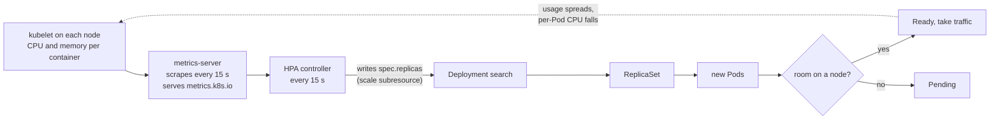

# Horizontal Pod Autoscaling

*Stage 7 · Orbital Maneuvering*

**You will be able to:** trace the metrics an HPA reads back to the kubelet, predict the replica count it will choose, explain why a missing CPU request blinds it and why a limit equal to the request slows it down, read Apollo's scale-up and scale-down policies, and spot a deployment tool fighting the HPA over `spec.replicas`.

When ticket sales open, search traffic can jump tenfold within a minute. A person editing `replicas` reacts too slowly, and forgets to scale back when the rush ends. The replica count should follow demand on its own: more Pods while busy, fewer when quiet, within limits someone chose in advance.

## The feedback loop

The **HorizontalPodAutoscaler (HPA)** is a controller in the controller manager. Every 15 seconds it reads a metric for the Pods of a target (a Deployment here), compares it with a target value, and writes a new `spec.replicas` if needed.



**metrics-server** is a small add-on, not part of a bare cluster. It asks every kubelet for recent CPU and memory use per container and serves the numbers through the `metrics.k8s.io` API, which is what `kubectl top` and the HPA read. A fresh kind cluster has none, so Stage 7's chart bundles it (v0.7, with `--kubelet-insecure-tls` because kind's kubelet certificates are self-signed). Without it, every HPA shows `<unknown>` and does nothing.

## The replica formula

```text
desired = ceil( currentReplicas × currentMetric ÷ targetMetric )
```

Then three adjustments:

1. **Tolerance.** If the ratio is within 10% of 1 (0.9–1.1), nothing changes. That keeps the HPA from reacting to noise.
2. **Bounds.** The result is clamped to `[minReplicas, maxReplicas]`.
3. **Behavior.** Stabilization windows and rate policies limit how far and how fast it may move (below).

Example: 2 Pods averaging 140% against a 70% target: `ceil(2 × 140 ÷ 70) = 4`.

## Utilization is measured against the request

"CPU utilization" is not a share of the node. It is each Pod's CPU use divided by its CPU **request**, averaged across the Pods:

```text
utilization % = actual CPU ÷ requested CPU × 100
```

| Actual | Request | Utilization | With a 70% target |
|---|---|---|---|
| 70m | 100m | 70% | Stable |
| 70m | 500m | 14% | Scales **down**: the request is oversized |
| 70m | 35m | 200% | Scales **up** hard |
| 70m | none | `<unknown>` | **Blind**: nothing to divide by |

Requests therefore do three jobs at once: scheduling and QoS ([Stage 4](../reliability/requests-limits-and-pressure)), and the HPA's denominator. Changing a request changes when the HPA scales, which is why [VPA recommendations](./vpa-and-capacity) are applied by a person.

### The ceiling a CPU limit creates

Search's container has `requests: 100m` **and** `limits: 100m` (Guaranteed QoS). The kernel throttles it at 100m ([Stage 4](../reliability/requests-limits-and-pressure#how-the-kernel-enforces-limits)), so measured utilization **can never exceed 100%**, however many requests are queueing. Against a 70% target the largest ratio the HPA can ever see is 100 ÷ 70 ≈ 1.43:

| Step | Replicas | Next: `ceil(n × 1.43)` |
|---|---|---|
| 1 | 1 | 2 |
| 2 | 2 | 3 |
| 3 | 3 | 5 |
| 4 | 5 | 8 |

Each step also waits for metrics from the new Pods. With limits above requests, an overloaded Pod could report 300% and the HPA would jump straight to the right size. With `limits == requests`, scale-up is a staircase, and the throttled Pods are slow the whole way up. Apollo's recorded capacity run shows exactly that shape: 1 → 2 → 3 replicas, no failed requests, and a failed threshold on dropped iterations ([Measurement before optimization](./measurement-baseline#reading-and-reporting-the-result)).

### New and unready Pods

The HPA is cautious with Pods it cannot judge yet. Pods that are not Ready, or have no metrics, are treated conservatively: when deciding to scale up, they count as using nothing; when deciding to scale down, as fully busy. CPU samples from a Pod's first minutes, when start-up work inflates them, are ignored. The effect is that the HPA does not stampede on start-up spikes, and does not scale down because new Pods have not reported yet.

## Behavior: how fast, in each direction

From [`search-hpa.yaml`](https://github.com/darshan-raul/Apollo11/blob/f6211e679f8ed66a5a19033ac49a3bfc3a506eab/stages/stage7/helm/apollo11/templates/autoscaling/search-hpa.yaml):

```yaml
behavior:
  scaleUp:
    stabilizationWindowSeconds: 0        # act on the newest recommendation
    policies:
      - {type: Percent, value: 100, periodSeconds: 30}   # double…
      - {type: Pods,    value: 4,   periodSeconds: 30}   # …or add 4
    selectPolicy: Max                    # whichever allows more
  scaleDown:
    stabilizationWindowSeconds: 300      # use the highest recommendation of the last 5 min
    policies:
      - {type: Percent, value: 50, periodSeconds: 60}    # remove at most half per minute
```

- **Scale up fast.** From 2 Pods, `Max` of +100% (2) and +4 allows 6 Pods 30 s later; from 10, it allows 20.
- **Scale down slowly.** Traffic is bumpy. The 300-second **stabilization window** makes the HPA use the *highest* recommendation it computed in the last five minutes, so a brief dip does not remove Pods that would be needed again a minute later (**flapping**). After that, at most half the Pods go per minute.

## Who owns `spec.replicas`?

Once an HPA targets a Deployment, the HPA writes `spec.replicas`. Anything else that also writes it will fight it.

Stage 7's chart renders search's Deployment with `replicas: {{ .replicas }}` (1 in dev, 2 in staging, 3 in prod) while the HPA is enabled:

| Tool | What happens to search's replicas |
|---|---|
| `helm upgrade` | Helm compares the chart with the live object and sets `replicas` back to the chart's value; the HPA raises it again within seconds |
| Argo CD dev and staging (`selfHeal: true`) | The HPA's change shows as drift; self-heal reverts it, the HPA re-applies it, repeatedly |
| Argo CD prod | `ignoreDifferences` on `/spec/replicas` for Deployments: no fight |

The fix is to leave the field to the HPA: omit `replicas` from the template when autoscaling is enabled (the Deployment keeps whatever value it has), or ignore the field in the GitOps tool as prod does. This conflict follows from the chart and Application specs; the course has not yet recorded it on a live Argo CD install (Stage 6/7 Argo paths were not rerun in the October pass).

## What an HPA cannot do

- **Create capacity.** New Pods need room. On full nodes they stay `Pending` with `Insufficient cpu`, and the HPA keeps asking. A cluster autoscaler can add nodes in the cloud ([Stage 9](../../stage-9)); kind cannot.
- **Fix a bottleneck elsewhere.** More search Pods do not make flight or PostgreSQL faster. On cache misses they send flight *more* concurrent work.
- **See the right signal by itself.** CPU is a proxy for load. Search answers cache hits with almost no CPU, so a heavily cached search may never cross 70% at all; Apollo's lab notes record that as a valid outcome. Queue length, request rate or latency can be better signals. They need an adapter that serves them through the custom or external metrics APIs (for example the Prometheus Adapter, or KEDA in [Stage 11](../../stage-11)).
- **Scale to zero.** `minReplicas` is at least 1.

## Apollo example

| Environment | Range | CPU target | Deployment `replicas` |
|---|---|---|---|
| dev | 1–3 | 70% | 1 |
| staging | 2–10 (chart default) | 70% | 2 |
| prod | 3–20 | 60% | 3 |

Search's request and limit are both `100m`, so 70% means about 70m of CPU per Pod on average. `scaling-lab.sh` temporarily lowers the target to 10% and the scale-down window to 30 s so a laptop can show a full scale-out and scale-in in minutes, taints one worker as a preferred search pool, and restores everything at the end.

## Try it

:::caution[Unverified]
Not yet run on a live cluster for this documentation revision. Needs metrics-server (installed by Stage 7, or on its own). Uses a throwaway namespace; takes about 8 minutes.
:::

The upstream example image burns CPU on every request. Its limit is above its request, so utilization can exceed 100%:

```bash
kubectl create namespace hpa-demo
kubectl -n hpa-demo apply -f - <<'EOF'
apiVersion: apps/v1
kind: Deployment
metadata: {name: burner}
spec:
  replicas: 1
  selector: {matchLabels: {app: burner}}
  template:
    metadata: {labels: {app: burner}}
    spec:
      containers:
        - name: app
          image: registry.k8s.io/hpa-example
          ports: [{containerPort: 80}]
          resources: {requests: {cpu: 100m}, limits: {cpu: 500m}}
---
apiVersion: v1
kind: Service
metadata: {name: burner}
spec: {selector: {app: burner}, ports: [{port: 80}]}
---
apiVersion: autoscaling/v2
kind: HorizontalPodAutoscaler
metadata: {name: burner}
spec:
  scaleTargetRef: {apiVersion: apps/v1, kind: Deployment, name: burner}
  minReplicas: 1
  maxReplicas: 5
  metrics:
    - type: Resource
      resource: {name: cpu, target: {type: Utilization, averageUtilization: 50}}
  behavior:
    scaleDown: {stabilizationWindowSeconds: 60}
EOF
kubectl -n hpa-demo rollout status deploy/burner
sleep 60; kubectl -n hpa-demo get hpa burner           # TARGETS 0%/50% (or <unknown> for the first minute)

kubectl -n hpa-demo run load --image=busybox:1.36 --restart=Never -- \
  sh -c 'while true; do wget -q -O- http://burner >/dev/null; done'
kubectl -n hpa-demo get hpa burner -w                  # utilization climbs past 100%, replicas jump; Ctrl-C

kubectl -n hpa-demo delete pod load
kubectl -n hpa-demo get hpa burner -w                  # after the 60 s window, back towards 1; Ctrl-C
kubectl -n hpa-demo describe hpa burner | sed -n '/Events:/,$p'
kubectl delete namespace hpa-demo
```

- Utilization above 100% was possible because the limit (500m) is above the request (100m), so the HPA could see the real overload and size in one or two steps.
- The events list each rescale with its reason; scale-down waited for the stabilization window.

## Common misconceptions

- **"The HPA scales on how busy the node is."** It uses each Pod's usage relative to its own request.
- **"`<unknown>` means there is no load."** It means an input is missing: no metrics-server, or no CPU request.
- **"Guaranteed QoS makes autoscaling safer."** It caps utilization at 100% and slows scale-up.
- **"The chart and the HPA can both set replicas."** Whichever writes last wins, over and over.
- **"More replicas always help."** Only if this service's CPU is the bottleneck and nodes have room.

## Check yourself

<details>
<summary>2 replicas, 140% utilization, target 70%. What does the HPA want?</summary>

`ceil(2 × 140 ÷ 70) = 4`, within `maxReplicas` and the scale-up policy.
</details>

<details>
<summary>Search is overloaded at 1 replica, with limit equal to request. How many HPA steps to reach 5 replicas, and why?</summary>

Three: 1 → 2 → 3 → 5. Throttling caps measured utilization at 100%, so each step multiplies by at most 100 ÷ 70.
</details>

<details>
<summary>Search scaled to 3 in dev, and a minute later it is back to 1 with no drop in load. What is likely happening?</summary>

Argo CD's self-heal restored the chart's `replicas: 1`. The HPA will raise it again, and the two will keep fighting until the template omits `replicas` or Argo CD ignores the field.
</details>

<details>
<summary>Why a 300-second scale-down window but none for scale-up?</summary>

Adding Pods late hurts passengers now; removing Pods late only costs some idle capacity. The window prevents removing Pods during short dips.
</details>

## Where this leads

The HPA changes **how many** Pods run, and depends entirely on each Pod's request being right. [VPA and capacity](./vpa-and-capacity) asks how big each Pod should be, and what happens when the cluster itself runs out of room.

## References

- [Horizontal Pod Autoscaling](https://kubernetes.io/docs/tasks/run-application/horizontal-pod-autoscale/), including the [algorithm details](https://kubernetes.io/docs/tasks/run-application/horizontal-pod-autoscale/#algorithm-details)
- [HorizontalPodAutoscaler walkthrough](https://kubernetes.io/docs/tasks/run-application/horizontal-pod-autoscale-walkthrough/)
- [metrics-server](https://github.com/kubernetes-sigs/metrics-server)
