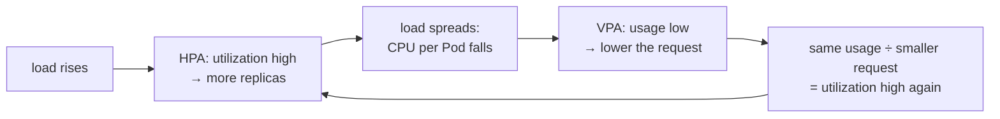
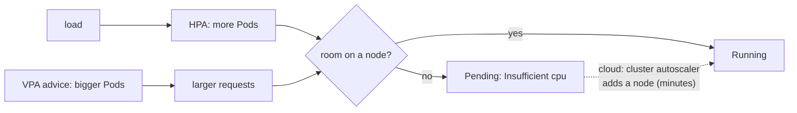

# VPA and capacity planning

*Stage 7 · Orbital Maneuvering*

**You will be able to:** read a VPA recommendation and say how it was computed, choose an update mode and know which VPA component each one needs, explain the HPA/VPA feedback loop and the safe ways to combine them, apply a recommendation without side effects, and reason about where scaling stops: at node capacity.

Every request in Apollo is a guess made in Stage 4: 100m and 128Mi for the default tier, 200m and 256Mi for booking. Those guesses now matter more than ever. The scheduler packs nodes by them, QoS ranks evictions by them, and the HPA divides by them ([Horizontal Pod Autoscaling](./hpa#utilization-is-measured-against-the-request)). Too high, and capacity is wasted and the HPA scales in too eagerly. Too low, and Pods are throttled or OOM-killed and the HPA overreacts. A measured suggestion is better than a guess.

## The Vertical Pod Autoscaler

The HPA changes **how many** Pods run. The **Vertical Pod Autoscaler (VPA)** works out **how big** each Pod's requests should be. It is an add-on from the Kubernetes autoscaler project, with three components:

| Component | Does | Apollo |
|---|---|---|
| **Recommender** | Reads usage from `metrics.k8s.io`, keeps a history per container, writes recommendations into each VPA object's status | Installed (v1.7.0) |
| **Updater** | In modes that apply changes, evicts Pods whose requests are far from the recommendation | Installed; does nothing for an `Off` VPA |
| **Admission controller** | A mutating webhook that rewrites requests on new Pods as they are created | **Omitted**: `Off` mode never mutates Pods, so a TLS webhook would only add a failure mode |

A `VerticalPodAutoscaler` object names a target and a policy:

```yaml
# search-vpa.yaml (trimmed)
spec:
  targetRef: {apiVersion: apps/v1, kind: Deployment, name: search}
  updatePolicy:
    updateMode: "Off"                   # recommend only
  resourcePolicy:
    containerPolicies:
      - containerName: search
        minAllowed: {cpu: 50m, memory: 64Mi}
        maxAllowed: {cpu: 1, memory: 512Mi}
        controlledResources: ["cpu", "memory"]
```

## How a recommendation is computed

The recommender samples each container's CPU and memory use and keeps them in **decaying histograms**: recent samples weigh more, with a half-life of about a day by default. History is saved in `VerticalPodAutoscalerCheckpoint` objects, so it survives a recommender restart.

| Field | Roughly (defaults) | Use it as |
|---|---|---|
| `lowerBound` | A low percentile of usage | Below this, the Pod is likely starved |
| `target` | About the 90th percentile of CPU and of memory peaks, plus a 15% safety margin | The suggested request |
| `upperBound` | A high percentile | Above this, the request is likely wasted |
| `uncappedTarget` | The target before `minAllowed`/`maxAllowed` | Shows when your policy bounds are clipping the advice |

Three behaviours matter when reading one:

- **Bounds are wide while history is short.** The less data, the further apart lower and upper bounds are. Recommendations stay empty until enough samples exist. A ten-minute lab gives a hint, not a sizing.
- **Memory is sized for peaks.** An OOM kill bumps the memory recommendation up sharply.
- **There are floors.** By default the recommender does not go below about 25m CPU and 250 Mi of memory per Pod, so a small service is often recommended *more* memory than it uses. Check `uncappedTarget` against observed usage before accepting it.

The recommendation is only as representative as the traffic it saw. A week of quiet nights and one sales event produce a different answer than a load test.

## Update modes

| Mode | Behaviour | Needs | Risk |
|---|---|---|---|
| **`Off`** (Apollo) | Recommend only | Recommender | None |
| `Initial` | Apply only when a Pod is created | Recommender + admission controller | Low: changes arrive with normal rollouts |
| `Recreate` / `Auto` | Evict running Pods to recreate them with new requests | All three | Restarts; fights the HPA on CPU; eviction respects PDBs but still disrupts single-replica workloads |

When the VPA does apply changes, it scales **limits** proportionally with requests by default, so a Guaranteed Pod stays Guaranteed.

## Why the HPA and VPA fight over CPU

Both use the CPU request: the HPA divides by it, an active VPA rewrites it.



Each controller's action changes the other's input. The result oscillates instead of settling. Safe combinations:

| HPA scales on | VPA | Safe? |
|---|---|---|
| CPU | `Off`, a person applies advice (Apollo) | Yes |
| CPU | Active on **memory only** (`controlledResources: [memory]`) | Yes |
| A custom metric (requests/s, queue length) | Active on CPU and memory | Yes |
| CPU | Active on CPU | **No** |

## Applying a recommendation

A person reads the advice, changes the chart, and ships it through Helm or Argo CD (Stage 5), so the change is reviewed and in Git. Two traps sit in Apollo's chart:

- **Tiers are shared.** Search uses the `default` tier, and so does **flight**. The VPA template's own comment suggests updating `tiers.default`; doing that resizes flight too, on advice measured only from search. Give search its own tier (or an override) first.
- **The HPA's denominator moves.** Raising search's CPU request from 100m to 150m means the same load now reads as two-thirds the utilization, so the HPA settles on fewer replicas. Rerun the same load afterwards and compare p95, throttling and replica counts ([Measurement before optimization](./measurement-baseline)).

## Capacity is the real limit

Neither autoscaler creates hardware. The HPA asks for Pods, the VPA asks for bigger Pods, and the scheduler must find room for their **requests** ([Scheduling](../reliability/scheduling#reading-pending)).



On Apollo's kind cluster, two workers are all there is. The airline already books about 1.9 CPUs before any scaling ([Stage 4's totals](../reliability/requests-limits-and-pressure#apollo-example)), plus the observability stack. Search at `maxReplicas: 10` would ask for another 1 CPU on top.

In the cloud, a **cluster autoscaler** (Stage 9, planned) watches for Pods that are `Pending` because nothing fits, and adds nodes; it removes nodes whose Pods fit elsewhere. Three things it does not change:

- **It is slow.** A new node takes minutes to boot and join; the HPA reacts in seconds. Teams often keep spare room with low-priority placeholder Pods, which real Pods [preempt](../reliability/priority-and-spreading#a-preemption-step-by-step) instantly while the new node boots.
- **It cannot satisfy impossible Pods.** A Pod with an unsatisfiable affinity, a volume pinned to one zone, or a request larger than any node type stays `Pending`.
- **It is bounded too.** Node-group maximums, quotas and budgets cap it.

## Apollo example

| Setting | dev | staging, prod |
|---|---|---|
| VPA for search | Disabled | Enabled, `Off` |
| Components | none | Recommender + updater in `kube-system`; no admission controller |
| Policy | | 50m–1 CPU, 64Mi–512Mi, CPU and memory |
| metrics-server | Bundled | Bundled |

## Try it

:::caution[Unverified]
Not yet run on a live cluster for this documentation revision. Needs Stage 7 installed with `--env staging` (dev disables the VPA) and some traffic; recommendations appear only after enough samples.
:::

```bash
NS=apollo-airlines-apps
kubectl get deploy -n kube-system | grep vpa                                   # recommender, updater; no admission controller
kubectl -n $NS get vpa search-vpa                                              # MODE Off
kubectl -n $NS get vpa search-vpa -o jsonpath='{.status.recommendation.containerRecommendations[0]}' | jq .
kubectl -n $NS get deploy search -o jsonpath='{.spec.template.spec.containers[0].resources}'; echo
kubectl top pods -n $NS -l app=search                                          # actual usage now
kubectl -n $NS get verticalpodautoscalercheckpoints                            # the stored history
kubectl get events -n $NS --field-selector reason=EvictedByVPA                 # none in Off mode
```

- Compare `target` with the current request and with `kubectl top`. A wide gap between `lowerBound` and `upperBound` means the history is still short.
- If `target` and `uncappedTarget` differ, the policy's min or max is clipping the advice.
- No evictions: `Off` only writes status.

## Common misconceptions

- **"The VPA resizes my Pods."** Not in `Off` mode, and not at all without the admission controller.
- **"A recommendation is a measurement."** It is a percentile of the history it saw, plus a margin and floors.
- **"Running an HPA and a VPA together is always wrong."** It is wrong when both act on CPU.
- **"Autoscaling means unlimited capacity."** Pods still need room on real nodes.
- **"Updating the tier only affects search."** Flight shares it.

## Check yourself

<details>
<summary>Why does Apollo run the VPA in <code>Off</code> mode beside a CPU-based HPA?</summary>

An active VPA would rewrite the CPU request that the HPA divides by, and the two would chase each other. `Off` gives sizing advice without touching Pods.
</details>

<details>
<summary>The VPA recommends 250Mi of memory for search, which uses 40Mi. Why might that be, and what do you check?</summary>

The recommender has a default per-Pod memory floor and adds safety margins. Compare `uncappedTarget`, `lowerBound` and actual usage before accepting it.
</details>

<details>
<summary>You raise search's CPU request from 100m to 150m. What happens to its HPA under the same load?</summary>

Utilization drops to two-thirds of its previous value, so the HPA settles on fewer replicas. Rerun the load to compare.
</details>

<details>
<summary>The HPA wants 8 search Pods and 3 are <code>Pending</code>. Which autoscaler can help?</summary>

Neither the HPA nor the VPA. Room must come from freeing requests or adding nodes, which a cluster autoscaler does in the cloud, over minutes.
</details>

## Where this leads

That completes the local path: Apollo runs, survives, ships, can be observed and scales. The planned missions continue with [Stage 8](../../missions/command-module): securing what is now running.

## References

- [Vertical Pod Autoscaler](https://github.com/kubernetes/autoscaler/tree/master/vertical-pod-autoscaler) and [its FAQ](https://github.com/kubernetes/autoscaler/blob/master/vertical-pod-autoscaler/docs/faq.md)
- [Kubernetes: autoscaling workloads](https://kubernetes.io/docs/concepts/workloads/autoscaling/)
- [Cluster Autoscaler](https://github.com/kubernetes/autoscaler/tree/master/cluster-autoscaler)
