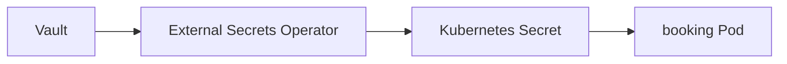
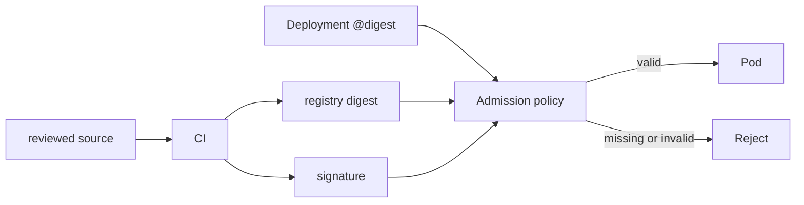

# Secrets and supply chain

*Command Module · Planned*

:::note[Conceptual chapter]
Vault, External Secrets Operator, Reloader, signing and admission enforcement are planned architecture, not installed in any Apollo stage yet.
:::

**You will be able to:** explain what an external secret store changes, and why a tag is not provenance.

Two quiet risks sit at either end of a deployment. **Secrets:** Apollo's passwords live in plain `Secret` YAML in the repository, so anyone with read access to Git holds production credentials, and rotating them means editing files. **Supply chain:** the cluster pulls `booking:v1.2.0` and runs it, but how do you know that image is what your CI built rather than something overwritten in the registry?

## Two trust problems

**Secrets:** instead of keeping the safe's combination written on a note in the office, keep it in a *bank vault* (HashiCorp Vault) that logs access and can change the combination on schedule, and have a courier (the External Secrets Operator) deliver the current value to the cluster.

**Supply chain:** a **tamper-evident seal** on a parcel. A *digest* identifies the exact contents; a *signature* proves your CI sealed it; an *admission policy* refuses to accept unsealed parcels.

### Secrets

| Today (Stages 1–7) | Planned |
|---|---|
| Plain Secret YAML in the repo (base64, not encrypted) | Secrets live in **Vault** |
| Manual rotation | **External Secrets Operator** copies Vault values into Kubernetes Secrets and refreshes them |
| Anyone with Git read access has the value | Rotation in Vault updates the cluster automatically |



The Kubernetes Secret still exists inside the cluster, so you still need RBAC and encryption at rest to protect it.

### Delivery is not restart

Rotation stops at the Kubernetes Secret. Every Apollo backend reads `apollo-airlines-secrets` through `env` (`secretKeyRef`), and an environment variable is copied once, at container start ([Delivery and timing](../workloads/configuration-and-identity#delivery-and-timing)). After ESO writes a new `JWT_SECRET`, the Secret is current and every running Pod still holds the old one. Kubernetes does not connect "this Secret changed" to "restart the Pods that read it".

A rollout happens only when the Deployment's Pod template changes. Two tools can cause that change:

- **`checksum/*` annotation.** Helm renders a hash of the ConfigMap or Secret into a Pod-template annotation, such as `checksum/config: {{ include (print $.Template.BasePath "/config.yaml") . | sha256sum }}`. New contents produce a new hash, and the Deployment rolls. Stage 7's Tempo Deployment already does this for its config file.
- **Reloader.** [Stakater Reloader](https://github.com/stakater/Reloader) is a controller that watches ConfigMaps and Secrets. When one changes, it updates the Pod template of each workload annotated to depend on it, and the Deployment rolls.

| Change comes from | Who notices | Planned trigger |
|---|---|---|
| A Git commit (Helm values, chart ConfigMap) | Helm or Argo CD, during the render | `checksum/*` annotation; no extra controller |
| Outside Git (ESO sync from Vault, cert-manager renewal) | Nothing in Git, because there is no commit | Reloader |


The planned Stage 8 design adds three constraints:

- **Opt-in, per workload, by name.** Reloader is installed with auto-reload off. Each Deployment names the Secret it depends on, for example `secret.reloader.stakater.com/reload: "apollo-airlines-secrets"`, so the trigger shows in the manifest.
- **One Secret, five rollouts.** All five backends read `apollo-airlines-secrets`, so one rotation restarts five Deployments at once. The Stage 4 PodDisruptionBudgets and Reloader's `pause-period` annotation limit the restart storm.
- **Not the databases.** Postgres applies `POSTGRES_PASSWORD` only when it first initialises its data directory. Restarting `booking-db` with a new value leaves the old password in the database and breaks every client. Rotating a database credential takes a database-side step.

The pinned version is Reloader v1.4.22, the latest stable release. Reloader v2 is still in beta, and it uses the same workload annotations.

### Supply chain

| Problem | Control |
|---|---|
| Tags (`:v1.2.0`, `:latest`) can be overwritten without any manifest change | Pin by **digest**: `@sha256:…` |
| Who built this image? | CI **signs** it (Cosign / Sigstore) |
| Unsigned images can still be deployed | An admission policy (Kyverno) **verifies** the signature and digest before admitting the Pod |



## Evidence (future stage)

```bash
kubectl get externalsecrets -n apollo-airlines-apps
kubectl rollout history deployment/booking -n apollo-airlines-apps   # a new revision after a rotation
cosign verify --key cosign.pub apollo11/booking@sha256:<digest>
kubectl get events -n apollo-airlines-apps | grep -i 'signature'
```

## Common misconceptions

- **"A private Git repo makes plain Secrets safe."** Leaks, forks and clones still spread the value.
- **"A signed image is a safe image."** Signing proves origin, not absence of bugs.
- **"A pinned tag is immutable."** Only a digest is.
- **"ESO rotated the Secret, so the app uses the new value."** Only new Pods do. Something must roll the Deployment.

## Check yourself

<details>
<summary>Why is <code>booking:v1.2.0</code> weak provenance?</summary>

A registry compromise or mistake can overwrite the tag without any manifest diff. A digest plus a verified signature ties the running bytes to a build.
</details>

<details>
<summary>Vault rotates <code>JWT_SECRET</code> and ESO updates the Secret. Why does booking still accept old tokens?</summary>

Booking read `JWT_SECRET` from `env` when its container started. Running Pods keep that value. No Git commit happened, so no checksum changed either. Reloader rolls the Deployment, and the new Pods read the rotated value.
</details>

## Where this leads

That ends the security concepts. The last conceptual mission asks what changes when Apollo leaves the local cluster for a cloud.
