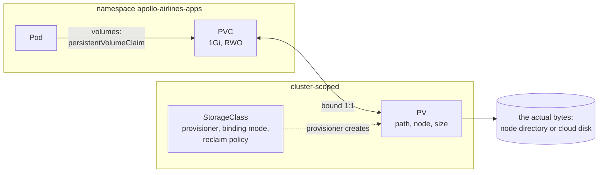
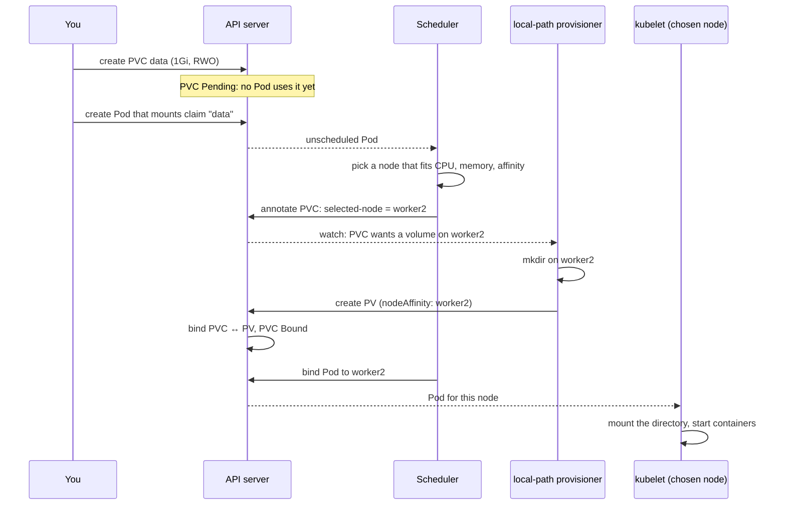
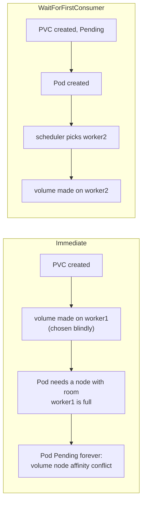

# Claims and provisioning

*Stage 3 · Mission Data*

**You will be able to:** trace a claim to the storage behind it, describe each step of dynamic provisioning, explain why node-local storage waits for the scheduler, and read access modes and capacity correctly.

[Volumes](./volume-lifetimes) showed that a database needs storage that outlives its Pod, without hard-coding a node directory. Kubernetes solves this the same way it solves compute: the workload says **what it needs**, and the cluster decides **how to supply it**. A Pod asks for CPU without naming a core; it asks for storage without naming a disk.

## Three objects: request, supply, policy

| Object | Role | Scope | Written by |
|---|---|---|---|
| **PersistentVolumeClaim (PVC)** | The request: "1Gi, mountable read-write by one node" | Namespace | The application (you) |
| **PersistentVolume (PV)** | The supply: one real piece of storage and how to reach it | Cluster | A provisioner, or an administrator |
| **StorageClass** | The policy: which provisioner creates PVs, with which settings | Cluster | The cluster administrator |



- A Pod only ever names a **claim** in its own namespace. It never names a PV.
- When a claim is **bound**, the PVC records its PV in `spec.volumeName` and the PV records its claim in `spec.claimRef`. One claim, one volume.
- The bytes are not in any of these objects. The PV *describes* where they are.

This split is why the same manifest works on kind and on EKS: only the StorageClass differs.

## Static and dynamic provisioning

There are two ways for a PV to exist:

- **Static provisioning:** an administrator creates PVs in advance. A new claim binds to any available PV that is big enough and has a matching access mode and class.
- **Dynamic provisioning:** nobody creates PVs. A **provisioner**, a controller named in the StorageClass, watches for claims and creates a PV for each one.

Almost every cluster today uses dynamic provisioning. kind ships one: `rancher.io/local-path`, which creates a directory on a node.

## Dynamic provisioning, step by step

With node-local storage the order matters, because the directory must be created on the node where the Pod will run. kind's StorageClass therefore uses `volumeBindingMode: WaitForFirstConsumer`:



1. The claim sits in `Pending`. That is normal: nothing needs it yet.
2. A Pod referencing the claim arrives. The scheduler chooses a node for the Pod first, then records that choice on the claim (`volume.kubernetes.io/selected-node`).
3. The provisioner creates storage on that node and a PV whose `nodeAffinity` names the node.
4. The claim and PV bind.
5. The kubelet mounts the volume and only then starts the container.

From then on the PV's `nodeAffinity` is a hard rule: every future Pod using this claim must run on that node.

### Why wait for the first consumer

The other mode, `Immediate`, provisions as soon as the claim appears. For storage that can be reached from anywhere that is fine. For node-local storage it is a trap:



Zonal cloud disks have the same problem at zone level, which is why most cloud StorageClasses also use `WaitForFirstConsumer`.

## Claim and volume phases

| Object | Phase | Meaning |
|---|---|---|
| PVC | `Pending` | Not bound yet: waiting for a consumer, for a matching PV, or provisioning failed |
| PVC | `Bound` | Has a PV |
| PVC | `Lost` | Its PV disappeared; the data may be gone |
| PV | `Available` | Static PV with no claim yet |
| PV | `Bound` | Belongs to a claim |
| PV | `Released` | Its claim was deleted; the data is still there but the PV cannot be reused automatically |

When a claim is deleted, the PV's **reclaim policy** (set from the StorageClass) decides the rest: `Delete` removes the storage, `Retain` leaves it `Released` for an administrator. kind's class uses `Delete`. [StatefulSet storage](./statefulset-storage-and-operations) shows which operations actually delete claims.

## Access modes

An **access mode** says how many *nodes* may mount the volume, and how:

| Mode | Short | Who may mount it |
|---|---|---|
| `ReadWriteOnce` | RWO | Read-write, from **one node** at a time |
| `ReadWriteOncePod` | RWOP | Read-write, from **one Pod** (CSI drivers only) |
| `ReadOnlyMany` | ROX | Read-only, from many nodes |
| `ReadWriteMany` | RWX | Read-write, from many nodes (needs network file storage such as NFS or EFS) |

Two things access modes are not:

- **Not a lock.** RWO is node-scoped: two Pods on the same node can both mount it read-write. If both run PostgreSQL against one data directory, the database can be corrupted. Preventing that is the controller's job ([next chapter](./statefulsets-and-headless-dns)).
- **Not a feature menu.** A claim lists the modes it needs; the provisioner must support them. local-path supports RWO only.

## Capacity

`resources.requests.storage: 1Gi` is a request. What happens with it depends on the provisioner:

- A cloud disk provisioner creates a 1Gi disk. Writes fail when it is full.
- **local-path ignores it.** It creates a plain directory with no quota. The database can grow until the node's own filesystem fills, and then *everything* on that node runs out of space.
- Growing a claim later requires a StorageClass with `allowVolumeExpansion: true`. kind's does not set it.

## The default StorageClass

A claim names its class in `spec.storageClassName`:

| Claim says | Result |
|---|---|
| Field omitted | The cluster's **default** StorageClass is used (kind: `standard`; EKS: usually `gp2` or `gp3`) |
| `storageClassName: ""` | No class: only a pre-created PV with no class can bind. No dynamic provisioning |
| `storageClassName: fast` | That class; `Pending` if it does not exist |

Apollo omits the field, so its manifests stay portable between clusters.

## Apollo example

Apollo does not write PVCs directly. Its StatefulSets generate them from a template, covered in [StatefulSet storage](./statefulset-storage-and-operations). The class they land on is kind's default:

```yaml
# kubectl get storageclass standard -o yaml (trimmed)
metadata:
  name: standard
  annotations:
    storageclass.kubernetes.io/is-default-class: "true"
provisioner: rancher.io/local-path
volumeBindingMode: WaitForFirstConsumer
reclaimPolicy: Delete
```

After installing Stage 3 you can follow one claim all the way down:

```bash
kubectl get pvc pg-data-identity-db-0 -n apollo-airlines-apps
PV=$(kubectl get pvc pg-data-identity-db-0 -n apollo-airlines-apps -o jsonpath='{.spec.volumeName}')
kubectl get pv "$PV" -o jsonpath='{.spec.claimRef.name}{"\n"}{.spec.nodeAffinity}{"\n"}{.spec.persistentVolumeReclaimPolicy}{"\n"}'
```

Expected: the PVC is `Bound`, RWO, 1Gi; the PV points back to `pg-data-identity-db-0`, names one node in its `nodeAffinity`, and has reclaim policy `Delete`. The [walkthrough](../../stage-3#step-3-follow-the-chain-down-to-the-bytes) follows it into the node's directory.

## Try it

:::caution[Unverified]
Not yet run on a live cluster for this documentation revision. Uses a throwaway claim and Pod in the `default` namespace of any kind cluster.
:::

Watch a claim wait, bind, keep data across Pods, and disappear with its storage:

```bash
kubectl apply -f - <<'YAML'
apiVersion: v1
kind: PersistentVolumeClaim
metadata: {name: demo-data}
spec:
  accessModes: ["ReadWriteOnce"]
  resources: {requests: {storage: 100Mi}}
YAML
kubectl get pvc demo-data                     # Pending
kubectl describe pvc demo-data | tail -3      # "waiting for first consumer to be created before binding"

cat > demo-pod.yaml <<'YAML'
apiVersion: v1
kind: Pod
metadata: {name: demo}
spec:
  containers:
    - name: app
      image: busybox:1.36
      command: ["sleep", "3600"]
      volumeMounts: [{name: data, mountPath: /data}]
  volumes:
    - name: data
      persistentVolumeClaim: {claimName: demo-data}
YAML
kubectl apply -f demo-pod.yaml
kubectl wait --for=condition=Ready pod/demo
kubectl get pvc demo-data                     # Bound, with a pvc-… VOLUME
PV=$(kubectl get pvc demo-data -o jsonpath='{.spec.volumeName}')
kubectl get pv "$PV" -o jsonpath='{.spec.nodeAffinity.required.nodeSelectorTerms[0].matchExpressions[0].values[0]}{"\n"}'
kubectl get pod demo -o jsonpath='{.spec.nodeName}{"\n"}'   # same node

# Data outlives the Pod
kubectl exec demo -- sh -c 'echo kept > /data/note'
kubectl delete pod demo
kubectl apply -f demo-pod.yaml
kubectl wait --for=condition=Ready pod/demo
kubectl exec demo -- cat /data/note           # kept

# Deleting the claim deletes the storage (reclaim policy Delete)
kubectl delete pod demo
kubectl delete pvc demo-data
kubectl get pv "$PV"                          # NotFound, after a few seconds
rm demo-pod.yaml
```

## When a claim is stuck

| You see | Meaning | Look at |
|---|---|---|
| PVC `Pending`, no Pod uses it | Normal under `WaitForFirstConsumer` | Nothing to fix |
| PVC and Pod both `Pending` | Scheduling or provisioning has not finished | `kubectl describe pod`, then `kubectl describe pvc` |
| Event `ProvisioningFailed` | The provisioner could not create storage | Claim events; provisioner logs (`kubectl logs -n local-path-storage deploy/local-path-provisioner`) |
| `storageclass … not found`, or no default class | Nothing will provision this claim | `kubectl get storageclass` |
| Pod `Pending`, `volume node affinity conflict` | The PV's node cannot take the Pod (cordoned, full, gone) | `kubectl get nodes`; Pod events |

## Common misconceptions

- **"`Bound` means the data is safe."** It means storage was assigned. Nothing about copies or backups.
- **"`Pending` means broken."** Under `WaitForFirstConsumer`, a claim waits for its Pod.
- **"RWO means one Pod."** It means one node. Use RWOP, or a controller that guarantees one Pod, for single-writer safety.
- **"1Gi is a limit."** On local-path it is only a label.

## Check yourself

<details>
<summary>Who chooses the node a local-path volume is created on?</summary>

The scheduler, while placing the first Pod that uses the claim. The provisioner then creates the directory on that node.
</details>

<details>
<summary>The same manifest is applied on kind and on EKS. What changes, and where?</summary>

Only the default StorageClass: local-path directories on kind, EBS disks on EKS. The claim and the Pod are unchanged.
</details>

<details>
<summary>A claim is deleted. Is the data gone?</summary>

It depends on the PV's reclaim policy. With `Delete` (kind's default) the provisioner removes it. With `Retain` the PV becomes `Released` and the bytes stay until an administrator deals with them.
</details>

## Where this leads

A database Pod can now mount a claim. [StatefulSets and headless DNS](./statefulsets-and-headless-dns) explains why a Deployment is still the wrong controller to run it, and what replaces it.

## References

- [Persistent Volumes](https://kubernetes.io/docs/concepts/storage/persistent-volumes/)
- [Storage Classes: volume binding mode](https://kubernetes.io/docs/concepts/storage/storage-classes/#volume-binding-mode)
- [Dynamic provisioning](https://kubernetes.io/docs/concepts/storage/dynamic-provisioning/)
- [local-path-provisioner](https://github.com/rancher/local-path-provisioner)
