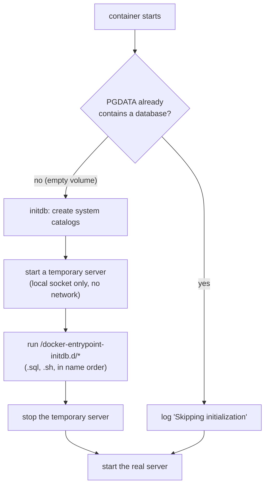
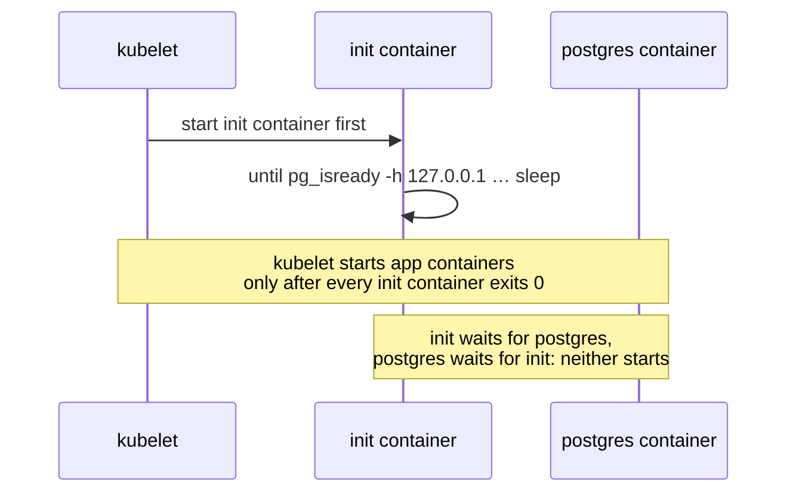

# Initialization and seeding

*Stage 3 · Mission Data*

**You will be able to:** tell bootstrap, seeding and migration apart, choose where each should run in Kubernetes, explain how PostgreSQL decides whether to initialize, and write a seed that is safe to run twice.

With `emptyDir`, every database Pod started empty, so setup could simply run "after the database starts". Persistent storage changes the question. A starting database Pod may be opening **a brand-new volume** or **one that already holds years of bookings**. Setup must depend on the state of the volume, not on the fact that a Pod started.

## Three tasks, three triggers

| Task | What it does | Should run when | Apollo example |
|---|---|---|---|
| **Bootstrap** | Creates the initial structure | The volume is empty | `CREATE TABLE users (…)` |
| **Seed** | Loads a chosen dataset | An operator decides to (install, reset, a new day of flights) | Demo users, six airports, 31 days of flights |
| **Migration** | Changes an existing schema, keeping its data | The application version changes | Add a column to `bookings` on a database that already has bookings |

Stages 1 and 2 did bootstrap and seed in one Job, once, after install. That fitted a database that never outlived its Pod. Stage 3 separates them because their triggers are now different.

## Where setup can run

| Option | Runs | Good for | Watch out for |
|---|---|---|---|
| **Image entrypoint hook** (e.g. `/docker-entrypoint-initdb.d`) | Inside the database container, only on an empty data directory | Bootstrap | Never runs again, so it cannot change an existing database |
| **Init container in the database Pod** | Before the database container, on every Pod start | Preparing files or permissions | Cannot talk to the database: it is not running yet |
| **Init container in the app Pod** | Before each app replica starts | Migrations with a tool that takes a lock | Runs once per replica and per restart |
| **Job** | Once, to completion, when created | Seeds, one-off maintenance, migrations | Does not rerun by itself; a Pod may be retried after partial work |

Stage 5 adds a fifth: release hooks in Helm and Argo CD, which tie a Job to a deployment.

## How the PostgreSQL image initializes

The official `postgres` image's entrypoint script makes the bootstrap decision itself:



- `POSTGRES_DB`, `POSTGRES_USER` and `POSTGRES_PASSWORD` are applied during that first run too. Changing them later does nothing to an existing database.
- While the scripts run, the server listens only on a local socket. A readiness probe or a seed Job cannot connect early and see a half-built schema.
- A script that fails aborts the start. The container restarts, but the data directory is no longer empty, so initialization is skipped and the database starts with whatever was created before the failure. Fix the script and recreate the volume.

## Why not an init container in the database Pod

It is a common first attempt: an init container that waits for PostgreSQL, then runs `CREATE TABLE`.



Init containers in the *database's own* Pod run before the database exists. An init container in the *application's* Pod is a different story: the database is a separate Pod and already running, so migrations there are a common, valid pattern.

## Idempotent seeds

**Idempotent** means running it twice leaves the same result as running it once. A seed Job must be idempotent for three reasons: you will rerun it, a Job may retry a Pod that failed halfway, and the volume may already hold the rows.

Kubernetes does not make a Job idempotent. The SQL does:

| Technique | Repeat run | Use for |
|---|---|---|
| `CREATE TABLE IF NOT EXISTS` | Skips an existing table (even if its columns differ) | Bootstrap scripts |
| `INSERT … ON CONFLICT (key) DO NOTHING` | Skips rows whose key already exists; does not update them | Reference and demo data |
| `INSERT … ON CONFLICT (key) DO UPDATE` | Overwrites existing rows with the seed's values | Data the seed should own |
| Run the file with `--single-transaction` | All or nothing: a failure leaves no partial seed | Any multi-statement seed |

`ON CONFLICT` needs a unique constraint on the key. Without one, PostgreSQL rejects the statement.

## Why migrations need their own tool

Bootstrap runs once; seeds add rows. Neither changes an existing table. `CREATE TABLE IF NOT EXISTS` sees that `bookings` exists and does nothing, even if the new version of the script adds a column.

A **migration tool** (Flyway, Liquibase, Alembic, golang-migrate, and others) keeps a table of which numbered changes the database has already received, and applies only the missing ones, in order. Apollo does not use one in the verified stages, so a schema change means a manual migration or a fresh volume.

## Apollo example

Each database has two ConfigMaps and one Job:

| File | Contains | How it runs |
|---|---|---|
| [`identity-db-init-script.yaml`](https://github.com/darshan-raul/Apollo11/blob/f6211e679f8ed66a5a19033ac49a3bfc3a506eab/stages/stage3/k8s/apps/identity-db/identity-db-init-script.yaml) | `init.sql`: `CREATE TABLE IF NOT EXISTS users (…)` | Mounted at `/docker-entrypoint-initdb.d` in the StatefulSet |
| [`identity-db-seed.yaml`](https://github.com/darshan-raul/Apollo11/blob/f6211e679f8ed66a5a19033ac49a3bfc3a506eab/stages/stage3/k8s/jobs/identity-db-seed.yaml) | `seed.sql`: two users, `ON CONFLICT (id) DO NOTHING` | Mounted at `/init` in the Job |
| [`seed-identity-db.yaml`](https://github.com/darshan-raul/Apollo11/blob/f6211e679f8ed66a5a19033ac49a3bfc3a506eab/stages/stage3/k8s/jobs/seed-identity-db.yaml) | The Job | Created by `apply.sh` after the StatefulSets are Ready |

The Job connects through the ordinary Service, like any client:

```bash
until pg_isready -h identity-db -U postgres; do sleep 2; done
psql -h identity-db -U postgres -d identity -v ON_ERROR_STOP=1 -f /init/seed.sql
```

`ON_ERROR_STOP=1` makes `psql` exit non-zero on the first failed statement, so the Job fails instead of reporting success.

| Seed | Conflict key | On a repeat run |
|---|---|---|
| Users (`identity-db`) | `id` | Existing users untouched |
| Airports (`flight-db`) | `code` | Existing airports untouched |
| Flights (`flight-db`) | `(flight_number, departure_time)`, unique in the schema | Existing flights untouched; days that have newly come into the 31-day window are added |
| Bookings (`booking-db`) | none: the seed is `SELECT 1` | Nothing; bookings only come from passengers |

That last row is the point of the whole stage. Seeds can rebuild everything Apollo ships with. They can never rebuild what passengers did.

## Try it

:::caution[Unverified]
Not yet run on a live cluster for this documentation revision. Requires a running Stage 3; reruns a seed Job and changes no existing rows.
:::

See which path the database took on its last start, then rerun a seed and confirm nothing doubles:

```bash
NS=apollo-airlines-apps
kubectl logs -n $NS identity-db-0 | grep -iE "docker-entrypoint-initdb.d|skipping initialization"
kubectl exec -n $NS identity-db-0 -- psql -U postgres -d identity -tAc 'SELECT count(*) FROM users;'

# A Job's Pod template is immutable: delete and recreate it to run again
# (run from the Apollo11 repo root)
kubectl delete job seed-identity-db -n $NS
kubectl apply -f stages/stage3/k8s/jobs/seed-identity-db.yaml
kubectl wait --for=condition=Complete job/seed-identity-db -n $NS --timeout=60s
kubectl logs -n $NS job/seed-identity-db | tail -2      # INSERT 0 0, "identity DB seeded"
kubectl exec -n $NS identity-db-0 -- psql -U postgres -d identity -tAc 'SELECT count(*) FROM users;'
```

- On the first start of a fresh volume the log shows `running /docker-entrypoint-initdb.d/init.sql`; after any replacement it shows `Skipping initialization`.
- `INSERT 0 0` means zero rows inserted: every seed user already existed. The count is unchanged.

## Common misconceptions

- **"Editing the init ConfigMap updates the database."** The scripts only run on an empty data directory.
- **"Ready means the schema is there."** `pg_isready` checks that the server accepts connections, nothing more.
- **"A Job runs exactly once."** It runs until it succeeds, retrying failed Pods. The SQL must tolerate a repeat.
- **"The login works, so the data recovered."** Seeds can recreate demo users on an empty volume. Check data the seeds cannot create.

## Check yourself

<details>
<summary><code>booking-db</code>'s volume is lost and recreated. Which tables and rows exist afterwards?</summary>

The entrypoint hook recreates the `bookings` table on the empty volume. The seed adds nothing, so the table is empty. Passenger bookings are gone.
</details>

<details>
<summary>Why can an init container in the application's Pod run migrations, when one in the database's Pod cannot run the schema?</summary>

The application Pod's init container runs while the database, in another Pod, is already up. The database Pod's init container runs before its own database starts, so it waits forever.
</details>

<details>
<summary>Does <code>ON CONFLICT DO NOTHING</code> fix a seed user whose email is wrong?</summary>

No. It skips the insert because the key exists. Changing existing rows needs `DO UPDATE` or an explicit `UPDATE`.
</details>

## Where this leads

Everything so far keeps one copy of the data and reopens it. [Recovery boundaries](./recovery-boundaries) asks what happens when that one copy is lost or damaged.

## References

- [Official PostgreSQL image: initialization scripts](https://hub.docker.com/_/postgres)
- [Init containers](https://kubernetes.io/docs/concepts/workloads/pods/init-containers/)
- [Jobs: handling Pod and container failures](https://kubernetes.io/docs/concepts/workloads/controllers/job/#handling-pod-and-container-failures)
- [PostgreSQL `INSERT … ON CONFLICT`](https://www.postgresql.org/docs/15/sql-insert.html#SQL-ON-CONFLICT)
