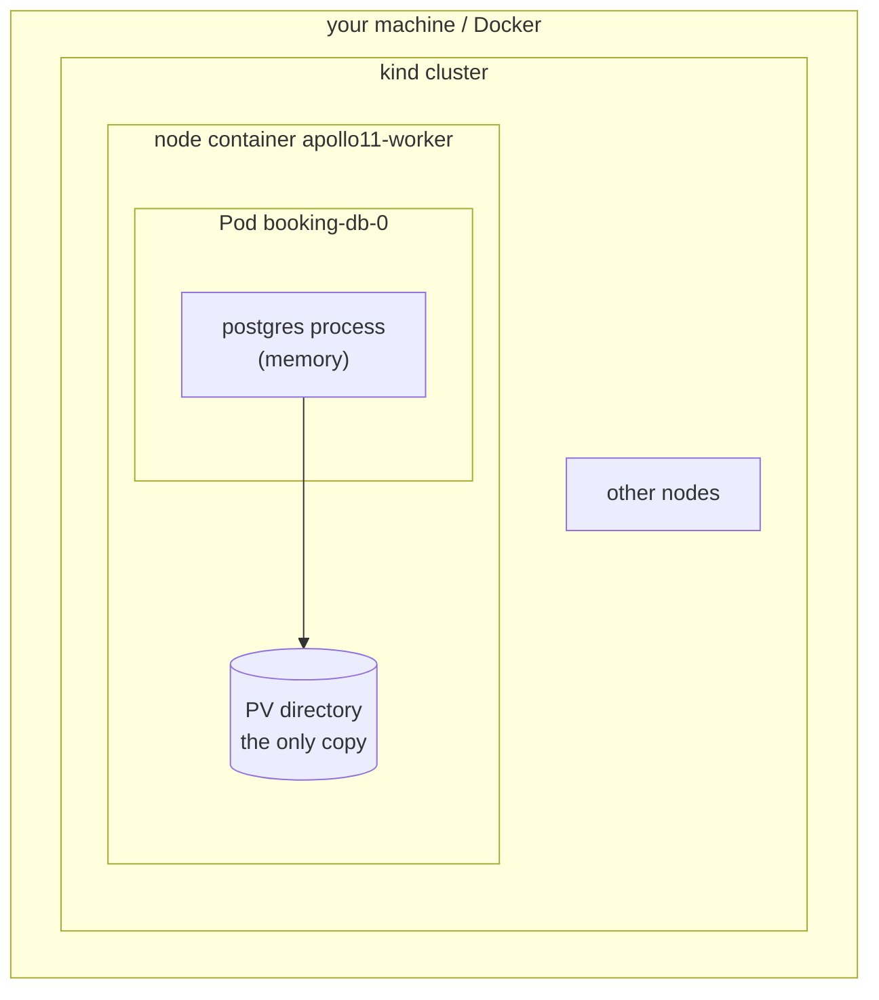

# Recovery boundaries

*Stage 3 · Mission Data*

**You will be able to:** name the failures Stage 3's storage survives and the ones it does not, tell persistence, availability, replication and backup apart, pick a backup method by what it captures, and say what a restore test proves.

Stage 3 ends with a booking that survives its database Pod being replaced. That is a real result, and a narrow one. There is still exactly **one copy** of every booking, in **one directory**, on **one node**. This chapter is about everything that one copy cannot protect against.

## Failure domains

A **failure domain** is the set of things that fail together. A copy of data protects you only from failures *outside* the domain it lives in.



| Event | Domain lost | Stage 3 data |
|---|---|---|
| Container crash, Pod deleted, rollout | Pod | ✅ the PV directory remains |
| Node container restarted (`docker restart`) | Node, temporarily | ✅ once the node returns; the database is down meanwhile |
| Node container deleted, `kind delete cluster` | Node or cluster | ❌ the directory was inside it |
| Claim or namespace deleted | Kubernetes objects | ❌ reclaim policy `Delete` removes the directory |
| `DELETE FROM bookings;` by mistake | None: the database did what it was told | ❌ the deletion is persisted faithfully |
| Bug writes bad data for a week | None | ❌ |

The last two rows matter most. No storage design survives them, because the storage is working correctly. Only a copy taken **before** the mistake helps.

## Four different protections

| Protection | Answers | Mechanism | Survives | Does not survive |
|---|---|---|---|---|
| **Persistence** | Do the files outlive the process? | PV/PVC | Pod replacement | Loss of the volume |
| **Availability** | Is the service answering? | Several members, probes, failover | A member going down | Bad writes |
| **Replication** | Is there a live second copy? | The database streams changes to replicas | Losing a node or disk | Bad writes: they are copied too, within milliseconds |
| **Backup** | Can I go back to an earlier state? | A copy taken at a point in time, kept elsewhere | Bad writes, deletion, cluster loss | Changes made after the backup |

Stage 3 has the first one only. Replication and backup are different tools: replication protects against hardware, backup protects against time.

## How much can you lose, and for how long

Two numbers describe any recovery plan:

- **Recovery Point Objective (RPO):** how much recent data you can afford to lose, measured in time. Nightly backups mean an RPO of up to 24 hours.
- **Recovery Time Objective (RTO):** how long it may take to be working again: notice, fetch the backup, restore, reconnect, verify.


Inside a single Redis Pod, `appendfsync everysec` gives a crash RPO of about one second. That says nothing about losing the volume, where Redis's RPO is "everything".

## Backup methods

| Method | What it captures | Point-in-time? | Kubernetes object | In Stage 3? |
|---|---|---|---|---|
| **Logical dump** (`pg_dump`) | SQL to rebuild one database's schema and rows | Only the moment of the dump | None; any Pod or Job can run it | No (manual rehearsal below) |
| **Physical backup + WAL archive** | Database files plus the change log since | Yes, to any second covered by the WAL | Usually an operator (CloudNativePG) | No |
| **Volume snapshot** | The disk's blocks at an instant | Only the snapshot moment | `VolumeSnapshot` (CSI drivers that support it) | No: local-path cannot snapshot |
| **Cluster backup** (Velero) | Kubernetes objects plus volume data | Only the backup moment | Velero's own resources | No: [Stage 9](../../stage-9) (planned) |

- A volume snapshot of a running database is **crash-consistent**: like pulling the power. PostgreSQL recovers from that using its WAL, but not every application can.
- A backup in the same failure domain as the data is not a backup for that failure. A dump saved inside the node directory dies with the node.
- A backup that has never been restored is a hope, not a plan.

## What Stage 3's verifier proves

[`verify.sh`](https://github.com/darshan-raul/Apollo11/blob/f6211e679f8ed66a5a19033ac49a3bfc3a506eab/stages/stage3/scripts/verify.sh) creates a booking through the Gateway, deletes `booking-db-0`, waits for it to be Ready, and looks for that booking ID in the database.

- **Proves:** the replacement Pod reopened the same volume, and PostgreSQL had committed the booking to it.
- **Does not prove:** survival of the node, the claim, the cluster, or a bad write. Those are the rows marked ❌ above.

## Try it: rehearse a restore

:::caution[Unverified]
Checked against the PostgreSQL 15 documentation but not yet run on a live Apollo cluster for this revision. Requires a running Stage 3. Creates a temporary database next to `identity` and leaves `identity` untouched.
:::

Dump `identity` to your machine, restore it into a new database, and compare:

```bash
(
  set -euo pipefail
  NS=apollo-airlines-apps
  DIR=$(mktemp -d)
  kubectl exec -n $NS identity-db-0 -- \
    pg_dump -U postgres -d identity --no-owner --no-privileges > "$DIR/identity.sql"
  test -s "$DIR/identity.sql"
  echo "dump: $DIR/identity.sql"

  kubectl exec -n $NS identity-db-0 -- createdb -U postgres identity_restore_check
  kubectl exec -i -n $NS identity-db-0 -- \
    psql -U postgres -d identity_restore_check -v ON_ERROR_STOP=1 --single-transaction -q \
    < "$DIR/identity.sql"

  for db in identity identity_restore_check; do
    printf '%s: ' "$db"
    kubectl exec -n $NS identity-db-0 -- psql -U postgres -d "$db" -tAc \
      "SELECT count(*), md5(string_agg(id::text || email, ',' ORDER BY id)) FROM users;"
  done
)
```

Expected: two identical lines (row count and checksum) for `identity` and `identity_restore_check`. Then remove the copy:

```bash
kubectl exec -n apollo-airlines-apps identity-db-0 -- dropdb -U postgres identity_restore_check
```

- The dump on your machine contains account data and password hashes. Delete it when you are done.
- This shows that the dump restores on the same server. A real rehearsal restores on separate infrastructure, points the application at it, and checks records only users could have created, while timing the whole process to measure the RTO.

## Common misconceptions

- **"We have persistent volumes, so we have backups."** A PV is the one copy; it keeps mistakes as faithfully as data.
- **"Replication is a backup."** It copies mistakes to every replica within moments.
- **"`Retain` protects the data."** It stops automatic deletion after a claim is removed. It does not protect against node loss or bad writes.
- **"The dump command succeeded, so we can recover."** Only a restore, checked against known data, shows that.

## Check yourself

<details>
<summary>A dump is written into <code>/var/lib/postgresql/data/backup.sql</code> every night. Which failures does it protect against?</summary>

Bad writes, as long as you notice within a day. Not node loss, claim deletion or cluster deletion: the dump sits in the same directory as the data.
</details>

<details>
<summary>Apollo adds two PostgreSQL replicas. Someone runs <code>DROP TABLE bookings</code>. What happens?</summary>

The primary drops the table and streams the change; both replicas drop it too. Only a backup from before the command can bring the bookings back.
</details>

<details>
<summary>After a restore into a second database, what is still unproven?</summary>

That the backup survives outside the node and cluster, that it runs on a schedule, how long a full recovery takes, and that the application works against the restored data.
</details>

## Where this leads

The [Stage 3 walkthrough](../../stage-3) runs the storage chain end to end. [Stage 4](../../stage-4) turns to keeping members healthy and placed sensibly; [Stage 9](../../stage-9) moves storage to cloud volumes and adds backups.

## References

- [Persistent Volumes: reclaiming](https://kubernetes.io/docs/concepts/storage/persistent-volumes/#reclaiming)
- [Volume snapshots](https://kubernetes.io/docs/concepts/storage/volume-snapshots/)
- [PostgreSQL 15: SQL dump](https://www.postgresql.org/docs/15/backup-dump.html)
- [PostgreSQL 15: continuous archiving and point-in-time recovery](https://www.postgresql.org/docs/15/continuous-archiving.html)
