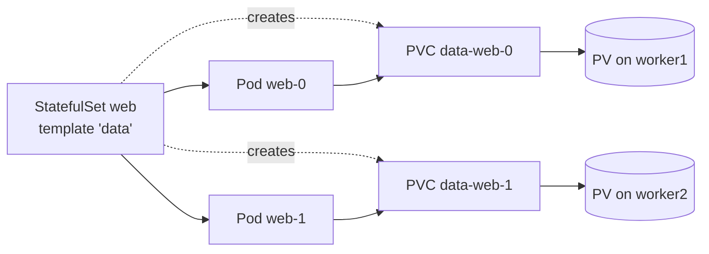
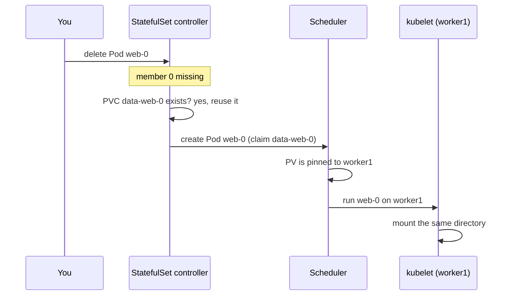
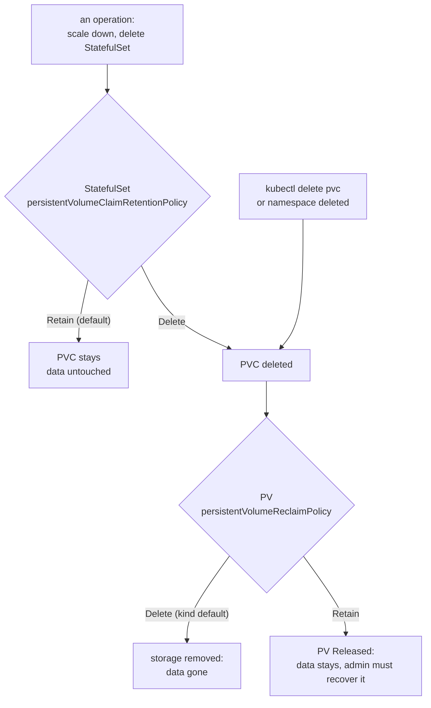

# StatefulSet storage and operations

*Stage 3 · Mission Data*

**You will be able to:** follow a member to its own claim, predict what replacement, updates, scale-down and deletion do to that claim and its data, and explain why mounting a volume does not by itself make Redis durable.

[StatefulSets](./statefulsets-and-headless-dns) give each member a stable name. A stable name is only useful to a database if it comes with the *same files* every time. This chapter connects the two, and then sorts out the operations that look similar but treat data very differently.

## One claim per member

A Deployment's Pod template can only name one claim, shared by every replica. A StatefulSet adds **`volumeClaimTemplates`**: a claim *shape* from which the controller stamps out one PVC per ordinal.

```yaml
apiVersion: apps/v1
kind: StatefulSet
metadata: {name: web}
spec:
  serviceName: web
  replicas: 2
  selector: {matchLabels: {app: web}}
  template:
    metadata: {labels: {app: web}}
    spec:
      containers:
        - name: web
          image: nginx:1.27-alpine
          volumeMounts:
            - {name: data, mountPath: /usr/share/nginx/html}  # refers to the template by name
  volumeClaimTemplates:
    - metadata: {name: data}
      spec:
        accessModes: ["ReadWriteOnce"]
        resources: {requests: {storage: 100Mi}}
```



- The claim name is **`<template>-<statefulset>-<ordinal>`**: `data-web-0`, `data-web-1`.
- The controller creates the claim *before* the Pod, if it does not already exist. If it does exist, it is reused. That single rule is what makes replacement work.
- Each claim is provisioned separately, so members can land on different nodes with their own volumes.
- `volumeClaimTemplates` cannot be edited on an existing StatefulSet. Changing the shape means a new StatefulSet (or editing each PVC, if the class allows expansion).

## Replacement reuses the claim



The replacement has a new UID, the same name, the same claim, and on node-local storage the same node. That is the whole mechanism behind "the database came back with its data".

## Updates

A change to the Pod template (a new image, a new environment variable) triggers an update. With the default `updateStrategy: RollingUpdate`:

- Members are updated **one at a time, from the highest ordinal down**. Each is deleted, recreated from the new template on its existing claim, and must become Ready before the next.
- The update never runs old and new copies of the *same* member side by side. Each member is down while it is replaced.
- **`partition: N`** updates only ordinals ≥ N. It lets you try a new version on one member first.
- `updateStrategy: OnDelete` updates nothing automatically; each member picks up the new template when you delete its Pod.

With one member, as in Apollo, an update means the database is unavailable from the moment `-0` stops until the new `-0` is Ready. Clients must retry.

## Two separate policies: claim retention and volume reclaim

Deleting storage happens at two layers, controlled by two different policies. Most confusion about "will this delete my data?" comes from mixing them up.



| Policy | Set on | Decides | Default |
|---|---|---|---|
| `persistentVolumeClaimRetentionPolicy.whenScaled` | StatefulSet | Delete a member's PVC when the StatefulSet scales below it? | `Retain` |
| `persistentVolumeClaimRetentionPolicy.whenDeleted` | StatefulSet | Delete all PVCs when the StatefulSet is deleted? | `Retain` |
| `persistentVolumeReclaimPolicy` | PV (copied from the StorageClass) | Remove the storage when its PVC is deleted? | `Delete` for dynamically provisioned volumes |

So with Kubernetes defaults, StatefulSet operations never delete claims, and deleting a claim always deletes the data.

| Operation (Apollo defaults) | PVC | Data |
|---|---|---|
| Delete Pod `identity-db-0` | Kept, reused by the replacement | ✅ |
| Scale to 0, later back to 1 | Kept, `Bound` with no Pod | ✅ (database offline meanwhile) |
| Scale 3 → 1 → 3 | `-1` and `-2` kept and reattached | ✅ |
| Delete the StatefulSet, re-apply it | Kept; new Pods adopt them by name | ✅ |
| `kubectl delete pvc` | Deleted once no Pod uses it (the `kubernetes.io/pvc-protection` finalizer waits) | ❌ |
| Delete the namespace | All PVCs in it deleted | ❌ |

## Scaling up is not replication

Scaling a StatefulSet adds members, each with a new, empty claim. For PostgreSQL that is a second independent database, not a copy. Whether extra members become replicas depends entirely on the application's own configuration.

## The application must write to the volume

A volume keeps whatever the process writes to it. It cannot make the process write.

- **PostgreSQL** is built around its data directory. Before it confirms a commit, it flushes the change to its write-ahead log (WAL) on that volume. A committed transaction is on the volume.
- **Redis** keeps data in memory and writes to disk only according to its configuration. With no options, the `redis:7` image takes occasional snapshots (`dump.rdb`, by default after 1 change in an hour, 100 in five minutes, or 10,000 in a minute). Everything since the last snapshot lives only in memory and is lost when the Pod is replaced.

Apollo's [Redis StatefulSet](https://github.com/darshan-raul/Apollo11/blob/f6211e679f8ed66a5a19033ac49a3bfc3a506eab/stages/stage3/k8s/apps/redis/redis-sts.yaml) turns on the append-only file:

```yaml
command:
  - redis-server
  - --appendonly yes        # log every write command to disk
  - --appendfsync everysec  # flush that log to disk once a second
  - --save 60 100           # also snapshot if 100 changes in 60s (replaces the defaults)
volumeMounts:
  - {name: redis-data, mountPath: /data}
```

- With AOF on, Redis 7 writes to `/data/appendonlydir/` (a base file, an incremental log and a manifest). On start it replays that log to rebuild memory.
- `everysec` means a write is acknowledged before it is on disk. A crash can lose about the last second of writes; a clean shutdown flushes first.
- When AOF is on, Redis loads from AOF rather than `dump.rdb` at startup.

## Apollo example

Each of Apollo's four StatefulSets has one template and one member:

| StatefulSet | Template | Mounted at | Resulting claim |
|---|---|---|---|
| `identity-db` | `pg-data` | `/var/lib/postgresql/data` | `pg-data-identity-db-0` |
| `flight-db` | `pg-data` | `/var/lib/postgresql/data` | `pg-data-flight-db-0` |
| `booking-db` | `pg-data` | `/var/lib/postgresql/data` | `pg-data-booking-db-0` |
| `redis` | `redis-data` | `/data` | `redis-data-redis-0` |

All four leave the retention policy and update strategy at their defaults. Apollo's PostgreSQL readiness probe runs `pg_isready`, which reports whether the server accepts connections. It does not check that tables or rows exist, so "Ready after replacement" is not by itself evidence that data survived. The [walkthrough](../../stage-3#step-5-see-the-data-survive-a-pod-replacement) checks a specific row instead.

## Try it

:::caution[Unverified]
Not yet run on a live cluster for this documentation revision. Uses throwaway objects in the `default` namespace; the last step deletes their claims.
:::

Apply the StatefulSet from the top of this chapter with its headless Service, then write a different file into each member's volume:

```bash
kubectl apply -f - <<'YAML'
apiVersion: v1
kind: Service
metadata: {name: web}
spec: {clusterIP: None, selector: {app: web}, ports: [{port: 80}]}
---
apiVersion: apps/v1
kind: StatefulSet
metadata: {name: web}
spec:
  serviceName: web
  replicas: 2
  selector: {matchLabels: {app: web}}
  template:
    metadata: {labels: {app: web}}
    spec:
      containers:
        - name: web
          image: nginx:1.27-alpine
          volumeMounts: [{name: data, mountPath: /usr/share/nginx/html}]
  volumeClaimTemplates:
    - metadata: {name: data}
      spec:
        accessModes: ["ReadWriteOnce"]
        resources: {requests: {storage: 100Mi}}
YAML
kubectl rollout status sts/web
kubectl get pvc                                   # data-web-0, data-web-1: Bound
for i in 0 1; do kubectl exec web-$i -- sh -c "echo member-$i > /usr/share/nginx/html/index.html"; done

# 1. Replacement keeps the file
kubectl delete pod web-0
kubectl wait --for=condition=Ready pod/web-0
kubectl exec web-0 -- cat /usr/share/nginx/html/index.html   # member-0

# 2. Scale-down keeps the claim; scale-up reattaches it
kubectl scale sts web --replicas=1
kubectl get pvc                                   # data-web-1 still Bound
kubectl scale sts web --replicas=2
kubectl wait --for=condition=Ready pod/web-1
kubectl exec web-1 -- cat /usr/share/nginx/html/index.html   # member-1

# 3. Deleting the StatefulSet keeps the claims
kubectl delete sts web
kubectl get pvc                                   # both still there

# 4. Only deleting the claims deletes the data
kubectl delete pvc data-web-0 data-web-1
kubectl delete svc web
```

On a running Stage 3, check Redis's persistence settings and files:

```bash
kubectl exec -n apollo-airlines-apps redis-0 -- redis-cli config get appendonly    # yes
kubectl exec -n apollo-airlines-apps redis-0 -- ls /data/appendonlydir
```

## Common misconceptions

- **"Deleting the StatefulSet deletes the data."** Not with default retention. The claims stay and are adopted again by name.
- **"Deleting a claim is safe because the StatefulSet will recreate it."** It recreates an *empty* claim. The old storage is already gone under reclaim policy `Delete`.
- **"Rolling updates keep a single-member database online."** The only member is stopped before its replacement starts.
- **"Redis with a PVC keeps every write."** Only what Redis has written to disk, and `everysec` allows about a second of loss.

## Check yourself

<details>
<summary>What does member 1 get after scaling 2 → 1 → 2 with default retention?</summary>

Its old claim, `data-web-1`, with its old files. Scale-down kept the claim; scale-up created the Pod and found the claim by name.
</details>

<details>
<summary>Which policy decides whether a deleted PVC's bytes are removed, and where is it set?</summary>

The PV's `persistentVolumeReclaimPolicy`, copied from the StorageClass at provisioning time. The StatefulSet's retention policy only decides whether the controller deletes the PVC in the first place.
</details>

<details>
<summary>Redis runs with a PVC but no persistence options. The Pod is replaced. What is in the new Redis?</summary>

Whatever was in its last automatic `dump.rdb` snapshot, if one was taken. Writes since then are lost.
</details>

## Where this leads

A replacement Pod now reopens existing files. A *new* volume has no files at all. [Initialization and seeding](./initialization-and-seeding) covers how the database gets its tables, and its demo data, on that first start.

## References

- [StatefulSets: stable storage and update strategies](https://kubernetes.io/docs/concepts/workloads/controllers/statefulset/)
- [PersistentVolumeClaim retention](https://kubernetes.io/docs/concepts/workloads/controllers/statefulset/#persistentvolumeclaim-retention)
- [Reclaiming PersistentVolumes](https://kubernetes.io/docs/concepts/storage/persistent-volumes/#reclaiming)
- [Redis persistence](https://redis.io/docs/latest/operate/oss_and_stack/management/persistence/)
