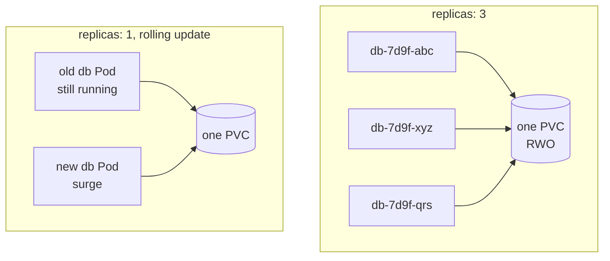
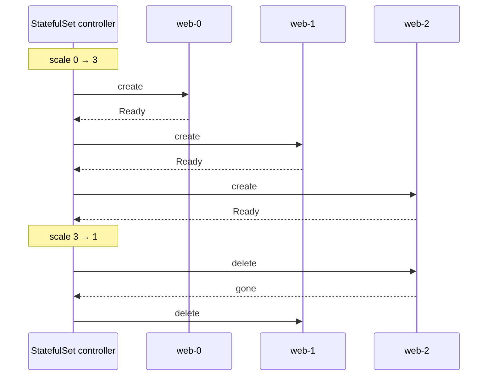
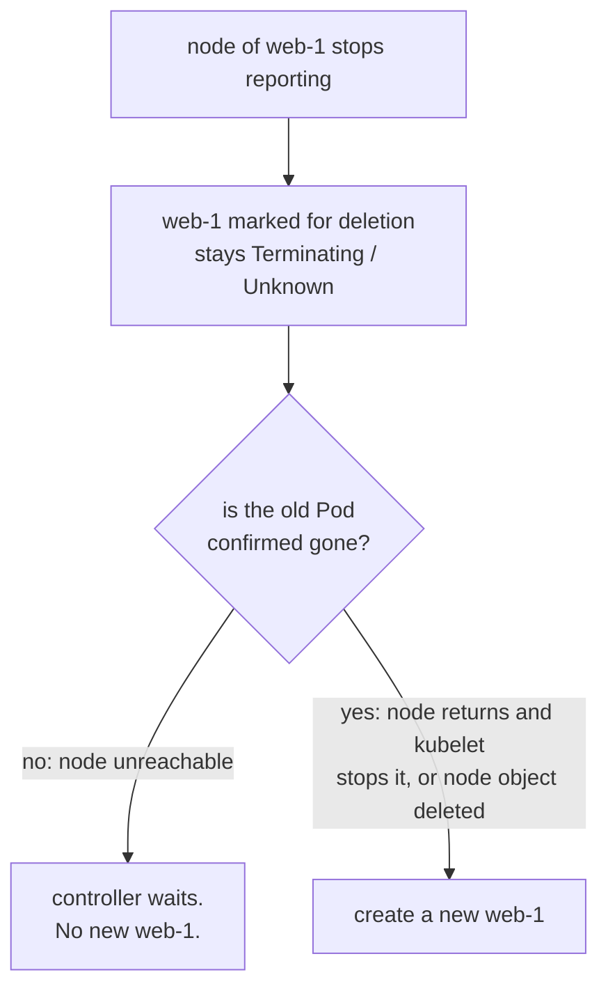
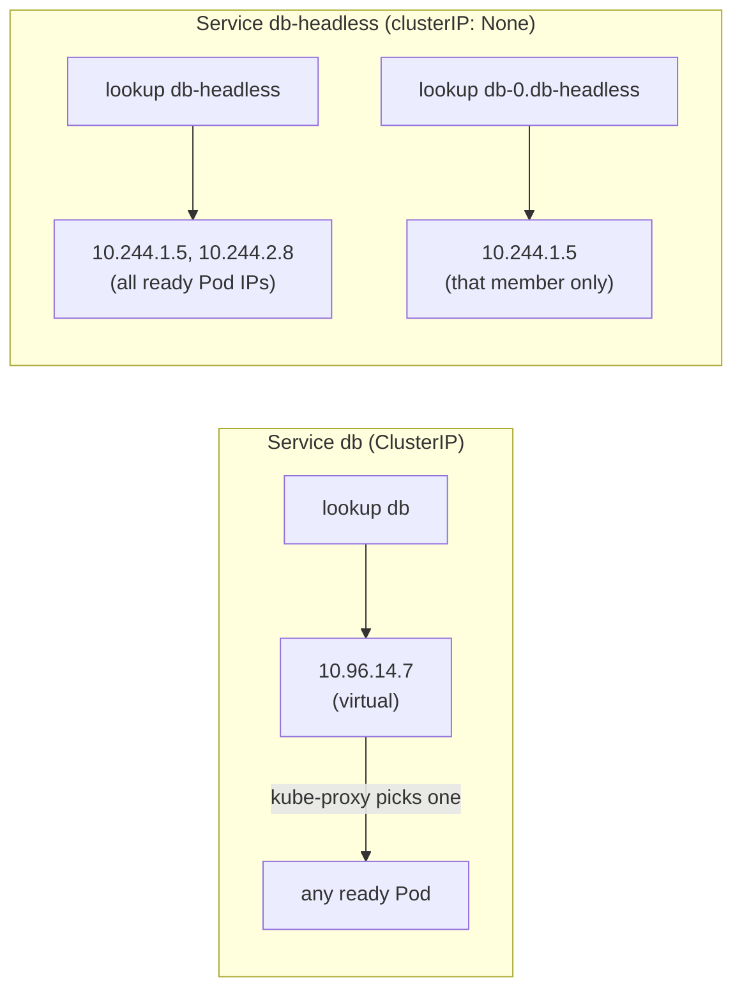

# StatefulSets and headless DNS

*Stage 3 · Mission Data*

**You will be able to:** explain why a Deployment mishandles a database even with a PVC, predict how a StatefulSet names, creates, removes and replaces members, and read the DNS names a headless Service publishes.

A [Deployment](../cluster/deployments) assumes its Pods are interchangeable: any one can be deleted, any new one is as good as the old. That assumption is what makes rollouts and scaling simple. A database breaks it. Its Pod is *the* owner of one particular set of files, and two Pods must never believe they own the same files at once.

## What goes wrong with a Deployment

Give a Deployment a PVC and it works, until something changes:



- **Every replica gets the same volume.** The Pod template is shared, so it names one claim. On other nodes, extra replicas hang with `Multi-Attach error`. On the same node, RWO allows the mount, and several database processes write one data directory.
- **Even `replicas: 1` is not safe.** The default `RollingUpdate` starts the new Pod *before* stopping the old one. For a moment two databases share the files, or the new Pod is stuck because the old one still holds the volume. (`strategy: Recreate` avoids this, at the cost of explicit downtime.)
- **Names are random.** `booking-db-7d9f-abc` becomes `booking-db-7d9f-xyz`. Nothing can say "member zero" and mean the same thing tomorrow.

A database needs a controller that treats each Pod as a **named member** with its own storage, and that never runs two copies of a member.

## What a StatefulSet guarantees

A **StatefulSet** is a controller, like a Deployment, that gives each Pod a fixed identity:

| Guarantee | What it means |
|---|---|
| **Stable name** | Pods are `<name>-0`, `<name>-1`, … The number is the member's **ordinal**. A replacement for `web-1` is again `web-1` |
| **Stable storage** | Each ordinal gets its own claim and keeps it ([next chapter](./statefulset-storage-and-operations)) |
| **Stable DNS name** | Each member is reachable as `<pod>.<service>`, through a headless Service |
| **Order** | By default, members are created one at a time from 0 up, and removed from the highest down |
| **At most one** | There is never more than one Pod for a given ordinal |

| | Deployment | StatefulSet |
|---|---|---|
| Pod names | Random suffix | Ordinal: `-0`, `-1`, … |
| Replacement Pod | New name, new UID | **Same name**, new UID |
| Storage | One template, shared | One claim **per member** |
| Creation | All at once | One at a time, in order (default) |
| Pod on an unreachable node | Replaced elsewhere promptly | **Not replaced** until the old Pod is confirmed gone |
| Typical use | Stateless services (`booking`, `flight`) | Databases, queues (`booking-db`, `redis`) |

The name is reused but the object is new: a replacement `web-1` has a different UID, and usually a different IP. "Same name" is an identity the controller maintains, not the same Pod.

## Ordered creation and removal

With the default `podManagementPolicy: OrderedReady`:



- `web-1` is not created until `web-0` is Ready. A clustered database can rely on member 0 existing first (to become the primary, say).
- Scale-down removes the *highest* ordinal first, and waits for it to finish.
- If a lower member is unhealthy, the controller stops and waits. That is deliberate: it will not keep changing a cluster that is already broken.
- `podManagementPolicy: Parallel` drops the ordering for apps that do not need it. It keeps the names and storage.

## At most one Pod per member

This is the guarantee that matters most for data, and the one that surprises people.

Suppose the node running `web-1` stops responding. The control plane cannot tell whether the node is dead or just cut off from the network. A Deployment's ReplicaSet does not care: after the eviction timeout it starts a replacement elsewhere. If the old Pod was in fact still running, there are briefly two. For stateless web servers that is harmless.

For a database it is the corruption scenario. So the StatefulSet controller waits:



The member stays down until a human or automation confirms the old Pod is gone: by bringing the node back, deleting the Node object, or applying the `node.kubernetes.io/out-of-service` taint to a node known to be shut down. `kubectl delete pod web-1 --force` also unblocks it, but only *tells* Kubernetes the Pod is gone; if the node was alive after all, you now have two writers. Force-delete a StatefulSet Pod only when you know its node is off.

## Headless Services: one DNS name per member

An ordinary Service has a **ClusterIP**, one virtual address that load-balances to any ready Pod ([Stage 2](../networking/service-control-and-data-paths)). That is right when callers do not care which Pod answers. A database replica that must stream changes from *the primary* does care.

A **headless Service** sets `clusterIP: None`. It gets no virtual IP and no kube-proxy rules. Cluster DNS answers its name with the Pod IPs directly:



A StatefulSet names its headless Service in `spec.serviceName`, and sets each Pod's hostname and subdomain to match. DNS then publishes one record per member:

```text
web-0.web.default.svc.cluster.local
│     │   │       │
Pod   headless    namespace, then cluster domain
      Service
```

- Inside the same namespace, `web-0.web` is enough.
- The record follows the member: after replacement it points at the new Pod's IP. Existing TCP connections still break; clients must reconnect.
- Only **ready** Pods are published, unless the Service sets `publishNotReadyAddresses: true`. Clustered databases often set it so members can find each other while starting.
- The headless Service must exist and its selector must match the Pods. The StatefulSet does not create it for you.

## Apollo example

Each Apollo database has both kinds of Service, selecting the same Pod. From [`identity-db-sts.yaml`](https://github.com/darshan-raul/Apollo11/blob/f6211e679f8ed66a5a19033ac49a3bfc3a506eab/stages/stage3/k8s/apps/identity-db/identity-db-sts.yaml) and [`identity-db-svc-headless.yaml`](https://github.com/darshan-raul/Apollo11/blob/f6211e679f8ed66a5a19033ac49a3bfc3a506eab/stages/stage3/k8s/apps/identity-db/identity-db-svc-headless.yaml):

```yaml
# StatefulSet (trimmed)
spec:
  serviceName: identity-db-headless   # governs the per-member DNS names
  replicas: 1
---
# Headless Service (trimmed)
spec:
  clusterIP: None
  selector: {app: identity-db}
  ports: [{port: 5432, targetPort: 5432}]
```

| Name | Resolves to | Who uses it |
|---|---|---|
| `identity-db` | Virtual ClusterIP | The `identity` app (`DATABASE_URL=…@identity-db:5432/identity`), unchanged since Stage 1 |
| `identity-db-headless` | The ready Pod IPs | The StatefulSet's `serviceName` |
| `identity-db-0.identity-db-headless` | Member 0's Pod IP | Nobody yet; a replica would use it to reach the primary |

With one member there is nothing to choose between, so the apps keep the ordinary Service.

**`replicas: 2` would not give Apollo a replicated database.** It would create `identity-db-1` with its own empty claim: a second, independent PostgreSQL that the ordinary Service would send half the logins to. Replication is something the *database* does, configured by tools such as CloudNativePG or Patroni. A StatefulSet only gives those tools stable names and disks to work with.

## Try it

:::caution[Unverified]
Not yet run on a live cluster for this documentation revision. Uses throwaway objects in the `default` namespace.
:::

```bash
kubectl apply -f - <<'YAML'
apiVersion: v1
kind: Service
metadata: {name: web}
spec:
  clusterIP: None
  selector: {app: web}
  ports: [{port: 80}]
---
apiVersion: apps/v1
kind: StatefulSet
metadata: {name: web}
spec:
  serviceName: web
  replicas: 3
  selector: {matchLabels: {app: web}}
  template:
    metadata: {labels: {app: web}}
    spec:
      containers: [{name: web, image: nginx:1.27-alpine}]
YAML

# 1. Ordered creation: web-0, then web-1, then web-2
kubectl get pods -l app=web -w           # Ctrl-C once all three are Running

# 2. Per-member DNS
kubectl run dns --rm -it --restart=Never --image=busybox:1.36 -- \
  sh -c 'nslookup web; nslookup web-1.web'
kubectl get pods -l app=web -o wide      # compare the IPs

# 3. Same name, new object
kubectl get pod web-1 -o jsonpath='{.metadata.uid}{"\n"}'
kubectl delete pod web-1
kubectl wait --for=condition=Ready pod/web-1
kubectl get pod web-1 -o jsonpath='{.metadata.uid}{"\n"}'   # different UID

# 4. Scale-down removes the highest ordinal first
kubectl scale sts web --replicas=1
kubectl get pods -l app=web               # only web-0 remains

kubectl delete sts web; kubectl delete svc web
```

- `nslookup web` returns every ready Pod IP; `nslookup web-1.web` returns one.
- After deleting `web-1`, the name returns with a new UID. If its IP changed, `web-1.web` now resolves to the new one.

## Common misconceptions

- **"Same name, same Pod."** The name is reused; the UID, and usually the IP, are new.
- **"Headless means no Service."** It is a Service without a virtual IP. DNS still publishes it.
- **"A StatefulSet replicates data."** It gives members names and disks. The application does the replicating.
- **"A StatefulSet recovers from node failure as fast as a Deployment."** It deliberately waits until the old Pod is known to be gone.

## Check yourself

<details>
<summary>A database runs as a Deployment with <code>replicas: 1</code> and a PVC. What can go wrong during a rollout?</summary>

The default rolling update starts the new Pod before stopping the old one. On the same node both can mount the RWO volume and write the same files; on another node the new Pod hangs on a multi-attach error.
</details>

<details>
<summary>The node running <code>redis-0</code> loses network. Why is no new <code>redis-0</code> started elsewhere?</summary>

The controller cannot confirm that the old Pod has stopped. Starting another would risk two Pods with the same identity writing the same data, so it waits.
</details>

<details>
<summary>Why do Apollo's apps connect to <code>identity-db</code> and not <code>identity-db-0.identity-db-headless</code>?</summary>

There is only one member, so there is no member to choose. The ordinary Service already gives a stable address, and it keeps the apps unchanged.
</details>

## Where this leads

[StatefulSet storage and operations](./statefulset-storage-and-operations) attaches a claim to each member and follows it through replacement, updates, scale-down and deletion.

## References

- [StatefulSets](https://kubernetes.io/docs/concepts/workloads/controllers/statefulset/)
- [Force deleting StatefulSet Pods](https://kubernetes.io/docs/tasks/run-application/force-delete-stateful-set-pod/)
- [Non-graceful node shutdown](https://kubernetes.io/docs/concepts/cluster-administration/node-shutdown/#non-graceful-node-shutdown)
- [DNS for Services and Pods](https://kubernetes.io/docs/concepts/services-networking/dns-pod-service/)
- [Headless Services](https://kubernetes.io/docs/concepts/services-networking/service/#headless-services)
