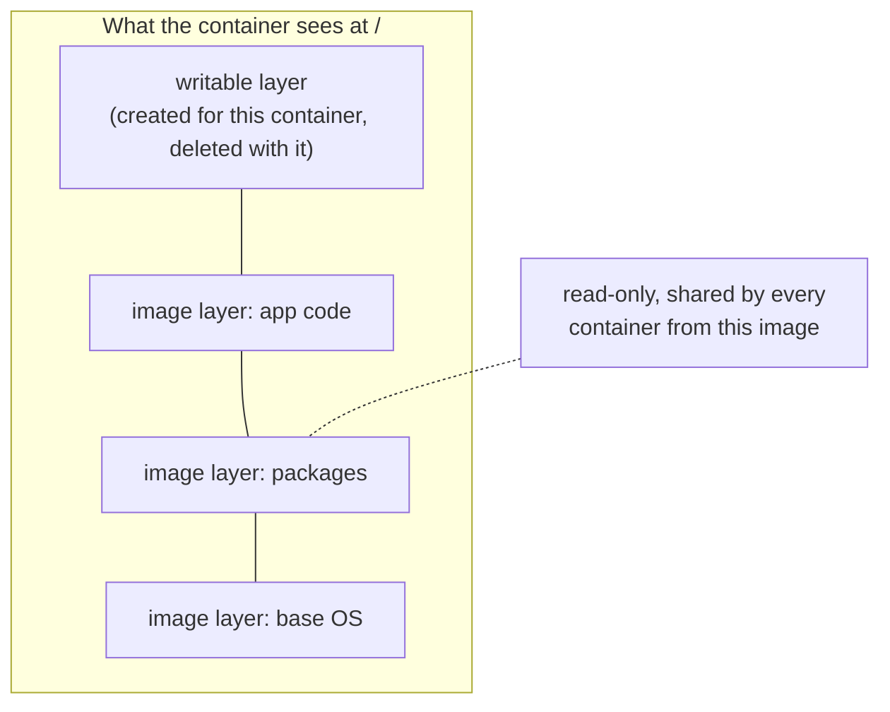
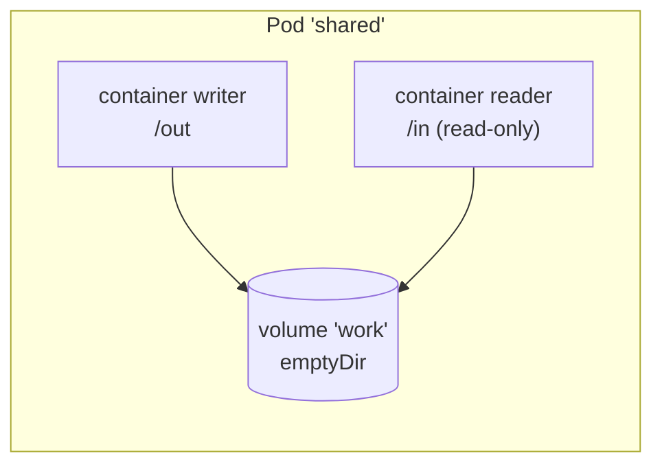
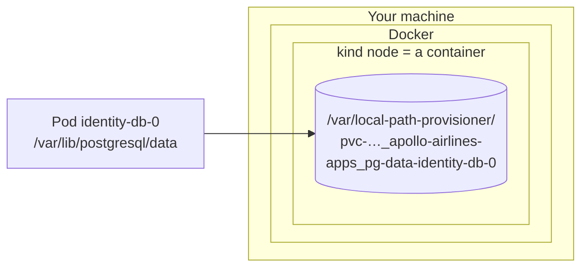

# Volumes: where a container's files live

*Stage 3 · Mission Data*

**You will be able to:** explain where a container writes its files, declare and mount a volume, sort volume types by how long they live, and say why a database needs storage that Kubernetes tracks separately from the Pod.

[Ephemeral state](../workloads/ephemeral-state) ended Stage 1 with a database that comes back empty after every Pod replacement. Stage 2 made the database easy to *find* again; it did nothing for its *files*. Before fixing that, it helps to know exactly where a container's files go, and what "mounting a volume" changes.

## A container's own filesystem

A container does not get a disk. It gets a **root filesystem** assembled from layers:



- The **image layers** are read-only and shared.
- The **writable layer** is created when the container is created. Every file the process writes lands there, unless the path is a mount.
- When the kubelet restarts a crashed container, it creates a *new* container from the image. The new one gets a new, empty writable layer. Anything written outside a volume is gone, even though the Pod is the same.

So "the container restarted" already loses files. What survives depends on volumes.

## A volume is a directory mounted into the container

A **volume** is a directory, prepared by the kubelet, that appears at a chosen path inside the container. The process reads and writes it with normal file calls and cannot tell where the bytes really live.

A volume is declared in two places, linked by name:

```yaml
apiVersion: v1
kind: Pod
metadata: {name: shared}
spec:
  volumes:                         # 1. Pod level: WHAT the storage is
    - name: work
      emptyDir: {}
  containers:
    - name: writer
      image: busybox:1.36
      command: ["sh", "-c", "date > /out/now; sleep 3600"]
      volumeMounts:                # 2. Container level: WHERE it appears
        - {name: work, mountPath: /out}
    - name: reader
      image: busybox:1.36
      command: ["sh", "-c", "sleep 5; cat /in/now; sleep 3600"]
      volumeMounts:
        - {name: work, mountPath: /in, readOnly: true}
```



- **`spec.volumes`** belongs to the Pod. It says what kind of storage backs the volume.
- **`volumeMounts`** belongs to each container. It places that volume at a path. Two containers can mount the same volume at different paths; that is how sidecars share files.
- The mount *hides* whatever the image had at that path. The container sees the volume's contents instead.

## Three lifetimes

Volume types differ mainly in **what their lifetime is tied to**. That is the question to ask of any storage: *which event does it survive?*

| Lifetime tied to | Examples | Created | Deleted |
|---|---|---|---|
| **The Pod** | `emptyDir`; `configMap`, `secret` and `downwardAPI` projections | When the Pod starts on a node | When the Pod is removed from that node |
| **A node** | `hostPath` | Already exists on the node | When someone deletes it from the node |
| **Its own object** | `persistentVolumeClaim` | When the claim is provisioned | When the claim (and its volume) is deleted |

Read against the events from [ReplicaSets](../cluster/replicasets#restart-versus-replacement):

| Where the file is | Container restart | Pod replaced | Pod's node lost |
|---|---|---|---|
| Writable layer | ❌ | ❌ | ❌ |
| `emptyDir` | ✅ | ❌ | ❌ |
| `hostPath` | ✅ | Only if the new Pod lands on the same node | ❌ |
| PersistentVolumeClaim | ✅ | ✅ | Depends on what backs it |

`configMap` and `secret` volumes are Pod-scoped too, but losing them does not matter: the kubelet regenerates their files from the API objects. They carry configuration *in*; they are not a place to keep data.

## Why a node directory is not the answer

`hostPath` mounts a directory of the node into the Pod. It does survive Pod replacement, so it looks like a fix. It is not a good one:

- **Placement becomes your problem.** A replacement Pod may be scheduled on another node and find an empty directory there, or someone else's. You would have to pin the Pod to the node by hand.
- **Kubernetes does not track it.** There is no object saying "this directory belongs to that database", no capacity request, and nothing to clean up.
- **It reaches into the host.** A Pod with `hostPath` can read or overwrite node files. Restricted Pod Security settings forbid it for exactly that reason.
- **It cannot move.** The same manifest cannot ask for a cloud disk on EKS.

What a database needs is storage that is **requested** by the application, **supplied** by the cluster, **tracked** as its own API object, and **placed** by the scheduler. That is a PersistentVolumeClaim, the subject of the [next chapter](./claims-and-provisioning).

## "Persistent" is a lifetime, not a promise

A **persistent volume** outlives any Pod that uses it. That is all the word promises. How well the bytes are protected depends on what backs the volume:



On kind, a persistent volume is a directory inside a node, and that node is itself a Docker container. It survives the database Pod being replaced. It does not survive that node container being deleted. There is one copy, on one node. A cloud disk survives node loss but not deletion of the disk. [Recovery boundaries](./recovery-boundaries) returns to this.

## Apollo example

Stages 1 and 2 ran each database as a Deployment with:

```yaml
volumes:
  - name: pg-data
    emptyDir: {}
```

Stage 3 gives each data workload a claim instead:

| Workload | Mounted at | Claim |
|---|---|---|
| `identity-db` | `/var/lib/postgresql/data` | `pg-data-identity-db-0` |
| `flight-db` | `/var/lib/postgresql/data` | `pg-data-flight-db-0` |
| `booking-db` | `/var/lib/postgresql/data` | `pg-data-booking-db-0` |
| `redis` | `/data` | `redis-data-redis-0` |

The [identity database manifest](https://github.com/darshan-raul/Apollo11/blob/f6211e679f8ed66a5a19033ac49a3bfc3a506eab/stages/stage3/k8s/apps/identity-db/identity-db-sts.yaml) also sets `PGDATA=/var/lib/postgresql/data/pgdata`. PostgreSQL refuses to initialize a data directory that is not empty, and a freshly formatted disk usually contains a `lost+found` directory at its root. Pointing `PGDATA` at a subdirectory of the mount works on every kind of volume.

## Try it

:::caution[Unverified]
Not yet run on a live cluster for this documentation revision. Uses only a throwaway Pod in the `default` namespace.
:::

Write one file to the writable layer and one to an `emptyDir`, restart the container, then replace the Pod:

```bash
cat > lifetimes.yaml <<'YAML'
apiVersion: v1
kind: Pod
metadata: {name: lifetimes}
spec:
  containers:
    - name: app
      image: busybox:1.36
      # exits when /tmp/stop appears, so we can trigger a container restart
      command: ["sh", "-c", "while [ ! -f /tmp/stop ]; do sleep 1; done"]
      volumeMounts: [{name: scratch, mountPath: /scratch}]
  volumes:
    - {name: scratch, emptyDir: {}}
YAML
kubectl apply -f lifetimes.yaml
kubectl wait --for=condition=Ready pod/lifetimes
kubectl exec lifetimes -- sh -c 'echo layer > /tmp/a; echo volume > /scratch/b'

# 1. Container restart
kubectl exec lifetimes -- touch /tmp/stop
kubectl wait --for=jsonpath='{.status.containerStatuses[0].restartCount}'=1 pod/lifetimes
kubectl wait --for=condition=Ready pod/lifetimes
kubectl exec lifetimes -- ls /tmp /scratch        # /tmp: empty   /scratch: b

# 2. Pod replacement (a bare Pod, so we recreate it ourselves)
kubectl delete pod lifetimes
kubectl apply -f lifetimes.yaml
kubectl wait --for=condition=Ready pod/lifetimes
kubectl exec lifetimes -- ls /scratch             # empty

kubectl delete pod lifetimes; rm lifetimes.yaml
```

- After the restart, `/tmp/a` is gone (new writable layer) but `/scratch/b` is still there (same Pod, same `emptyDir`).
- After replacement, `/scratch` is empty: a new Pod gets a new `emptyDir`.

## Common misconceptions

- **"A container restart keeps everything."** It keeps the Pod's volumes. The writable layer is new.
- **"`hostPath` is persistent storage."** It outlives the Pod only on one node, untracked, with access to the host.
- **"A persistent volume is a backup."** It is usually the only copy, and it faithfully keeps mistakes too.

## Check yourself

<details>
<summary>A process writes to <code>/var/cache/app</code>, which is not a mount. The container crashes and is restarted. Is the cache still there?</summary>

No. A restarted container gets a new writable layer. Only volume mounts carry over within the Pod.
</details>

<details>
<summary>Two containers in one Pod must exchange files. Which volume type, and why does its short lifetime not matter?</summary>

`emptyDir`. Both containers live and die with the Pod, so storage tied to the Pod is exactly long enough.
</details>

<details>
<summary>Why not just use <code>hostPath</code> for a database and pin the Pod to a node?</summary>

It works until that node is replaced, and it leaves placement, tracking, capacity and cleanup to you, while giving the Pod access to the host filesystem. A PVC lets the cluster do those jobs.
</details>

## Where this leads

[Claims and provisioning](./claims-and-provisioning) separates the database's request for storage from the system that supplies it.

## References

- [Kubernetes volumes](https://kubernetes.io/docs/concepts/storage/volumes/)
- [Ephemeral volumes](https://kubernetes.io/docs/concepts/storage/ephemeral-volumes/)
