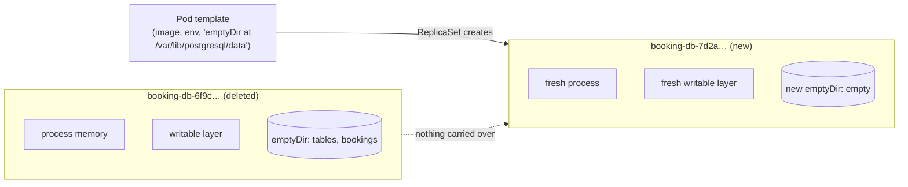
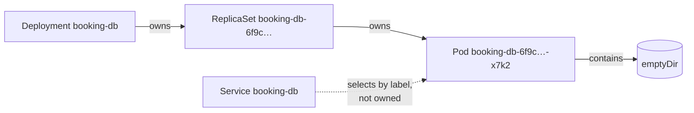

# Ephemeral state

*Stage 1 · Liftoff*

**You will be able to:** say what a restarted container keeps and what a replacement Pod loses, explain why Stage 1's databases come back empty, predict what a `kubectl delete` removes along with its target, and check data rather than status before calling a recovery done.

Everything in Liftoff so far restores **processes**. A crashed container is restarted, a deleted Pod is replaced, the Service finds the new one, configuration is injected again. After any of that, `kubectl get pods` shows `Running` and `1/1` Ready, and it is tempting to say the airline recovered.

Ready is a statement about the process: it started and answers its probe. It says nothing about the **data** the old process had. This chapter separates the two.

## Two kinds of "it came back"

[ReplicaSets](../cluster/replicasets#restart-versus-replacement) introduced the distinction. Here it is from the point of view of state:

| | Container restart | Pod replacement |
|---|---|---|
| Who does it | The kubelet, on the same node | The ReplicaSet controller, then the scheduler |
| Caused by | The process exited or failed liveness | The Pod was deleted, evicted, or its node was lost |
| Same Pod name, UID, IP | Yes | No: all new |
| Process memory | **Lost** | **Lost** |
| Container's writable layer (`/tmp`, anything not mounted) | **Lost**: a new container gets a fresh layer | **Lost** |
| `emptyDir` volumes | **Kept**: they belong to the Pod | **Lost**: deleted with the Pod |
| Inherited from the Pod template | n/a | Image, env, ConfigMap and Secret references, ServiceAccount, volume *declarations* |

The last row is the trap. A replacement Pod inherits the **description** of its volumes, not their contents. A template that says "mount an `emptyDir` at `/var/lib/postgresql/data`" produces a new, empty directory every time.



## emptyDir: scratch space owned by the Pod

An **`emptyDir`** volume is a directory the kubelet creates when the Pod starts on a node, shares between that Pod's containers, and deletes when the Pod leaves the node. It is the right tool for:

- scratch files and caches that can be rebuilt,
- files one container writes and another reads (a sidecar pattern),
- data that should survive a crash-restart of the container but not the Pod.

Two settings matter:

| Field | Effect |
|---|---|
| `medium: Memory` | Backs the directory with RAM (`tmpfs`). Fast, and it counts against the container's memory limit |
| `sizeLimit: 500Mi` | If the Pod writes more, the kubelet evicts the Pod, and the volume goes with it |

Without `sizeLimit`, an `emptyDir` on disk shares the node's disk with images, logs and every other Pod's writable layer. Filling it can push the node into disk pressure and get Pods evicted. Stage 4 covers [node pressure and eviction](../reliability/requests-limits-and-pressure).

## Why Stage 1's databases forget

Each Stage 1 database is a Deployment with its data directory on an `emptyDir`. Trimmed from [`booking-db-dep.yaml`](https://github.com/darshan-raul/Apollo11/blob/f6211e679f8ed66a5a19033ac49a3bfc3a506eab/stages/stage1/k8s/infra/booking-db/booking-db-dep.yaml):

```yaml
containers:
  - name: postgres
    image: postgres:15-alpine
    volumeMounts:
      - {name: pg-data, mountPath: /var/lib/postgresql/data}
    readinessProbe:
      exec: {command: ["pg_isready", "-U", "postgres", "-d", "booking"]}
volumes:
  - name: pg-data
    emptyDir: {}            # lives and dies with this Pod
```

Follow one event through:

1. The `postgres` process crashes. The kubelet restarts the container in the same Pod. The `emptyDir` is still there, so Postgres finds its files and recovers. Bookings survive.
2. The Pod is deleted (by a person, a node drain, an eviction, or a rollout of `booking-db`). The ReplicaSet creates a new Pod with a new, empty `emptyDir`.
3. The Postgres image sees an empty data directory and creates a **new, empty database** named `booking`.
4. `pg_isready` succeeds, so the Pod is Ready. Booking's readiness, which checks its database connection, also passes.
5. Every booking is gone, the `bookings` table does not exist (the init Job ran once, against the old Pod), and every status is green.

That is deliberate. Stage 1 shows what Pod-scoped storage means before [Stage 3](../storage/volume-lifetimes) gives each database a PersistentVolumeClaim, storage with a lifetime of its own.

## What `kubectl delete` takes with it

Deleting one object can delete others. When a controller creates an object, it records itself in the child's `metadata.ownerReferences`. The **garbage collector** watches those references: when an owner is deleted, its dependents are deleted too.



| You delete | Also removed | Not removed |
|---|---|---|
| A Pod | Its writable layers and `emptyDir` volumes | Nothing else; its ReplicaSet makes a new one |
| A Deployment | Its ReplicaSets and their Pods (and their `emptyDir` data) | The Service, ConfigMaps, Secrets: they are not owned |
| A Job | Its Pods and their logs | The data the Job wrote elsewhere |
| A namespace | **Everything inside it** | Cluster-scoped objects, such as PersistentVolumes |

`kubectl delete` accepts `--cascade=orphan` to remove an owner but leave its dependents running, and `--cascade=foreground` to wait until the dependents are gone first. A Service is linked to Pods only by a label selector, so it never deletes them and is never deleted with them.

Before a delete, ask three questions: which object goes, which dependents go with it through `ownerReferences`, and which state is unrecoverable once they do.

## Ready is not recovered

After a replacement, check the data, not the status:

| Evidence | Proves | Does not prove |
|---|---|---|
| `Running`, `1/1` Ready | The process started and passes its probe | That any data is there |
| `RESTARTS` count went up, Pod name unchanged | A container restart: `emptyDir` data kept | That the app recovered cleanly |
| New Pod name, `RESTARTS 0` | A replacement: Pod-scoped data is gone | Anything about durable storage |
| A query that returns a known row | The data survived | That everything survived |

## Try it

:::caution[Unverified]
Not yet run on a live cluster for this documentation revision. Uses a throwaway namespace on any cluster.
:::

A Pod with one file in an `emptyDir` and one in its writable layer. Creating `/tmp/stop` makes the container exit, so the kubelet restarts it:

```bash
kubectl create namespace state-demo
kubectl -n state-demo apply -f - <<'EOF'
apiVersion: apps/v1
kind: Deployment
metadata: {name: scratch}
spec:
  replicas: 1
  selector: {matchLabels: {app: scratch}}
  template:
    metadata: {labels: {app: scratch}}
    spec:
      containers:
        - name: app
          image: busybox:1.36
          command: ["sh", "-c", "while [ ! -f /tmp/stop ]; do sleep 1; done"]
          volumeMounts: [{name: data, mountPath: /data}]
      volumes:
        - name: data
          emptyDir: {sizeLimit: 10Mi}
EOF
kubectl -n state-demo rollout status deploy/scratch
kubectl -n state-demo exec deploy/scratch -- sh -c 'echo kept > /data/note; echo lost > /tmp/note'

# 1. Container restart: same Pod
kubectl -n state-demo exec deploy/scratch -- touch /tmp/stop
sleep 15
kubectl -n state-demo get pods                             # same name, RESTARTS 1
kubectl -n state-demo exec deploy/scratch -- cat /data/note   # kept
kubectl -n state-demo exec deploy/scratch -- cat /tmp/note    # No such file

# 2. Pod replacement: new Pod
kubectl -n state-demo delete pod -l app=scratch
kubectl -n state-demo rollout status deploy/scratch
kubectl -n state-demo get pods                             # new name, RESTARTS 0
kubectl -n state-demo exec deploy/scratch -- cat /data/note   # No such file

# 3. Ownership: delete the Deployment but orphan its children
kubectl -n state-demo get pod -l app=scratch -o jsonpath='{.items[0].metadata.ownerReferences[0].kind}'; echo
kubectl -n state-demo delete deploy scratch --cascade=orphan
kubectl -n state-demo get rs,pods                          # still there, now ownerless
kubectl delete namespace state-demo
```

- The restart kept `/data` and lost `/tmp`: `emptyDir` belongs to the Pod, the writable layer to the container.
- The replacement lost both, though it was created from an identical template.
- The Pod's owner was a ReplicaSet; with `--cascade=orphan`, deleting the Deployment left the ReplicaSet and Pod running.

## Common misconceptions

- **"Ready means my data is back."** A new `emptyDir` gives an empty database that passes every probe.
- **"A restarted container starts clean."** It gets a fresh writable layer, but `emptyDir` volumes keep their contents.
- **"The replacement Pod gets the old Pod's volumes."** It gets the same volume *declarations*. Only storage with its own lifetime, such as a PVC, carries contents over.
- **"Deleting a Deployment deletes its Service."** The Service is not owned by the Deployment; it stays, with no Pods behind it.

## Check yourself

<details>
<summary><code>booking-db</code>'s container is OOM-killed and restarted. Are the bookings still there?</summary>

Yes. A container restart keeps the Pod, and the `emptyDir` belongs to the Pod. Postgres recovers from the files it finds.
</details>

<details>
<summary>You run <code>kubectl rollout restart deploy/booking-db</code>. What happens to the data, and what does every status show afterwards?</summary>

A rollout replaces the Pod, so the new Pod gets an empty `emptyDir` and an empty database. Every Pod is Running and Ready; only a query shows the loss.
</details>

<details>
<summary>Which objects disappear with <code>kubectl delete deployment booking</code>, and which stay?</summary>

Its ReplicaSets and Pods go, through `ownerReferences`. The `booking` Service, the ConfigMap and the Secret stay, because nothing owns them.
</details>

## Where this leads

Stage 1 ends with an airline that heals its processes and forgets its data. [Stage 2](../networking/pod-network-and-cni) opens up how requests reach the Pods; [Stage 3](../storage/volume-lifetimes) gives the databases storage with a lifetime of its own.

## References

- [Volumes: emptyDir](https://kubernetes.io/docs/concepts/storage/volumes/#emptydir)
- [Owners and dependents](https://kubernetes.io/docs/concepts/overview/working-with-objects/owners-dependents/)
- [Garbage collection: cascading deletion](https://kubernetes.io/docs/concepts/architecture/garbage-collection/#cascading-deletion)
- [Local ephemeral storage](https://kubernetes.io/docs/concepts/configuration/manage-resources-containers/#local-ephemeral-storage)
