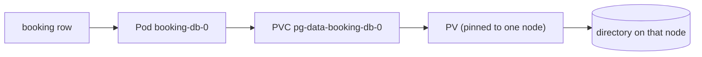

# Stage 3 · Mission Data: storage

**Problem:** delete `booking-db`'s Pod and every booking disappears. The Service name still works, and the new Pod is `Ready`, with an empty database.

Stage 3 makes the data outlive the Pod. By the end you can follow one booking from a SQL row down to a directory on a node, and say which failures it survives:

## Chapters

1. [Volumes](../learn/storage/volume-lifetimes): where a container writes, what a mount changes, and which events each volume type survives.
2. [Claims and provisioning](../learn/storage/claims-and-provisioning): PVC, PV and StorageClass; why provisioning waits for the scheduler; access modes.
3. [StatefulSets and headless DNS](../learn/storage/statefulsets-and-headless-dns): why a Deployment mishandles a database; stable member names; per-member DNS.
4. [StatefulSet storage and operations](../learn/storage/statefulset-storage-and-operations): one claim per member; what updates, scale-down and deletion do to data; Redis persistence.
5. [Initialization and seeding](../learn/storage/initialization-and-seeding): schema on an empty volume, re-runnable seed Jobs, why migrations are separate.
6. [Recovery boundaries](../learn/storage/recovery-boundaries): persistence vs replication vs backup; RPO and RTO; a restore rehearsal.

First pass: chapters 1–4 are enough to follow the walkthrough. Read 5 and 6 before you trust the data.

## Ready for the walkthrough when you can answer

- A container restarts, then later its Pod is replaced. What happens to a file in `emptyDir` each time?
- A PVC has been `Pending` for ten minutes and no Pod uses it. Is anything wrong?
- Why does `booking-db-0` come back with the same claim but a new UID?
- The node running `redis-0` loses network. Why does no new `redis-0` start elsewhere?
- You delete the StatefulSet, then the PVC. Which step loses the data?
- After a volume is lost, the tables and demo users are back. Why is that not a recovery?

## Walkthrough

- [Stage 3 walkthrough](../stage-3)
