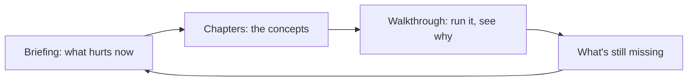

# Before you board

**You will be able to:** decide whether you are ready, and set up the two repositories.

## Assumed knowledge

- Run commands in a terminal; use `cd`, `ls`, `cat`.
- A browser sends HTTP requests to a server.
- Nothing else. Containers, YAML, DNS, storage and signals are taught when needed.

## Two repositories

| Repo | Contains | Use it to |
|---|---|---|
| `apollo11-docs` | This site | Learn the concepts and follow the walkthroughs |
| `Apollo11` | App source, Dockerfiles, manifests, scripts | The YAML you read and the scripts you run |

## Setup for the hands-on route

Follow [Prepare your launchpad](../labs/setup#prepare-the-verified-workspace)
for the canonical clone → pinned checkout → bootstrap → verification sequence.
The pinned commit contains both `prep.sh` and `mise.toml`. Install Docker with
Compose v2 first; the script installs the remaining course tools through mise.

- Run every walkthrough from the `Apollo11` repo root.
- The application revision is pinned; tool versions currently use `latest`.
- Check the [host access boundary](../labs/local-access) before Stage 2:
  Docker Desktop needs a different route to the Gateway than native Linux.

## Learning loop used throughout

- Every stage starts from a limit of the previous one, and ends by naming the next one.
- Read each step's **Why this way** and **Compared with** bullets. They matter more than the commands.

Next: [How this course works](./how-to-use-this-course).
